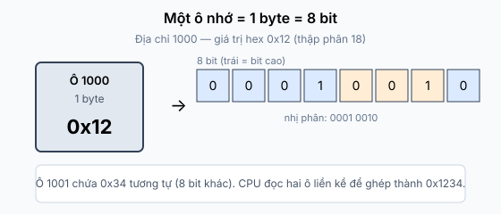
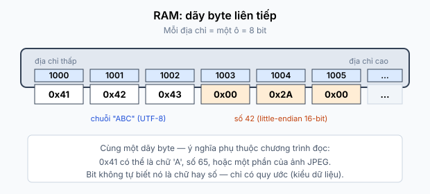

## Số nhị phân & Dữ liệu trong máy tính

**Toán Rời Rạc**

Tiết 10 — Từ lý thuyết → bit/byte → ứng dụng CNTT

**Bài tham chiếu:** `contents/chapter09/.../09_00_Binary_Data_Storage.md`

---

## Mục tiêu tiết học

**Cơ bản → ứng dụng:**

1. Nắm **lý thuyết** biểu diễn số tự nhiên trong hệ nhị phân (cơ số 2, tồn tại, duy nhất)
2. Chuyển đổi giữa **thập phân**, **nhị phân** và **hexadecimal**
3. Hiểu **bit**, **byte** và đơn vị lưu trữ lớn hơn
4. Mô tả RAM như **dãy byte có địa chỉ**; phân biệt **dữ liệu thô** và **diễn giải**
5. Đọc **hex dump**; liên hệ **ứng dụng CNTT** (debug, mạng, CSDL, bảo mật)

---

## Lộ trình tiết học

| Phần    | Nội dung                            |
| :------ | :---------------------------------- |
| **I**   | Lý thuyết số tự nhiên & hệ nhị phân |
| **II**  | Bit, byte, giới hạn $n$ bit         |
| **III** | Hexadecimal — viết gọn bit          |
| **IV**  | RAM, diễn giải dữ liệu              |
| **V**   | Ứng dụng trong CNTT                 |

*Mỗi phần xây trên phần trước — từ toán thuần đến debugger thực tế.*

---

## I — Lý thuyết: Số tự nhiên

**Số tự nhiên** (trong tiết này): $$\mathbb{N} = \{0, 1, 2, 3, \ldots\}$$

Ta muốn **mã hóa** mỗi $n \in \mathbb{N}$ thành chuỗi ký hiệu mà máy lưu được.

Trong máy tính, bảng chữ số chỉ có **hai** ký hiệu: $0$ và $1$ → **hệ nhị phân**.

*Lưu ý:* Bài sau mới nói số **âm** (two's complement); tiết này chỉ **không âm**.

---

## Hệ đếm theo vị trí (positional)

Mọi hệ cơ số $b \geq 2$ đều dùng **quy tắc vị trí**:

$$N = \sum_{i=0}^{k-1} d_i \cdot b^{i}$$

- $d_i \in \{0, 1, \ldots, b-1\}$ — chữ số tại vị trí $i$
- $b^{0}$ = hàng **đơn vị**; sang trái: $b^{1}, b^{2}, \ldots$

| Hệ | $b$ | Chữ số | Ví dụ $13$ |
|:---|:---:|:---|:---|
| Thập phân | 10 | $0$–$9$ | `13` |
| Nhị phân | 2 | $0, 1$ | `1101` |
| Hex | 16 | $0$–$F$ | `D` |

---

## Hệ nhị phân — định nghĩa chính thức

**Biểu diễn nhị phân** của $n \in \mathbb{N}$ là chuỗi bit $b_{k-1} \ldots b_0$ ($b_i \in \{0,1\}$) sao cho:

$$n = \sum_{i=0}^{k-1} b_i \cdot 2^{i}$$

**Ký hiệu:** hậu tố subscript ₂ hoặc tiền tố `0b` — ví dụ `0b1101` hoặc `1101`₂.

**Ví dụ** `1101`₂:

$$1 \cdot 2^{3} + 1 \cdot 2^{2} + 0 \cdot 2^{1} + 1 \cdot 2^{0} = 8 + 4 + 1 = 13$$

---

## Bảng trọng số — mỗi vị trí một lũy thừa 2

Đọc bit từ **phải sang trái** (LSB → MSB):

| Vị trí $i$ | 7 | 6 | 5 | 4 | 3 | 2 | 1 | 0 |
|:---:|:---:|:---:|:---:|:---:|:---:|:---:|:---:|:---:|
| Trọng số $2^{i}$ | 128 | 64 | 32 | 16 | 8 | 4 | 2 | 1 |

Bit $b_i = 1$ → **cộng** $2^{i}$; bit $0$ → bỏ qua.

`00101010`: chỉ vị trí 5, 3, 1 là 1 → $32 + 8 + 2 = 42$.

---

## Tính duy nhất & số không

**Mệnh đề:** Mỗi $n \in \mathbb{N}$ có **đúng một** biểu diễn nhị phân **tối thiểu** (không có chữ số 0 thừa ở đầu).

- $n = 0$ → biểu diễn tối thiểu là **`0`** (một bit)
- $13$ → `1101`, **không** `01101` (cùng giá trị, thêm 0 đầu)

**Leading zero** (số 0 đầu): không đổi **giá trị**, chỉ **độ dài chuỗi**.

Trong RAM ta hay dùng **độ rộng cố định** $n$ bit — ví dụ `00101010` (8 bit).

---

## Biểu diễn tối thiểu vs cố định $n$ bit

| Kiểu | Ý nghĩa | Ví dụ $42$ |
|:---|:---|:---|
| **Tối thiểu** | Ít bit nhất, không 0 thừa đầu | `101010` |
| **Cố định $n$ bit** | Luôn đủ $n$ bit (padding trái) | `00101010` (8 bit) |

**Trong máy:**
- `uint8_t` → luôn **8 bit**; $42$ = `00101010`
- Giá trị tối đa $n$ bit unsigned: $$2^{n} - 1$$

Padding giúp CPU/ALU xử lý **cùng độ rộng** mỗi lần cộng.

---

## Định lý tồn tại — mọi $n$ đều biểu diễn được

**Định lý (tồn tại):** Với mọi $n \in \mathbb{N}$, tồn tại chuỗi bit biểu diễn $n$.

**Chứng minh constructive** (thuật toán chia 2):
- Nếu $n = 0$ → chuỗi `0`
- Nếu $n > 0$: ghi $n \bmod 2$, thay $n \leftarrow \lfloor n/2 \rfloor$, lặp đến $n = 0$
- Đọc các dư **từ dưới lên** → biểu diễn nhị phân

Đây chính là **Cách 2** chuyển thập phân → nhị phân ở slide sau.

---

## Định lý duy nhất — ý tưởng chứng minh

**Định lý (duy nhất, dạng tối thiểu):** Hai biểu diễn tối thiểu của cùng $n$ phải **giống hệt** chuỗi bit.

**Ý tưởng:**
1. Bit LSB ($b_0$) = **parité** của $n$: $b_0 = n \bmod 2$
2. Phần còn lại $\lfloor n/2 \rfloor$ quyết định các bit cao hơn
3. Quy nạp: nếu hai chuỗi cùng biểu diễn $n$, LSB trùng → phần $\lfloor n/2 \rfloor$ trùng → toàn chuỗi trùng

→ Không có hai cách viết `1101` khác nhau cho cùng $13$.

---

## Dãy lũy thừa 2 — công cụ tách số

Mọi $n > 0$ có thể viết (không nhất thiết nhị phân) là tổng **các lũy 2 khác nhau**:

$$1, 2, 4, 8, 16, 32, 64, 128, \ldots$$

**Ví dụ** $200$:
$$200 = 128 + 64 + 8 = 2^{7} + 2^{6} + 2^{3} \Rightarrow \texttt{11001000}$$

**Cách nhanh:** tìm lũy $2^{i} \leq n$ lớn nhất, trừ dần (giống đổi tiền).

---

## Phép cộng nhị phân — carry

Cộng hai số tự nhiên trong nhị phân = cộng từng cột bit + **nhớ** (carry):

| $a$ | $b$ | tổng bit | carry ra |
|:---:|:---:|:---:|:---:|
| 0 | 0 | 0 | 0 |
| 0 | 1 | 1 | 0 |
| 1 | 0 | 1 | 0 |
| 1 | 1 | 0 | 1 |

Ví dụ: `0111` + `0001` = `1000` (7 + 1 = 8).


*inductiveload / Wikimedia Commons, public domain*

---

## Đếm nhị phân = +1 liên tục

Mỗi lần +1:
- LSB đảo (0↔1)
- Nếu sinh carry, đảo bit tiếp theo sang trái

`0000` → `0001` → `0010` → … → `1111` → `10000` (cần thêm 1 bit).


*Ephert / Wikimedia Commons, CC BY-SA 4.0*

**Quy luật:** sau $2^{k}$ bước đếm cần **$k+1$ bit** để không tràn.

---

## Bảng đếm 4 bit

| Thập phân | Nhị phân |
|:---:|:---:|
| 0 | `0000` |
| 1 | `0001` |
| 2 | `0010` |
| 3 | `0011` |
| 4 | `0100` |
| 5 | `0101` |
| … | … |
| 15 | `1111` |

**Quy luật:** +1 → bit LSB đổi; carry tràn sang trái (giống hệ 10).

---

## Thập phân → nhị phân

**Cách 1 — lũy thừa:** tách thành tổng các lũy của 2.

$$13 = 8 + 4 + 1 = 2^{3} + 2^{2} + 2^{0} \Rightarrow \texttt{1101}$$

**Cách 2 — chia dư:** chia liên tiếp cho 2, ghi **dư** từ dưới lên.

$$42 \Rightarrow \texttt{00101010} = \texttt{0x2A}$$

---

## Ví dụ: $42$ từng bước

Chia dư cho 2:

$$42 = 21 \times 2 + 0$$
$$21 = 10 \times 2 + 1$$
$$10 = 5 \times 2 + 0$$
$$5 = 2 \times 2 + 1$$
$$2 = 1 \times 2 + 0$$
$$1 = 0 \times 2 + 1$$

Đọc dư **từ cuối:** `0 1 0 1 0 1 0` → **`00101010`**

---

## Nhị phân → thập phân

Đọc từ **phải sang trái**, vị trí $i$ (bắt đầu 0) mang trọng số $2^{i}$.

`00101010`:

$$0 \cdot 2^{7} + 0 \cdot 2^{6} + 1 \cdot 2^{5} + 0 \cdot 2^{4} + 1 \cdot 2^{3} + 0 \cdot 2^{2} + 1 \cdot 2^{1} + 0 \cdot 2^{0}$$
$$= 32 + 8 + 2 = 42$$

---

## II — Bit & byte: từ lý thuyết đến phần cứng

Chương 1: mệnh đề — đúng/sai, **1/0**, true/false.

Chương này trả lời:

> Bit nằm **ở đâu**? Gom thành khối **thế nào**? Vì sao byte `0x41` vừa là `A` vừa là 65?

**Mọi thứ** máy lưu — chữ, ảnh, timestamp, opcode — cuối cùng là **chuỗi bit**.

---

## Bit — đơn vị nhỏ nhất

**Bit** (binary digit): $$b \in \{0, 1\}$$

- Phần cứng: điện cao/thấp, từ trường, lỗ đóng/mở
- Lập trình: biến Boole như Chương 1

**Chuỗi $n$ bit:** $$b_{n-1} b_{n-2} \ldots b_0$$

- **MSB** = bit cao nhất ($b_{n-1}$)
- **LSB** = bit thấp nhất ($b_0$)

Ví dụ: công tắc tắt = 0, bật = 1.

---

## Byte — 8 bit gom một nhóm

**Byte** = **8 bit** liền nhau — đơn vị địa chỉ hóa RAM phổ biến.

- Unsigned: $$0 \ldots 2^{8} - 1 = 255$$
- Ví dụ: `01000001` = 65 = `0x41` = chữ `A` (ASCII)

**Số tổ hợp 8 bit:** $$2^{8} = 256$$


*Fcarmody / Wikimedia Commons, CC BY-SA 4.0*

---

## Đơn vị lưu trữ lớn hơn

| Tên | Bit | Byte | Ví dụ |
|:---|:---:|:---:|:---|
| nibble | 4 | ½ | 1 chữ số hex |
| byte | 8 | 1 | `uint8_t` |
| half-word | 16 | 2 | `uint16_t` |
| word | 32 | 4 | `int`, `float` |
| double word | 64 | 8 | `int64_t` |

$$1 \text{ KB} = 1024 \text{ byte},\quad 1 \text{ MB} = 1024 \text{ KB},\ldots$$

Bit không tự biết nó là chữ hay số — **chương trình** quyết định.

---

## Đếm tổ hợp: $2^{n}$ giá trị

Biến **$n$ bit unsigned** có đúng:

$$2^{n} \text{ giá trị khác nhau}$$

| $n$ | Giá trị | Ví dụ |
|:---:|:---:|:---|
| 8 | 256 | byte: 0–255 |
| 16 | 65.536 | `uint16_t` |
| 32 | $\approx 4.3 \times 10^{9}$ | `int`, timestamp |
| 64 | $\approx 1.8 \times 10^{19}$ | `int64_t` |

---

## Overflow — khi hết bit

`11111111` = 255 (8 bit unsigned).

$$255 + 1 = 256 \Rightarrow \texttt{00000000}$$ với **carry bị bỏ** (chỉ 8 bit).

→ **tràn** (overflow) — biểu diễn cố định $n$ bit **không** chứa được mọi số tự nhiên, chỉ $0 \ldots 2^{n} - 1$.

Cùng hiện tượng ở quy mô 32-bit (Year 2038, bài sau).

---

## III — Hexadecimal — viết gọn bit

**Hex** (cơ số 16): chữ số `0–9`, `A–F` (= 10–15).

- **1 chữ số hex** = **4 bit** (nibble)
- **2 chữ số hex** = **1 byte**

| Hex | Nhị phân | Thập phân |
|:---:|:---:|:---:|
| `0` | `0000` | 0 |
| `A` | `1010` | 10 |
| `F` | `1111` | 15 |
| `2A` | `00101010` | 42 |
| `FF` | `11111111` | 255 |

Ký hiệu: tiền tố **`0x`** (ví dụ `0x2A`).

---

## Vì sao dùng hex khi debug?

8 bit = 2 chữ số hex — **vừa đủ** đọc bằng mắt.

Debugger, Wireshark, `xxd` hiển thị **byte** dạng hex, không in từng bit.

```text
48 69        →  UTF-8 / ASCII của "Hi"
FF D8 FF E0  →  đầu file JPEG
2A 00 00 00  →  uint32 LE = 42
```

---

## IV — RAM & diễn giải dữ liệu

Địa chỉ byte, kiểu dữ liệu, và vì sao cùng bit pattern có nhiều ý nghĩa.

---

## Một ô nhớ = một byte

Địa chỉ RAM (ví dụ `1000`) = **số nhà** trên con phố.

Mỗi ô chứa **đúng 8 bit** — không chứa cả số `1234` một lần.

`0x12` trong ô = giá trị 18 — bên trong: `0001 0010` (nhị phân).



---

## RAM — dãy byte có địa chỉ

**RAM** = con phố dài: `1000`, `1001`, `1002`, …

CPU đọc **từng byte** tại địa chỉ; số lớn = **nhiều byte liền kề**.

Cùng vùng RAM có thể là:
- chuỗi ký tự
- số nguyên `int`
- phần file nhị phân

→ tùy **chương trình đọc**.



---

## Ví dụ: `int x = 42` trong RAM

Máy 32-bit **little-endian** (PC phổ biến):

| Địa chỉ | Byte (hex) | Nhị phân (rút gọn) |
|:---:|:---:|:---:|
| `0x1000` | `0x2A` | `00101010` |
| `0x1001` | `0x00` | `00000000` |
| `0x1002` | `0x00` | `00000000` |
| `0x1003` | `0x00` | `00000000` |

Giá trị toán = **42**; vật lý = **4 byte** — byte đầu không “trông như 42”.

---

## Dữ liệu thô vs diễn giải

**Dữ liệu thô:** dãy byte **không nhãn** kiểu.

**Kiểu / encoding:** quy ước đọc byte.

Cùng byte `0x41`:

| Cách đọc | Kết quả |
|:---|:---|
| `char` / ASCII | Chữ `A` |
| `uint8_t` | Số 65 |
| Header JPEG | Byte định dạng |

**Bit không đổi — ý nghĩa đổi.**

---

## Hai lớp hay bị gộp nhầm

1. **Lớp vật lý:** bit trong transistor, byte trong RAM, sector SSD
2. **Lớp quy ước:** `int`, `float`, UTF-8, PNG — **ánh xạ** byte → ý nghĩa

<div class="content-box warning-box" markdown="1">

In `char*` và cast `int*` cùng địa chỉ = hai **diễn giải** — minh họa bit không đổi; C strict aliasing cấm làm tùy tiện.

</div>

---

## Số lớn cần nhiều byte

Số $$> 255$$ → một byte không đủ.

$$4660 = 0x1234$$ cần **2 byte:** `0x12` và `0x34`.

**Word** trên CPU 32-bit: thường xử lý **4 byte** một lần.

Thứ tự byte trong RAM → **endianness** (bài tiếp theo).


---

## V — Ứng dụng trong CNTT

Debugger, mạng, CSDL, bảo mật — cùng nền bit đã học ở phần I–IV.

---

## Mở đầu — Hùng và debugger

Tuần đầu học C, Hùng in biến `int age = 42`:

```text
Địa chỉ: 0x7ffeefbff3ac
Byte:    2A 00 00 00
```

Máy **không** lưu chữ `42` — chỉ lưu **mẫu bit** mà CPU đọc thành số 42.

Mở ảnh bằng hex editor: `FF D8 FF E0` (JPEG) — vẫn là byte, không phải pixel.

*Giờ bạn đã có công cụ đọc dump này: hex, endian, diễn giải.*

---

## Đồng hồ nhị phân — bit = thời gian

Đồng hồ nhị phân: mỗi cột LED = một bit; giá trị = tổng lũy 2.

Minh họa: **cùng bit pattern**, máy có thể đọc là giờ, số, hoặc màu pixel.


*Alexander Jones & Eric Pierce / Wikimedia Commons, CC BY-SA 3.0*

---

## Ứng dụng theo tầng CNTT

| Tầng | Ví dụ |
|:---|:---|
| Lập trình | `sizeof(int)` = số **byte**; struct padding |
| Mạng | TCP header đo bằng byte; Wireshark hex dump |
| CSDL | `BLOB` = byte thô; `VARCHAR` vẫn byte + charset |
| Bảo mật | SHA-256 → 32 byte; so sánh bit-by-bit |
| Ảnh/sound | Pixel RGB = 3 byte; MP3 = stream byte |

Mọi tầng stack đều dựa trên **bit**.

---

## Code Python — đọc byte thô

```python
raw = open("payload.bin", "rb").read(4)
print(raw.hex())                    # 2a000000
print(list(raw))                    # [42, 0, 0, 0]
print(int.from_bytes(raw, "little"))  # → 42
```

Dòng cuối mới **gán ý nghĩa** `uint32` little-endian.

Đổi `"big"` hoặc decode UTF-8 → kết quả **khác** trên cùng byte.

---

## Code C — góc nhìn debugger

```c
int age = 42;
printf("%p\n", (void*)&age);       // địa chỉ
printf("%02X\n", *(unsigned char*)&age);  // byte thấp: 2A
```

`unsigned char*` đọc **từng byte** — không phải “in số 42”.

Hex dump = công cụ **bắt buộc** khi debug binary protocol.

---

## Thực hành 1 — Lý thuyết biểu diễn

1. Viết biểu diễn **tối thiểu** và **8-bit** của $7$, $42$, $255$.
2. Chứng minh bằng tay: $13$ và `1101`₂ cùng giá trị (bảng trọng số).
3. `01101` và `1101` — giá trị có khác? Vì sao máy vẫn hay ghi `01101`?

*Đáp: (3) cùng 13; padding cho đủ 5 hoặc 8 bit trong register.*

---

## Thực hành 2 — Chuyển đổi

1. Chuyển **13**, **42**, **200** sang nhị phân 8 bit (cả tách lũy 2 và chia dư).
2. `0xC3` → thập phân? → bit pattern 8 bit?
3. `11001000`₂ → thập phân?

**Gợi ý:** $200 = 128 + 64 + 8$ → `11001000`.

---

## Thực hành 3 — Hex dump

Vùng RAM 4 byte (little-endian): `2A 00 00 00`

1. Đọc là `uint32_t` unsigned → giá trị?
2. Chỉ byte đầu — có phải ký tự ASCII in được?
3. Nếu đổi thành `2A 00 00 00` trên máy big-endian đọc `uint32` — khác gì?

*Đáp án nhanh: (1) 42; (2) `0x2A`=42, ngoài ASCII in thường 32–126.*

---

## Thực hành 4 — Bộ nhớ ảnh

Ảnh grayscale $4 \times 4$, mỗi pixel **1 byte** (0–255).

(a) Tổng số **byte** pixel?

(b) Tổng số **bit**?

(c) File trên disk lớn hơn vì sao?

*Đáp: (a) 16 byte; (b) 128 bit; (c) thêm header/metadata.*

---

## Bài tập ôn tập (1/2)

1. **Lý thuyết:** Phát biểu định nghĩa biểu diễn nhị phân của $n \in \mathbb{N}$. Vì sao tính duy nhất chỉ đúng với biểu diễn **tối thiểu**?

2. **Định nghĩa:** Bit và byte khác nhau thế nào? MSB và LSB?

3. **Chuyển đổi:** $255$ → nhị phân tối thiểu, 8-bit, và hex.

4. **Công thức:** Với $n$ bit unsigned, biểu diễn được bao nhiêu số tự nhiên? Max là bao nhiêu? ($n=8$, $n=32$)

5. **Hex dump:** `41 42 43 00` — nếu đọc 3 byte đầu ASCII, chuỗi là gì?

---

## Bài tập ôn tập (2/2)

6. **Cộng nhị phân:** Tính `1011` + `0110` bằng bảng carry.

7. **RAM:** Vẽ 4 ô địa chỉ liên tiếp chứa `int x=42` (LE 32-bit).

8. **Diễn giải:** Cùng `0xFF` — giải thích 3 cách đọc khác nhau.

9. **Ứng dụng:** Tại sao hash SHA-256 trả về 32 byte? Liên hệ $256$ bit?

10. **Mở rộng:** Mở hex editor xem 20 byte đầu file `.png` hoặc `.jpg` — ghi nhận pattern magic number.

---

## Tóm tắt tiết 10

| Phần | Khái niệm chính |
|:---|:---|
| **I — Lý thuyết** | $n = \sum b_i 2^{i}$; tồn tại & duy nhất (tối thiểu); cộng, đếm |
| **II — Bit/byte** | Bit 0/1; byte = 8 bit; $2^{n}$ giá trị; overflow |
| **III — Hex** | 1 hex = 4 bit; `0x2A` = `00101010` |
| **IV — RAM** | Địa chỉ byte; diễn giải vs dữ liệu thô; word, endian |
| **V — CNTT** | Debugger, mạng, CSDL, hash, ảnh — cùng nền bit |

Máy lưu **mẫu bit**, không lưu “42” hay “A” trực tiếp.

---

## Liên hệ & tiết sau

**Chứng minh / luật:**
- $n = \sum b_i 2^{i}$ — biểu diễn số tự nhiên trong cơ số 2
- Tồn tại & duy nhất (biểu diễn tối thiểu) — thuật toán chia 2
- $0 \ldots 2^{n} - 1$ — dải $n$ bit unsigned; $2^{n}$ giá trị

**Edge case:** overflow 8-bit; `0x2A` không phải ASCII in được

**Tiết sau:** Unicode & encoding (`09_01`) — byte đó được hiểu thành **chữ** thế nào?

**Câu hỏi?**
