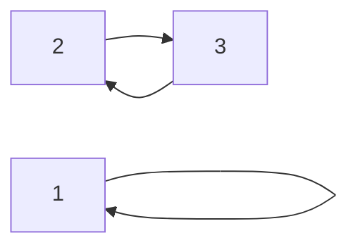

## Quan hệ — Định nghĩa & Tính chất

**Toán Rời Rạc**

Tiết 11 (45 phút) — Binary Relations

---

## Mục tiêu tiết học

- Định nghĩa quan hệ hai ngôi trên tích Descartes
- Biểu diễn quan hệ: liệt kê, ma trận 0-1 (bit), đồ thị có hướng
- Nhận biết tính chất: phản xạ, đối xứng, phản đối xứng, bắc cầu
- Kiểm tra tính chất từ ma trận và ví dụ thực tế
- Liên hệ ER diagram, đại số quan hệ, mạng xã hội, recommendation

---

## Quan hệ trong thế giới thực

Sinh viên đăng ký môn, user theo dõi nhau, khách mua sản phẩm, tài khoản–quyền, video–người xem.

**Toán**: $$R \subseteq A \times B$$ — tập con tích Descartes.

**CNTT**: relational DB, graph data, recommendation, equivalence testing.

---

## Định nghĩa Quan hệ

**Quan hệ hai ngôi** $$R$$ từ $$A$$ đến $$B$$ là tập con của tích Descartes:

$$R \subseteq A \times B$$

- $$(a,b) \in R$$: viết $$aRb$$ hoặc $$R(a,b)$$
- $$(a,b) \notin R$$: viết $$a \not\!R b$$

Khi $$A = B$$: $$R$$ là **quan hệ trên** $$A$$ ($$R \subseteq A \times A$$).

---

## Ví dụ thực tế — $$R \subseteq A \times B$$

| Bối cảnh | $$A$$ | $$B$$ | Cặp $$(a,b) \in R$$ |
|:---------|:------|:------|:---------------------|
| Đăng ký học | Sinh viên | Môn học | SV đã đăng ký môn |
| Phân quyền | User | Permission | User được cấp quyền |
| Giao hàng | Đơn hàng | Trạm kho | Đơn được xử lý tại trạm |

**CSDL**: bảng `Enrollments(student_id, course_id)` lưu $$R \subseteq Students \times Courses$$.

---

## Ví dụ thực tế — Quan hệ trên $$A$$

| Quan hệ | Tập $$A$$ | Ý nghĩa | Tính chất nổi bật |
|:--------|:---------|:--------|:------------------|
| `follows` | User | A theo dõi B | Có hướng, không đối xứng |
| `depends_on` | Gói phần mềm | A cần B để chạy | Bắc cầu |
| `same_city` | Địa chỉ | Cùng thành phố | Phản xạ, đối xứng, bắc cầu |

```python
follows = {("An", "Bình"), ("Chi", "An")}  # R ⊆ Users × Users
```

---

## Ba phương pháp biểu diễn quan hệ

Cùng $$R \subseteq A \times A$$, ta có **3 cách** tương đương:

| Phương pháp | Ý nghĩa | Khi nào dùng |
|:------------|:--------|:-------------|
| **Liệt kê** | Tập các cặp $$(a,b)$$ | Định nghĩa, tập nhỏ |
| **Ma trận** | $$M[i][j]=1 \Leftrightarrow (a_i,a_j)\in R$$ | Kiểm tra tính chất, thuật toán |
| **Đồ thị** | Cung $$a\to b$$ ↔ $$(a,b)\in R$$ | Trực quan, mạng lớn |

*(Bổ sung: set-builder $$\{(x,y)\mid P(x,y)\}$$ cho miền vô hạn.)*

---

## Biểu diễn 1 — Liệt kê phần tử

$$A=\{1,2,3\},\quad R=\{(1,1),(2,3),(3,2)\}$$

- $$(a,b)\in R$$: ghi cặp một lần; thứ tự trong tập **không** quan trọng
- $$(a,b)\notin R$$: không liệt kê

```python
R = {(1, 1), (2, 3), (3, 2)}   # R ⊆ A × A
```

---

## Biểu diễn 2 — Ma trận quan hệ

**Quy tắc**: hàng = **nguồn**, cột = **đích**; $$M[i][j]=1$$ nếu $$(a_i,a_j)\in R$$.

```
      1  2  3
  1 [ 1  0  0 ]   ← (1,1)
  2 [ 0  0  1 ]   ← (2,3)
  3 [ 0  1  0 ]   ← (3,2)
```

**Quy tắc nhanh** (chi tiết ở slide sau): phản xạ ↔ chéo 1; đối xứng ↔ $$M=M^{T}$$; phản xứng ↔ không cặp $$1$$–$$1$$ ngoài chéo.

---

## Ma trận — kiểm 4 tính chất

Với $$M_R=[m_{ij}]$$ trên $$A=\{a_1,\ldots,a_n\}$$:

| Tính chất | Điều kiện ma trận |
|:---|:---|
| Phản xạ | $$m_{ii}=1$$ mọi $$i$$ |
| Đối xứng | $$m_{ij}=m_{ji}$$ mọi $$i,j$$ |
| Phản đối xứng | $$i\neq j \Rightarrow m_{ij}=0$$ hoặc $$m_{ji}=0$$ |
| Bắc cầu | $$m_{ik}=m_{kj}=1 \Rightarrow m_{ij}=1$$ |

**Thực hành**: 3 tính đầu đọc bằng mắt; bắc cầu dễ sót → Warshall (tiết 13).

---

## Ma trận 0-1 — Số tự nhiên & bit

Đánh chỉ số đỉnh bằng **số tự nhiên** $$0,1,\ldots,n-1$$ (hoặc $$1,\ldots,n$$).

Mỗi ô $$M[i][j] \in \{0,1\}$$ là **một bit**:
- **1** ⟺ $$(a_i,a_j)\in R$$ (có cung)
- **0** ⟺ không có cung

Cùng $$R=\{(1,1),(2,3),(3,2)\}$$, chỉ số $$0\!\to\!1,\;1\!\to\!2,\;2\!\to\!3$$:

```
    0  1  2
0 [ 1  0  0 ]
1 [ 0  0  1 ]
2 [ 0  1  0 ]
```

**Chuỗi bit** (đọc theo hàng): `100001010` — $$n$$ đỉnh ⟹ $$n^{2}$$ bit lưu toàn bộ quan hệ.

```python
bits = "".join(str(M[i][j]) for i in range(n) for j in range(n))
```

**CNTT**: ma trận kề = cách máy tính lưu đồ thị / quan hệ trong RAM.

---

## Biểu diễn 3 — Đồ thị có hướng

- **Đỉnh** = phần tử của $$A$$
- **Cung** $$a \to b$$ (mũi tên) = $$(a,b) \in R$$
- **Vòng** tại $$a$$ = $$(a,a) \in R$$

Cùng $$R=\{(1,1),(2,3),(3,2)\}$$:



**Đọc ngược**: mỗi cung ↔ một cặp ↔ một bit 1 trong ma trận 0-1.


---

## Tính phản xạ (Reflexive)

**Định nghĩa**: $$R$$ phản xạ trên $$A$$ nếu
$$\forall a \in A,\; (a,a) \in R$$

**Ví dụ**:
- ✅ $$=$$ trên $$\mathbb{R}$$; ✅ $$\le$$ trên $$\mathbb{R}$$
- ❌ $$<$$ trên $$\mathbb{R}$$ (không có $$a < a$$)

**Ma trận**: đường chéo chính toàn **1**. **Đồ thị**: mỗi đỉnh có vòng (loop).

---

## Tính đối xứng (Symmetric)

**Định nghĩa**: $$R$$ đối xứng nếu
$$\forall a,b \in A,\; (a,b) \in R \Rightarrow (b,a) \in R$$

**Ví dụ**:
- ✅ $$=$$, $$\neq$$ trên $$\mathbb{R}$$
- ❌ $$<$$ trên $$\mathbb{R}$$

**Ma trận**: đối xứng qua đường chéo. **CS**: "hai máy kết nối trực tiếp" thường đối xứng.

---

## Tính phản đối xứng (Antisymmetric)

**Định nghĩa**: $$R$$ phản đối xứng nếu
$$(a,b) \in R \land (b,a) \in R \Rightarrow a = b$$

**Ví dụ**:
- ✅ $$\le$$ trên $$\mathbb{R}$$; ✅ $$\subseteq$$ trên tập hợp
- ❌ $$\neq$$ trên $$\mathbb{R}$$

**Lưu ý**: Đối xứng và phản đối xứng **không** đối lập — $$=$$ thỏa **cả hai**.

---

## Tính bắc cầu (Transitive)

**Định nghĩa**: $$R$$ bắc cầu nếu
$$(a,b) \in R \land (b,c) \in R \Rightarrow (a,c) \in R$$

**Ví dụ**:
- ✅ $$<$$, $$\le$$, $$\subseteq$$
- ❌ "là cha của" (ông–cháu không phải cha trực tiếp)

**CS**: Phụ thuộc gói phần mềm — nếu $$A$$ phụ thuộc $$B$$, $$B$$ phụ thuộc $$C$$ thì $$A$$ phụ thuộc $$C$$.

---

## Bảng tổng hợp tính chất

| Tính chất | Điều kiện | Ma trận / Đồ thị |
|:----------|:----------|:-----------------|
| Phản xạ | $$\forall a,\; aRa$$ | Chéo chính = 1; có loop |
| Đối xứng | $$aRb \Rightarrow bRa$$ | Ma trận đối xứng |
| Phản đối xứng | $$aRb \land bRa \Rightarrow a=b$$ | $$i\neq j$$: không cả $$m_{ij}=m_{ji}=1$$ |
| Bắc cầu | $$aRb \land bRc \Rightarrow aRc$$ | Cung gián tiếp → cung trực tiếp |

---

## Ví dụ đọc ma trận

$$
M=\begin{pmatrix}1&1&0\\0&1&1\\0&0&1\end{pmatrix}
\quad\text{trên }\{1,2,3\}
$$

- Phản xạ ✅ · Đối xứng ❌ · Phản đối xứng ✅
- Bắc cầu ❌: $$(1,2)$$ và $$(2,3)$$ nhưng không $$(1,3)$$

---

## ER Diagram & Foreign Key

**Thiết kế**: `Student` — đăng ký — `Course`; `Instructor` — dạy — `Course`; môn có tiên quyết.

**Foreign key** = quan hệ được DB **cưỡng chế**:

```sql
CREATE TABLE Enrollments (
  student_id INT REFERENCES Students(id),
  course_id  INT REFERENCES Courses(id)
);
```

Cặp chỉ tồn tại nếu sinh viên và môn học **thật sự tồn tại**.


---

## Mạng xã hội — Quan hệ quy mô lớn

Mỗi user = đỉnh; mối liên hệ = cung trong $$R$$:

- `follows(A,B)` — X: có hướng, **không** đối xứng
- `friends(A,B)` — Facebook: gần **đối xứng**
- `likes(A, Post)` — quan hệ user × nội dung

Hàng tỷ bản ghi → graph analytics ở quy mô công nghiệp.


---

## Equivalence Partitioning & Hashing

**Testing**: không test mọi input — chia **lớp tương đương** (cùng hành vi dự kiến).

Ví dụ tuổi: $$<0$$, $$[0,120]$$, $$>120$$ — mỗi lớp chọn 1 test case đại diện.

**Hashing**: hash ánh xạ nhiều key → bucket hữu hạn = phân lớp gần đúng; collision ảnh hưởng hiệu năng.

---

## Recommendation — Ma trận User–Item

| user | item | action |
|:-----|:-----|:-------|
| U1 | M1 | watched |
| U1 | M2 | liked |
| U2 | M1 | skipped |

**Collaborative filtering**: user có hành vi giống → gợi ý item tương tự.

Quan hệ user×item = ma trận thưa — nền Netflix, Spotify, TikTok.


---

## Graph DB & Knowledge Graphs

Khi quan hệ dày & liên thông:

- **Graph DB** (Neo4j): truy vấn theo cung, không chỉ bảng
- Fraud detection, supply chain, semantic search
- Enterprise knowledge graphs

AI/embeddings đổi **cách biểu diễn** — câu hỏi gốc vẫn là: đối tượng nào liên kết với đối tượng nào?

---

## Thực hành 1

Trên $$A=\{1,2,3,4\}$$, cho $$R=\{(1,1),(1,2),(2,3),(3,2),(3,3),(4,4)\}$$.

Kiểm tra $$R$$ có phản xạ, đối xứng, phản đối xứng, bắc cầu không?

Gợi ý: vẽ ma trận hoặc đồ thị có hướng.

---

## Thực hành 2

Cho quan hệ "chia hết" trên $$A=\{1,2,3,4,6,12\}$$: $$aRb \Leftrightarrow a \mid b$$.

1. Liệt kê một số cặp trong $$R$$
2. Xác định tính chất của $$R$$
3. Giải thích vì sao quan hệ này **không** đối xứng

---

## Thực hành 3

Viết ma trận quan hệ $$R=\{(a,a),(a,b),(b,c)\}$$ trên $$A=\{a,b,c\}$$.

Từ ma trận, chỉ ra tính chất nào $$R$$ **có** và **không có**.

---

## Tóm tắt Tiết 11

- Quan hệ = tập con $$A \times B$$ — mô hình liên kết giữa đối tượng
- Bốn tính chất cơ bản quyết định cấu trúc: phân loại vs sắp xếp
- bảng = quan hệ; ER + FK + đại số quan hệ → SQL
- Mạng xã hội, recommendation, hashing = quan hệ ở quy mô thực tế
- Tiết sau: từ tính chất → tương đương và thứ tự bộ phận

---

## Bài tập ôn tập (1/2)

1. **Bài 1**: Cho $$R$$ trên $$\mathbb{Z}$$: $$aRb \Leftrightarrow |a-b| \le 1$$. Kiểm tra 4 tính chất.

2. **Bài 2**: Vẽ ma trận cho quan hệ $$\le$$ trên $$\{1,2,3\}$$.

3. **Bài 3**: Quan hệ "theo dõi" trên mạng xã hội thường có tính chất gì?

---

## Bài tập ôn tập (2/2)

4. **Bài 4**: Cho $$R=\{(1,2),(2,1),(1,3)\}$$. $$R$$ có đối xứng? phản đối xứng? bắc cầu?

5. **Bài 5**: Mô tả quan hệ `User`–`Post`–`Comment` (1:N). Liệt kê các cặp trong $$R$$.

6. **Bài 6**: Chia input tuổi thành lớp tương đương để test. Mô tả quan hệ `parent_of` — tính chất nào cần để suy ra "tổ tiên"?
