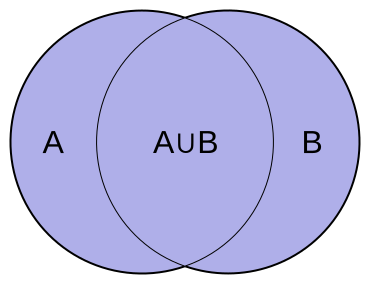

## Quy tắc Cộng và Nhân

**Toán Rời Rạc**

Tiết 16 (45 phút) — ch07 `07_01`

*Bài học: [Quy tắc Cộng và Nhân](https://nglelinh.github.io/discrete-mathematics-for-computer-science-iuh/contents/chapter07/21/01/01/Addition_and_Multiplication_Principles.html)*

---

## Mục tiêu tiết học

- Hiểu **quy tắc cộng** khi các lựa chọn loại trừ nhau
- Hiểu **quy tắc nhân** khi quy trình gồm nhiều bước nối tiếp
- Nắm **tích Descartes** và mối liên hệ với quy tắc nhân
- Phân biệt cấu trúc **"hoặc"** và **"và"** trong đề bài
- Kết hợp hai quy tắc trong bài toán thực tế

---

## Tại sao cần quy tắc đếm?

Hệ thống có bao nhiêu cách đăng nhập? Mật khẩu có bao nhiêu khả năng? Thuật toán sinh bao nhiêu cấu hình?

**Quy tắc đếm** ước lượng số cấu hình **không cần liệt kê hết** — kỹ năng gần với phân tích thuật toán và kiểm thử.

---

## Hai nguyên tắc nền tảng

| Cấu trúc bài toán                      | Quy tắc  | Từ khóa                 |
| :------------------------------------- | :------: | :---------------------- |
| Chọn **một trong** các cách (loại trừ) | **Cộng** | *hoặc*, *một trong các* |
| Làm **nhiều bước** liên tiếp           | **Nhân** | *và*, *rồi*, *tuần tự*  |

Hai ý tưởng này là **khung xương** cho hầu hết bài toán đếm sau này (hoán vị, tổ hợp, bao hàm–loại trừ…).

---

## Quy tắc Cộng (Addition Principle)

**Nguyên lý**: Tác vụ làm theo **m cách** hoặc **n cách** (không trùng) → tổng **m + n** cách.

**Định nghĩa chính thức** — $$A \cap B = \emptyset$$:

$$|A \cup B| = |A| + |B|$$



*Hình 7.2 — Quy tắc cộng: hợp của hai tập không giao.*

---

## Ví dụ 1: Chọn môn học

Một sinh viên có thể chọn:
- **3** môn toán: Giải tích, Đại số, Hình học
- **2** môn tin: Lập trình, Cấu trúc dữ liệu

**Hỏi**: Chọn **1** môn — bao nhiêu cách?

**Đáp án**: $$3 + 2 = 5$$ cách (các lựa chọn **loại trừ** nhau).

---

## Ví dụ 2: Đi từ A đến C

Từ A đến C có thể đi:
- Đường bộ: **4** tuyến
- Hàng không: **2** chuyến
- Thủy: **1** tuyến

**Tổng**: $$4 + 2 + 1 = 7$$ cách.

Mỗi phương thức = một tập con **rời nhau** của tập tất cả hành trình.

---

## Quy tắc Nhân (Multiplication Principle)

**Nguyên lý**: Tác vụ gồm $$k$$ bước; bước $$i$$ có $$n_i$$ cách:

$$n_1 \times n_2 \times \cdots \times n_k$$

---

## Ví dụ 3: Tạo mật khẩu

Mật khẩu 3 ký tự:
- Ký tự 1: **26** chữ cái
- Ký tự 2: **10** chữ số
- Ký tự 3: **26** chữ cái

**Tổng**: $$26 \times 10 \times 26 = 6{,}760$$ mật khẩu.

Ba bước **tuần tự**, độc lập → quy tắc nhân.

---

## Ví dụ 4: Đi A → B → C

- A → B: **3** cách
- B → C: **4** cách

**Tổng** đi từ A đến C **qua B**:

$$3 \times 4 = 12$$ cách.

---

## Tích Descartes — Định nghĩa

**Cartesian Product** — tập mọi cặp có thứ tự $$(a,b)$$:

$$A \times B = \{(a, b) \mid a \in A,\ b \in B\}$$

Kết nối lý thuyết tập hợp với quy tắc nhân.

**Tổng quát**: $$A_1 \times A_2 \times \cdots \times A_k$$ — bộ $$k$$ thành phần có thứ tự.

---

## Lực lượng tích Descartes

Nếu $$|A| = m$$, $$|B| = n$$:

$$|A \times B| = m \times n$$

**Tổng quát**:

$$|A_1 \times \cdots \times A_k| = |A_1| \times \cdots \times |A_k|$$

---

## Ví dụ 5: Tích Descartes

$$A = \{a, b, c\}$$, $$B = \{1, 2\}$$

$$A \times B = \{(a,1),(a,2),(b,1),(b,2),(c,1),(c,2)\}$$

$$|A \times B| = 3 \times 2 = 6$$ phần tử.

---

## Ví dụ: Lập bảng chân trị — quy tắc nhân

Biểu thức logic có **2** biến $$p$$, $$q$$. Mỗi biến có **2** giá trị (T/F).

**Số hàng** bảng chân trị:

$$2 \times 2 = 4$$

| $$p$$ | $$q$$ |
|:-----:|:-----:|
| T | T |
| T | F |
| F | T |
| F | F |

Mỗi hàng = một cách gán giá trị → đúng **quy tắc nhân** (2 bước, mỗi bước 2 cách).

---

## Ví dụ: Bảng chân trị 3 biến

Biểu thức $$(p \land q) \to r$$ có **3** biến.

| $$p$$ | $$q$$ | $$r$$ |
|:-----:|:-----:|:-----:|
| T | T | T |
| T | T | F |
| T | F | T |
| T | F | F |
| F | T | T |
| F | T | F |
| F | F | T |
| F | F | F |

**Tổng số hàng**: $$2 \times 2 \times 2 = 2^{3} = 8$$

Liệt kê hết = tích Descartes $$\{T,F\}^{3}$$ — không cần đếm thủ công từng hàng.

---

## Ví dụ 6: Mã sinh viên

Mã gồm **2** chữ in hoa (A–Z) + **3** chữ số (0–9).

Gọi $$A$$: 26 chữ, $$B$$: 10 số. Mỗi mã ∈ $$A \times A \times B \times B \times B$$.

$$26 \times 26 \times 10 \times 10 \times 10 = 676{,}000$$ mã.

---

## Mối liên hệ với quy tắc nhân

Quy tắc nhân = **hệ quả trực tiếp** của lực lượng tích Descartes.

Tác vụ $$k$$ bước, bước $$i$$ có $$n_i$$ cách ⟺ đếm phần tử của:

$$A_1 \times A_2 \times \cdots \times A_k,\quad |A_i| = n_i$$

Mỗi phần tử tích = **một cách** hoàn thành toàn bộ tác vụ.

---

## Phân biệt Cộng vs Nhân

| Dấu hiệu | Quy tắc |
|:---|:---:|
| "Chọn A **hoặc** B" (không làm cả hai) | **Cộng** |
| "Làm A **rồi** B" | **Nhân** |
| Các trường hợp **không giao** | **Cộng** |
| Chuỗi bước **tuần tự** | **Nhân** |

---

## Kết hợp: Đi du lịch (Ví dụ 5)

**Hà Nội → Đà Nẵng**:
- Bay trực tiếp: **3** chuyến
- Qua TP.HCM: HN→HCM (**4**) **và** HCM→ĐN (**2**)

**Giải**:
- Qua HCM: $$4 \times 2 = 8$$ (nhân)
- Tổng: $$3 + 8 = 11$$ (cộng — hai **loại** hành trình)

---

## Kết hợp: Tạo tài khoản (Ví dụ 6)

Username theo **2 định dạng** (loại trừ):
- Định dạng 1: 1 chữ + 3 số → $$26 \times 10^{3} = 26{,}000$$
- Định dạng 2: 2 chữ + 2 số → $$26^{2} \times 10^{2} = 67{,}600$$

**Tổng**: $$26{,}000 + 67{,}600 = 93{,}600$$ username.

---

## Ứng dụng CNTT (1): Thuật toán

```python
def count_operations(n):
    # Vòng lặp ngoài: n lần
    # Vòng lặp trong: n lần
    return n * n * 1  # Quy tắc nhân → O(n²)

def count_paths(graph, start, end):
    # Cộng: các đường đi khác loại
    # Nhân: chuỗi cạnh liên tiếp
    pass
```

---

## Ứng dụng CNTT (2): Mật mã

```python
def password_strength(length, charset_size):
    return charset_size ** length  # quy tắc nhân

# Mật khẩu 8 ký tự, chữ + số (36 ký tự)
strength = password_strength(8, 36)  # 36^{8} ≈ 2.8×10^{12}
```

Mỗi vị trí = một bước, $$36$$ lựa chọn → không gian brute-force.

---

## Ứng dụng CNTT (3): Cơ sở dữ liệu

```sql
-- Quy tắc nhân cho JOIN (worst case)
SELECT COUNT(*) FROM
    (SELECT COUNT(*) AS users FROM Users) u,
    (SELECT COUNT(*) AS orders FROM Orders) o;
```

Số dòng kết quả JOIN có thể = tích lực lượng hai bảng.

---

## Bài tập thực hành 1 — Quy tắc Cộng

1. Chọn 1 trong **5** môn toán, **3** môn lý, **4** môn hóa → ?

2. A → B: **3** đường bộ, **2** đường sắt, **1** hàng không → ?

---

## Đáp án — Bài tập thực hành 1

(1) $$5+3+4=12$$ · (2) $$3+2+1=6$$

---

## Bài tập thực hành 2 — Quy tắc Nhân

1. Mã: **2** chữ cái + **3** chữ số → ?

2. Thực đơn: **4** khai vị × **6** món chính × **3** tráng miệng → ?

---

## Đáp án — Bài tập thực hành 2

(1) $$26^{2} \times 10^{3} = 676{,}000$$ · (2) $$4 \times 6 \times 3 = 72$$

---

## Bài tập thực hành 3 — Kết hợp

1. A → C: trực tiếp (**2**), qua B (A→B **3**, B→C **4**) → ?

2. Mật khẩu định dạng 1: **3** chữ + **2** số; định dạng 2: **2** số + **3** chữ → ?

---

## Đáp án — Bài tập thực hành 3

(1) $$2 + 3 \times 4 = 14$$ · (2) $$2 \times 26^{3} \times 10^{2} = 3{,}515{,}200$$

---

## Bài tập CNTT 1 — Quy tắc Nhân

1. **E2E test**: **5** browser × **4** OS × **2** locale
2. **OTP** 6 chữ số (0–9), mỗi vị trí độc lập
3. **API key** 8 ký tự `[a-zA-Z0-9]` (62 ký tự)
4. **Feature toggle**: **6** module, mỗi module bật/tắt

---

## Đáp án — Bài tập CNTT 1

(1) **40** · (2) $$10^{6}$$ · (3) $$62^{8}$$ · (4) $$2^{6}=64$$ cấu hình

---

## Bài tập CNTT 2 — Quy tắc Cộng

*(Từ dễ → khó — mỗi câu: các lựa chọn **loại trừ**, dùng **cộng**)*

1. *(cơ bản)* Chọn **1** charset file: UTF-8 hoặc ASCII → ?
2. *(dễ)* **Đăng nhập** chọn 1: Google / GitHub / email-password → ?
3. *(trung bình)* **Log level** chọn 1: DEBUG / INFO / WARN / ERROR → ?
4. *(khó hơn)* **Incident** chọn **1** hướng (không làm đồng thời):
   rollback (**3** bản), hoặc scale (**2** cluster), hoặc maintenance (**1**) → ?

---

## Đáp án — Bài tập CNTT 2

(1) **2** · (2) **3** · (3) **4** · (4) $$3+2+1=6$$

---

## Bài tập CNTT 3 — Kết hợp

1. **Request**: cache HIT (**1** đường) hoặc MISS → **2** LB × **3** pod → ?
2. **CI/CD**: deploy nhanh (**1** job) hoặc full pipeline (**4** stage × **2** runner) → ?
3. **Username**: dạng A (**2** chữ + **4** số) hoặc dạng B (**3** chữ + **3** số) → ?

---

## Đáp án — Bài tập CNTT 3

(1) $$1+2\times3=7$$ · (2) $$1+4\times2=9$$ · (3) $$26^{2}\cdot10^{4}+26^{3}\cdot10^{3}$$

---

## Bài tập CNTT 4 — Tích Descartes & kết hợp

1. **K8s rollout**: **2** namespace × **3** image tag × **2** replica profile → ?
2. **API gateway**: route v1 (**5** path) hoặc v2 (**3** service × **4** method) → ?
3. **Webhook**: retry **3** lần × **2** backoff, hoặc gửi thẳng DLQ (**1** đường) → ?
4. **Permission bitmask** 5 bit on/off → ?

---

## Đáp án — Bài tập CNTT 4

(1) $$2\times3\times2=12$$ · (2) $$5+3\times4=17$$ · (3) $$3\times2+1=7$$ · (4) $$2^{5}=32$$

---

## Tóm tắt Tiết 16

- **Cộng**: lựa chọn loại trừ → $$|A \cup B| = |A| + |B|$$
- **Nhân**: bước tuần tự → $$n_1 \cdots n_k$$
- **Tích Descartes**: cơ sở hình thức của quy tắc nhân
- **Kết hợp**: cộng các trường hợp, mỗi trường hợp dùng nhân

---

## Liên hệ chương trình

| Tiết | Bài học | Nội dung |
|:---:|:---|:---|
| **16** | `07_01` | Cộng, nhân, tích Descartes, kết hợp |
| 17 | `07_02` | Hoán vị, chỉnh hợp, tổ hợp |
| 18 | `07_05` | Hoán vị lặp, stars and bars |
| 19 | `07_03` | Bao hàm–loại trừ (trường hợp có giao) |
