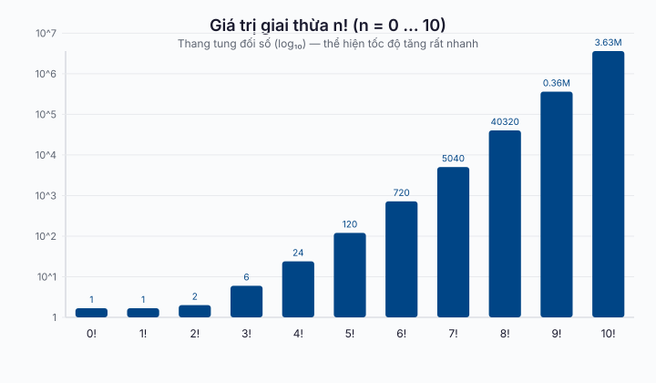
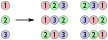
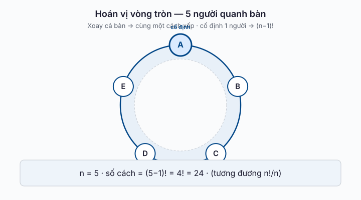
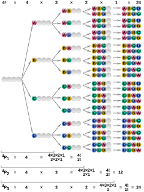
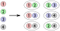

## Hoán vị và Tổ hợp

**Toán Rời Rạc**

Tiết 17 (45 phút) — ch07 `07_02`

*Bài học: [Hoán vị và Tổ hợp](https://nglelinh.github.io/discrete-mathematics-for-computer-science-iuh/contents/chapter07/21/01/01/Permutations_and_Combinations.html)*

---

## Mục tiêu tiết học

- Tính **giai thừa** và hiểu tốc độ tăng của $$n!$$
- Phân biệt **hoán vị**, **chỉnh hợp**, **tổ hợp**
- Thành thạo $$P(n,k)$$, $$C(n,k)$$ và **hoán vị vòng tròn** $$(n-1)!$$
- Nhận dạng bài toán: **thứ tự** có quan trọng không? **hàng** hay **vòng**?
- Áp dụng đếm đội tuyển, xếp hạng, xếp bàn tròn

---

## Câu hỏi then chốt

Trước khi chọn công thức, hỏi **4** câu:

1. Chọn **bao nhiêu** phần tử? ($$k$$ hay tất cả $$n$$?)
2. **Thứ tự** có quan trọng không?
3. Xếp **thẳng hàng** hay **vòng tròn**?
4. Có **lặp** không? *(tiết 18 — `07_05`)*

---

## Bảng nhận dạng nhanh

| Thứ tự? | Chọn / kiểu | Công thức |
|:---:|:---:|:---|
| Có | $$n$$ (hàng) | $$n!$$ |
| Có | $$n$$ (vòng tròn) | $$(n-1)!$$ |
| Có | $$k$$ | $$P(n,k)$$ |
| Không | $$k$$ | $$C(n,k)$$ |

---

## Chiến lược: "Ít nhất $$k$$"

Khi điều kiện là **ít nhất** (không phải **đúng**):

$$\text{Số cách} = \binom{n}{r} - \text{(các trường hợp cấm)}$$

---

## Ví dụ bù: Ít nhất 1 Lead

14 dev (4 Lead, 10 Member), chọn nhóm **5** người, **ít nhất 1** Lead:

$$\binom{14}{5} - \binom{10}{5} = 2002 - 252 = 1750$$

*(Trừ nhóm chỉ gồm Member.)*

---

## Bù hay liệt kê?

| Tình huống | Cách làm |
|:---|:---|
| **Ít nhất 1** loại A | Bù: tổng − không có A |
| **Đúng 2** Lead + 3 Member | $$C(4,2)\times C(10,3)$$ |
| **Ít nhất 2** loại A | Bù nhiều bậc hoặc liệt kê |

---

## Giai thừa (Factorial)

**Định nghĩa** — với $$n \in \mathbb{N}$$, $$n \geq 1$$:

$$n! = n \times (n-1) \times \cdots \times 2 \times 1$$

**Quy ước**: $$0! = 1$$ (tập rỗng có đúng **một** cách sắp xếp).

---

## Giai thừa — Ví dụ & tăng trưởng

**Tính chất**: $$n! = n \times (n-1)!$$

Ví dụ: $$3!=6$$, $$5!=120$$, $$10!=3{,}628{,}800$$.



*Hình 7.6 — Giai thừa tăng rất nhanh.*

---

## Hoán vị — Định nghĩa

**Hoán vị** của $$n$$ đối tượng **phân biệt**: mọi cách **sắp xếp toàn bộ** $$n$$ đối tượng.

- Lấy **tất cả** $$n$$ phần tử
- **Thứ tự** có ý nghĩa; **không lặp**

---

## Hoán vị — Công thức

$$P(n) = n!$$



*Hình 7.7 — Mỗi hoán vị là một thứ tự khác nhau.*

---

## Ví dụ Hoán vị (hàng thẳng)

Xếp **4** người thành hàng → $$P(4)=4! = 24$$ cách.

*Chú ý:* nếu xếp **quanh bàn tròn** thì **không** dùng $$n!$$ — xem slide sau.

---

## Hoán vị vòng tròn — Định nghĩa

**Hoán vị vòng tròn** (circular permutation): sắp xếp $$n$$ đối tượng **phân biệt** theo **vòng**, trong đó các cách chỉ **xoay** lẫn nhau được coi là **cùng một** cách.

- Không phân biệt “điểm bắt đầu / kết thúc”
- Chỉ quan tâm **thứ tự tương đối** (ai ngồi cạnh ai, theo chiều nào)

---

## Hoán vị vòng tròn — Công thức

Số hoán vị vòng tròn của $$n$$ phần tử phân biệt:

$$P_{\text{vòng}}(n) = (n-1)! = \frac{n!}{n}$$

**Hai cách hiểu** (cùng kết quả):

1. **Cố định** 1 người → xếp $$n-1$$ người còn lại: $$(n-1)!$$
2. Có $$n!$$ cách xếp hàng; mỗi cấu hình vòng tương ứng $$n$$ lần xoay → chia cho $$n$$

---

## Vì sao chia cho $$n$$?

Xếp hàng: ABCDE, BCDEA, CDEAB, … là **khác nhau** (vị trí đầu khác).

Xếp **bàn tròn** (không đánh số ghế): xoay cả bàn → **cùng** cách ngồi.

Có đúng $$n$$ cách xoay mỗi cấu hình vòng → $$n! / n = (n-1)!$$.

---

## Minh họa: 5 người quanh bàn



*Cố định A (hoặc bất kỳ 1 người) → xếp B,C,D,E: $$4! = 24$$.*

---

## Ví dụ — Bàn tròn

**Ví dụ 1.** 5 bạn A, B, C, D, E quanh bàn tròn:

$$(5-1)! = 4! = 24$$ cách.

**Ví dụ 2.** 8 người quanh bàn tròn *(không phân biệt quay vòng)*:

$$(8-1)! = 7! = 5040$$ cách.

---

## Hàng thẳng vs Vòng tròn

| | Hàng thẳng | Vòng tròn |
|:---|:---|:---|
| Phân biệt vị trí tuyệt đối? | **Có** (đầu–cuối) | **Không** (chỉ xoay) |
| Công thức | $$n!$$ | $$(n-1)!$$ |
| Ví dụ $$n=5$$ | $$120$$ | $$24$$ |

**Nhận dạng:** “quanh bàn”, “vòng”, “không phân biệt xoay” → $$(n-1)!$$.

---

## Ghi chú (biến thể thường gặp)

- **Ghế đã đánh số / có “đầu bàn”** → coi như **hàng**: dùng $$n!$$
- **Vòng + không phân biệt lật** (vòng cổ, bàn không có hướng): thường $$(n-1)!/2$$ — *không* dùng trong bài kiểm tra cơ bản trừ khi đề nêu rõ
- Bài KT nhỏ: “không phân biệt vị trí quay vòng” → đúng $$(n-1)!$$

---

## Chỉnh hợp — Định nghĩa

**Chỉnh hợp chập $$k$$ của $$n$$**: chọn **$$k$$** phần tử rồi **sắp xếp** ($$1 \leq k \leq n$$).

- **Thứ tự** có ý nghĩa; **không lặp**
- $$k=n$$ ⟹ hoán vị: $$P(n,n)=n!$$

---

## Chỉnh hợp — Công thức

$$P(n,k) = \frac{n!}{(n-k)!} = n(n-1)\cdots(n-k+1)$$



*Hình 7.3 — $$k$$ vị trí: $$n, n-1, \ldots$$ → quy tắc nhân.*

---

## Ví dụ Chỉnh hợp 1

10 SV, chọn 3 xếp hàng:

$$P(10,3) = 10 \times 9 \times 8 = 720$$

---

## Ví dụ Chỉnh hợp 2

8 VĐV, trao Vàng–Bạc–Đồng:

$$P(8,3) = 8 \times 7 \times 6 = 336$$

**Nhận dạng**: có **thứ hạng / vị trí** → chỉnh hợp, không phải tổ hợp.

---

## Phân biệt Hoán vị vs Chỉnh hợp

Cả hai **có thứ tự**; khác ở **số phần tử lấy**:

| | Hoán vị | Chỉnh hợp |
|:---|:---|:---|
| Lấy | **Tất cả** $$n$$ | **$$k$$** phần tử |
| Công thức | $$n!$$ | $$P(n,k)$$ |

**Ý tưởng**: $$n, n-1, \ldots$$ → quy tắc nhân (tiết 16).

---

## Tổ hợp — Định nghĩa

**Tổ hợp chập $$k$$ của $$n$$**: chọn **$$k$$** phần tử, **không** quan tâm thứ tự.

- $$\{a,b,c\}$$ và $$\{c,a,b\}$$ là **cùng một** tổ hợp
- **Không lặp** phần tử

---

## Tổ hợp — Công thức

$$C(n,k) = \binom{n}{k} = \frac{n!}{k!(n-k)!}$$



*Hình 7.8 — Đếm **tập** $$k$$ phần tử, không đếm thứ tự.*

---

## Ví dụ Tổ hợp

Chọn **3** SV từ **10** vào đội tuyển → $$C(10,3) = 120$$.

---

## Ví dụ Tổ hợp: Nhóm nam–nữ

Lớp **12** nam, **8** nữ. Chọn nhóm **4** người có **đúng 2** nam:

- Chọn 2 nam: $$C(12,2) = 66$$
- Chọn 2 nữ: $$C(8,2) = 28$$
- Quy tắc nhân: $$66 \times 28 = 1{,}848$$ cách

---

## Mối quan hệ $$P$$ và $$C$$

$$P(n,k) = k! \times C(n,k)$$

**Giải thích**: Mỗi tổ hợp $$k$$ phần tử sắp xếp được $$k!$$ cách.

**Ví dụ**: $$P(10,3) = 6 \times C(10,3) = 720$$ ✓

Luôn đúng: $$P(n,k) \geq C(n,k)$$ (trừ $$k = 0, 1$$).

---

## Bảng tổng kết (không lặp)

| Khái niệm | Chọn | Thứ tự? | Công thức |
|:---|:---:|:---:|:---|
| Hoán vị (hàng) | $$n$$ | Có | $$n!$$ |
| Hoán vị **vòng tròn** | $$n$$ | Có (tương đối) | $$(n-1)!$$ |
| Chỉnh hợp | $$k$$ | Có | $$n!/(n-k)!$$ |
| Tổ hợp | $$k$$ | Không | $$n!/(k!(n-k)!)$$ |

---

## Nhận dạng nhanh

- Có **hạng / vị trí / thứ tự** (hàng) → $$P$$ hoặc $$n!$$
- Xếp **quanh bàn / vòng**, không phân biệt xoay → $$(n-1)!$$
- Chỉ **chọn nhóm** → $$C$$
- Có **lặp** → tiết 18 (`07_05`)

---

## So sánh Hoán vị và Tổ hợp

| Khía cạnh | Có thứ tự ($$P$$) | Không thứ tự ($$C$$) |
|:---|:---|:---|
| Ví dụ | Xếp hạng, trao huy chương | Chọn đội tuyển |
| Công thức | $$P(n,k)$$ | $$C(n,k)$$ |
| Quy mô | $$P(n,k) \geq C(n,k)$$ | — |

---

## Điểm then chốt

- "Chọn đội" → $$C$$
- "Xếp hạng / gán vai trò" → $$P$$
- "Quanh bàn / không phân biệt xoay" → $$(n-1)!$$

---

## Tính chất Tổ hợp (xem thêm tiết 20)

**Đối xứng**: $$C(n,k) = C(n,n-k)$$

**Tam giác Pascal**: $$C(n,k) = C(n-1,k-1) + C(n-1,k)$$

**Tổng**: $$\sum_{k=0}^{n} C(n,k) = 2^{n}$$ — mỗi phần tử: thuộc hoặc không thuộc tập con.

*(Chi tiết nhị thức: tiết 20 — `07_04`)*

---

## Bài 1: Xếp sách (đặt bài)

5 Toán + 4 Lý + 3 Hóa, **cùng môn đứng cạnh nhau**.

Hỏi: có bao nhiêu cách xếp?

---

## Đáp án — Bài 1: Xếp sách

- Sắp 3 khối môn: $$3! = 6$$
- Trong mỗi môn: $$5! \times 4! \times 3!$$

**Tổng**: $$3! \times 5! \times 4! \times 3! = 103{,}680$$ cách.

---

## Bài 2: Thành lập số (đặt bài)

Từ $$\{0,1,2,3,4,5\}$$, lập số **4 chữ số khác nhau**.

Hỏi: có bao nhiêu số?

---

## Đáp án — Bài 2: Thành lập số

- Hàng nghìn $$\neq 0$$: **5** cách
- 3 vị trí còn lại: $$P(5,3) = 60$$

**Tổng**: $$5 \times 60 = 300$$ số.

---

## Bài 3: Chọn ủy ban (đặt bài)

15 nam + 12 nữ, chọn ủy ban **5** người, **ít nhất 2** nữ.

---

## Bài 3: Liệt kê trường hợp

| Nữ | Nam | Cách |
|:---:|:---:|:---:|
| 2 | 3 | $$C(12,2)\times C(15,3)=30{,}030$$ |
| 3 | 2 | $$220\times105=23{,}100$$ |

---

## Bài 3: Tiếp & Tổng

| Nữ | Nam | Cách |
|:---:|:---:|:---:|
| 4 | 1 | $$495\times15=7{,}425$$ |
| 5 | 0 | $$792\times1=792$$ |

**Tổng**: $$61{,}347$$ (quy tắc **cộng**).

---

## Bài tập tự luyện (bài `07_02`)

*Gợi ý:* xác định dạng bài (hoán vị / vòng tròn / chỉnh hợp / tổ hợp) **trước** khi tính.

1. Xếp **5** SV vào **5** ghế một hàng.
2. Xếp **5** SV **quanh bàn tròn** (không phân biệt xoay).
3. **10** bi đỏ + **8** bi xanh, chọn **4** bi, **ít nhất 1** đỏ.

---

## Bài tập tự luyện (tiếp)

4. Từ $$\{1,2,3,4,5,6,7\}$$, lập số **chẵn** **4** chữ số khác nhau.
5. Xếp **3** Toán + **2** Văn + **4** Anh — cùng môn **không** cần đứng cạnh.
6. **10** nam + **7** nữ, chọn **5** người, **nam > nữ**.

---

## Đáp án tự luyện 1–2

**1.** Hàng thẳng: $$5! = 120$$.

**2.** Vòng tròn: $$(5-1)! = 4! = 24$$.

*So sánh:* cùng 5 người — hàng vs bàn tròn khác công thức.

---

## Đáp án tự luyện 3

Bù trừ — loại trường hợp **toàn xanh**:

$$\binom{18}{4} - \binom{8}{4} = 3{,}060 - 70 = 2{,}990$$

---

## Đáp án tự luyện 4

Số **chẵn** → chữ số cuối $$\in \{2,4,6\}$$: **3** cách.

Ba chữ số đầu từ 6 số còn lại: $$P(6,3)=120$$.

**Tổng**: $$3 \times 120 = 360$$ số.

---

## Đáp án tự luyện 5

9 quyển **phân biệt** — không ràng buộc khối (khác Bài 1).

Mọi hoán vị đều hợp lệ: $$9! = 362{,}880$$ cách.

*So sánh Bài 1:* “cạnh nhau” → nhóm khối; ở đây **không** nhóm.

---

## Đáp án tự luyện 6

Chọn 5 người, **nam > nữ** → liệt kê trường hợp:

| Nam | Nữ | Cách |
|:---:|:---:|:---:|
| 5 | 0 | $$\binom{10}{5}=252$$ |
| 4 | 1 | $$\binom{10}{4}\binom{7}{1}=1{,}470$$ |
| 3 | 2 | $$\binom{10}{3}\binom{7}{2}=2{,}520$$ |

**Tổng**: $$252+1{,}470+2{,}520=4{,}242$$ (quy tắc **cộng**).

---

## Ứng dụng CNTT — Ý nghĩa

- **Brute-force**: $$C(n,k)$$ hoặc $$n!$$ tổ hợp cần thử
- **Mật khẩu không lặp**: gần $$P(n,k)$$ hơn $$n^{k}$$
- **Tập con**: $$2^{n}$$ cấu hình

---

## Ứng dụng CNTT — Code

```python
import math
math.comb(len(items), k)   # tổ hợp
math.factorial(n)            # hoán vị
```

---

## Bài tập thực hành 1 — Giai thừa

1. Tính $$7!$$, $$0!$$, $$1!$$
2. So sánh $$10!$$ và $$3^{6}$$
3. Tìm $$n$$ sao cho $$n! > 1000$$

---

## Đáp án — Bài tập thực hành 1

(1) 5040, 1, 1 · (2) $$10! > 3^{6}$$ · (3) $$n = 7$$

---

## Bài tập thực hành 2 — Hoán vị

1. Xếp 6 cuốn sách trên kệ → ?
2. 8 SV, chọn 3 làm lớp trưởng, phó, thư ký → ?
3. Hoán vị chữ trong "COMPUTER" (8 chữ khác nhau) → ?
4. 7 người quanh bàn tròn (không phân biệt xoay) → ?

---

## Đáp án — Bài tập thực hành 2

(1) 720 · (2) $$P(8,3)=336$$ · (3) $$8!=40{,}320$$ · (4) $$6!=720$$

---

## Bài tập thực hành 3 — Tổ hợp

1. Chọn 5 người từ 12 → ?
2. Hộp 10 bi đỏ + 8 xanh, chọn 4 bi → ?
3. Chứng minh $$C(n,0)+\cdots+C(n,n)=2^{n}$$

---

## Đáp án — Bài tập thực hành 3

(1) $$C(12,5)=792$$ · (2) $$C(18,4)=3{,}060$$ · (3) $$(1+1)^{n}$$

---

## Bài tập thực hành 4 — Ứng dụng

1. Mật khẩu **8** ký tự (chữ + số, 36 ký tự) → ?
2. Lớp **30** SV: 1 lớp trưởng + 2 lớp phó → ?
3. **20** cầu thủ (1 thủ môn cố định), chọn **10** người còn lại → ?

---

## Đáp án — Bài tập thực hành 4

(1) $$36^{8}$$ · (2) $$30\times C(29,2)=12{,}180$$ · (3) $$C(19,10)=92{,}378$$

---

## Checklist trước khi làm bài

1. Ghi **$$n$$, $$k$$**, có thứ tự không, **hàng hay vòng**, có lặp không
2. "Chọn nhóm" → $$C$$; "xếp hạng / gán vai" → $$P$$; "bàn tròn / xoay" → $$(n-1)!$$
3. Điều kiện **đúng** $$t$$ người loại X → $$C(\cdot,t)\times C(\cdot,\cdot)$$
4. Điều kiện **ít nhất** $$k$$ → thử **bù** trước: tổng − trường hợp cấm
5. Kiểm tra: kết quả là số nguyên dương (và hợp lý so với $$n!$$ hoặc $$\binom{n}{k}$$)

*(Ôn kỹ năng — không thay cho luyện tập với số liệu mới.)*

---

## Tóm tắt Tiết 17 (1/2)

- **Giai thừa**: $$n!$$, quy ước $$0!=1$$
- **Hoán vị (hàng)**: $$n!$$ · **Vòng tròn**: $$(n-1)!$$
- **Chỉnh hợp**: $$P(n,k)$$ · **Tổ hợp**: $$C(n,k)=\binom{n}{k}$$

---

## Tóm tắt Tiết 17 (2/2)

- $$P(n,k) = k! \cdot C(n,k)$$
- **Ít nhất $$k$$** → phương pháp bù
- **Hoán vị/tổ hợp lặp** → tiết 18

---

## Liên hệ chương trình (1/2)

| Tiết | Bài | Nội dung |
|:---:|:---|:---|
| 16 | `07_01` | Quy tắc cộng, nhân |
| **17** | `07_02` | Hoán vị, vòng tròn, chỉnh hợp, tổ hợp |
| 18 | `07_05` | Hoán vị lặp, stars and bars |

---

## Liên hệ chương trình (2/2)

| Tiết | Bài | Nội dung |
|:---:|:---|:---|
| 19 | `07_03` | Bù trừ khi có giao |
| 20 | `07_04` | Hệ số nhị thức, Pascal |

---

## Edge case

$$k > n \Rightarrow P(n,k) = 0,\quad C(n,k) = 0$$
