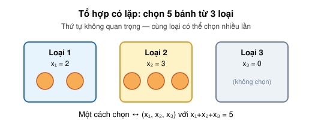
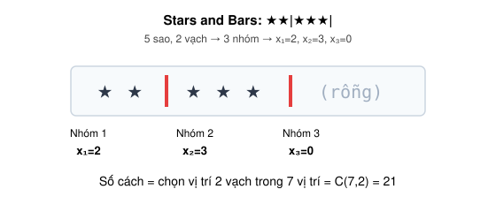
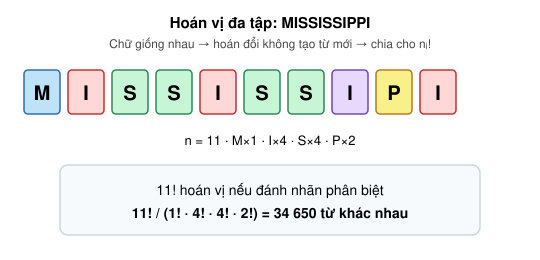

## Hoán vị và Tổ hợp Mở rộng

**Toán Rời Rạc**

Tiết 18 (45 phút) — ch07 `07_05`

*Bài học: [Hoán vị và Tổ hợp Mở rộng](https://nglelinh.github.io/discrete-mathematics-for-computer-science-iuh/contents/chapter07/21/01/01/Generalized_Permutations_and_Combinations.html)*

---

## Mục tiêu tiết học

- Tính **hoán vị đa tập** khi có phần tử trùng
- Dùng **hệ số đa thức** (multinomial)
- Áp dụng **stars and bars**: $$C(n+k-1,k)$$
- Đếm **nghiệm nguyên không âm**
- Nhận biết khi cần **bù trừ** (ràng buộc trên)

---

## 

Giả định $$n$$ đối tượng **phân biệt**. Thực tế:

- Chữ cái lặp ("BANANA", "MISSISSIPPI")
- Chọn nhiều vật **cùng loại** (có lặp)
- Phân phối tài nguyên vào nhóm

**Ba công cụ**: hoán vị đa tập, hệ số đa thức, stars and bars.

---

## Tổ hợp có lặp — Bài toán

Có $$n$$ **loại** đồ vật, mỗi loại **không giới hạn**.

Chọn **$$r$$** đồ vật, **không** xét thứ tự.

**Hỏi**: có bao nhiêu cách?

---

## Tổ hợp có lặp 

|           | Tổ hợp                  | Tổ hợp **có lặp**    |
| :-------- | :---------------------- | :------------------- |
| Đối tượng | $$n$$ vật **phân biệt** | $$n$$ **loại**       |
| Lặp?      | Không                   | **Có**               |
| Ví dụ     | Chọn 3 SV từ 10         | Mua 5 bánh từ 4 loại |

---

## Tổ hợp có lặp — Ý nghĩa đếm

Một lần chọn = bộ đếm $$(x_1,\ldots,x_n)$$:

$$x_1+\cdots+x_n=r,\quad x_i\geq0$$

$$x_i$$ = số vật **loại $$i$$** được lấy (có thể 0).

**Thứ tự không quan trọng** — chỉ quan tâm *mỗi loại bao nhiêu*.

---

## Định lý

$$C_R(n,r)=\binom{n+r-1}{r}=\binom{n+r-1}{n-1}$$

**R** = *repetition* (lặp).

*Hình 7.21 — Chọn $$r$$ vật từ $$n$$ loại, lặp được.*

---

##  Ví dụ

4 loại bánh, mua **5** cái (có thể trùng loại):

$$\binom{4+5-1}{5}=\binom{8}{5}=56$$

Sai nếu dùng $$C(4,5)=0$$ — đây là bài **có lặp**, không phải tổ hợp thường.

---

## Tại sao $$n+r-1$$?

Mỗi cách chọn ↔ một phân phối $$x_1+\cdots+x_n=r$$.

Có $$r$$ “đơn vị” chia vào $$n$$ loại → tương đương chọn $$(n-1)$$ **vách ngăn** giữa $$r$$ **ô**.

→ Stars and Bars (slide tiếp theo).

---

## Stars and Bars — Ý tưởng

$$r$$ **sao** = $$r$$ vật cần chọn; $$(n-1)$$ **vạch** = chia $$n$$ loại.

*Hình 7.22 — Mỗi chuỗi sao–vạch ↔ một cách chọn có lặp.*

---

## Stars and Bars — Công thức

Hàng có $$(r+n-1)$$ vị trí ($$r$$ sao + $$(n-1)$$ vạch).

Chọn vị trí cho **vạch** → xác định duy nhất phân phối:

$$\binom{r+n-1}{n-1}=\binom{r+n-1}{r}$$

---

## Ví dụ Stars and Bars 1

5 vị kem, mua 3 cây → $$C(7,3)=35$$.

Chọn 5 bánh từ 4 loại → $$C(8,5)=56$$.

---

## Ví dụ Stars and Bars 2

Phân 5 license cho 3 team (có thể 0) → $$C(7,5)=21$$.

---

## Nghiệm nguyên không âm

Số nghiệm của:

$$x_1 + x_2 + \cdots + x_n = r \quad (x_i \geq 0)$$

là $$\binom{n+r-1}{n-1}$$ — **cùng** công thức tổ hợp có lặp.

---

## Ví dụ: Phương trình không âm

$$x_1+x_2+x_3+x_4=10$$ → $$\binom{13}{3}=286$$ nghiệm.

**Ràng buộc dưới**: đặt $$y_i = x_i - a_i$$, chuyển về dạng không âm.

---

## Ràng buộc dưới — Ví dụ

$$x_1+x_2+x_3=12$$ với $$x_1\geq2, x_2\geq1, x_3\geq4$$.

Đặt $$y_i = x_i - a_i$$ → $$y_1+y_2+y_3=5$$.

Số nghiệm: $$\binom{7}{2}=21$$.

---

## Hoán vị đa tập (Multiset)

$$n$$ đối tượng, loại $$i$$ có $$n_i$$ phần tử giống ($$\sum n_i=n$$):

$$\frac{n!}{n_1! \cdot n_2! \cdots n_k!}$$

**Ví dụ "BANANA"**: $$\frac{6!}{1!\cdot3!\cdot2!}=60$$.

---

## Ví dụ: MISSISSIPPI

11 chữ: M×1, I×4, S×4, P×2

$$\frac{11!}{1!\cdot4!\cdot4!\cdot2!} = 34{,}650$$

*Hình 7.23 — Chữ cùng loại hoán đổi không đổi từ.*

---

## Ràng buộc: Ít nhất 1 mỗi loại

Yêu cầu **ít nhất 1** loại bắt buộc → **đặt trước**, phần còn lại dùng stars and bars.

---

## Ví dụ: Quyền API (đặt bài)

Chọn **6** quyền từ 4 scope (READ, WRITE, DELETE, ADMIN).

Có lặp, không thứ tự. Bắt buộc **≥ 1** READ **và** **≥ 1** WRITE.

---

## Ví dụ: Quyền API (giải)

1. Đặt trước 1 READ + 1 WRITE → còn **4** quyền tự do
2. $$\binom{4+4-1}{4} = \binom{7}{4} = 35$$

**Mẫu**: ít nhất 1 $$A$$ và 1 $$B$$ ⟹ $$\binom{(r-2)+(n-1)}{r-2}$$

---

## Ràng buộc trên

Yêu cầu $$0 \leq x_i \leq b_i$$ → stars and bars đơn thuần **chưa đủ**.

Cần **bù trừ** (tiết 19).

---

## Ví dụ ràng buộc trên

$$x_1+x_2+x_3=10$$, $$x_i \leq 4$$.

- Không ràng buộc trên: $$\binom{12}{2}=66$$
- Trừ $$x_i \geq 5$$; cộng lại giao
- **Kết quả**: $$66 - 3\cdot21 + 3\cdot1 = 6$$

---

## Bài tập thực hành 1

1. Hoán vị "STATISTICS" (10 chữ) → ?
2. 4 vị trà, mua 6 gói (có lặp) → ?
3. $$x_1+x_2+x_3=8$$, $$x_i \geq 0$$ → ?

---

## Đáp án — Bài tập thực hành 1

(1) $$\frac{10!}{3!\cdot3!\cdot2!}=50{,}400$$ · (2) $$C(9,6)=84$$ · (3) $$C(10,2)=45$$

---

## Bài tập thực hành 2

1. Chia 7 task vào 4 sprint (task có thể 0) → ?
2. Hoán vị "ABRACADABRA" → ?
3. $$\binom{8}{2,3,3}$$ — ý nghĩa và giá trị?

---

## Đáp án — Bài tập thực hành 2

(1) $$C(10,7)=120$$ · (2) $$\frac{11!}{5!\cdot2!\cdot2!}=83{,}160$$ · (3) chia 8 vào 3 nhóm → 560

---

## Nhận dạng nhanh (1/2)

| Tình huống | Công thức |
|:---|:---|
| Chọn $$k$$ từ $$n$$, không lặp | $$C(n,k)$$ |
| Chọn $$r$$ từ $$n$$ loại, **có lặp** | $$C(n+r-1,r)$$ |
| Phân $$r$$ vật vào $$n$$ nhóm | $$C(n+r-1,r)$$ |

---

## Nhận dạng nhanh (2/2)

| Tình huống | Công thức |
|:---|:---|
| Sắp chữ có trùng | $$n!/(n_1!\cdots n_k!)$$ |
| **Ít nhất 1** loại bắt buộc | Đặt trước → stars and bars |
| Giới hạn trên $$x_i$$ | Bù trừ (tiết 19) |

---

## Tóm tắt Tiết 18

- **Tổ hợp có lặp**: $$n$$ loại, chọn $$r$$, lặp OK → $$\binom{n+r-1}{r}$$
- **Hoán vị lặp**: chia cho giai thừa nhóm trùng
- **Stars and bars**: sao + vạch = phân phối $$(x_1,\ldots,x_n)$$
- **Nghiệm không âm** ↔ tổ hợp có lặp (cùng công thức)
- **Multinomial**: chia nhóm có nhãn
- **Ràng buộc trên** → bao hàm–loại trừ (tiết 19)

---

## Liên hệ chương trình

| Tiết | Bài | Nội dung |
|:---:|:---|:---|
| 17 | `07_02` | Hoán vị, tổ hợp cơ bản |
| **18** | `07_05` | Lặp, stars and bars, đa thức |
| 19 | `07_03` | Bù trừ khi có giao |
| 22 | `07_06` | Đếm ứng dụng CNTT |
