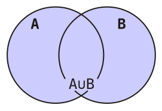
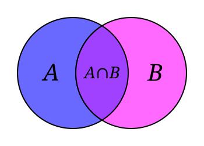
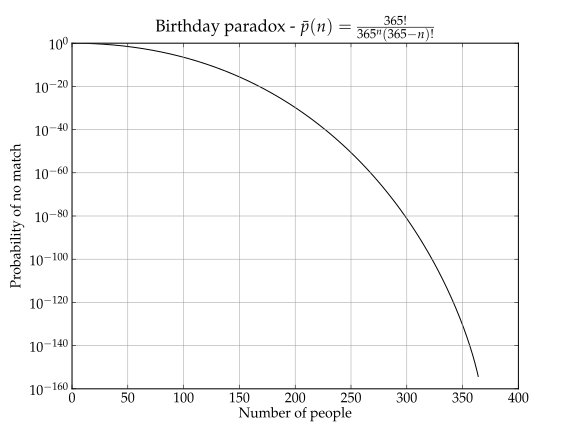

## Nguyên lý Bù trừ

**Toán Rời Rạc**

Tiết 19 (45 phút) — ch07 `07_03`

*Bài học: [Nguyên lý Bù trừ](https://nglelinh.github.io/discrete-mathematics-for-computer-science-iuh/contents/chapter07/21/01/01/Inclusion_Exclusion_Principle.html)*

---

## Mục tiêu tiết học

- Nắm công thức bù trừ cho **2, 3 và n tập**
- Hiểu **dạng bù**: đếm phần tử không vi phạm điều kiện
- Chứng minh ý tưởng: mỗi phần tử đếm đúng **1 lần**
- Áp dụng đếm, xác suất, kiểm tra mật khẩu
- Liên hệ truy vấn **OR** nhiều điều kiện trong CSDL

---

## Vấn đề: Đếm trùng

Khi cộng $$|A|+|B|$$, phần tử thuộc **cả A và B** bị đếm **2 lần**.

Ví dụ: 30 học Anh + 20 học Pháp = 50, nhưng 10 học cả hai → thực tế chỉ **40**.

---

## Nguyên lý bù trừ (IE)

Sửa sai có hệ thống:

**cộng** tập đơn → **trừ** giao đôi → **cộng** giao ba → …

**Nhịp dấu**: $$+ - + - \cdots$$

**Ứng dụng**: truy vấn `OR`, đếm user thỏa policy, mật khẩu có điều kiện.

---

## Công thức: 2 tập hợp

$$|A \cup B| = |A| + |B| - |A \cap B|$$

**Đọc công thức**: cộng hai tập, **trừ** phần đã đếm trùng (giao).

$$|A\cup B|$$ = số phần tử thuộc **ít nhất một** trong A, B.



*Hình 7.11 — Vùng giao bị tô 2 lần nếu chỉ cộng |A|+|B|.*

---

## Ví dụ: 2 tập hợp — Dữ liệu

Lớp **50** SV:

- $$A$$ = học Anh: $$|A|=30$$
- $$B$$ = học Pháp: $$|B|=20$$
- Giao $$A\cap B$$ = học **cả hai**: **10**

Hỏi: bao nhiêu SV học **ít nhất một** ngoại ngữ?

---

## Ví dụ: 2 tập — Sai nếu cộng thẳng

$$30+20=50$$ **sai** — 10 SV học cả hai bị đếm **2 lần**.

Phân vùng Venn:

- Chỉ Anh: $$30-10=20$$
- Chỉ Pháp: $$20-10=10$$
- Cả hai: **10**

---

## Ví dụ: 2 tập — Áp dụng công thức

$$|A\cup B| = 30+20-10 = 40$$

→ **40** SV học ít nhất một ngoại ngữ.

→ **10** SV không học ngoại ngữ nào ($$50-40$$).

---

## Công thức: 3 tập hợp

$$|A \cup B \cup C| = |A|+|B|+|C| -|A\cap B|-|A\cap C|-|B\cap C| +|A\cap B\cap C|$$

**Nhịp dấu**: $$+ - +$$

---

## Tại sao cộng lại giao ba?

Phần tử thuộc **cả 3** tập:

- Bước cộng đơn: đếm **3** lần
- Bước trừ đôi: trừ **3** lần → tạm = **0**
- Phải **cộng lại 1 lần** → đếm đúng **1** lần

---

## Hình minh họa 3 tập


*Hình 7.12 — Cộng đơn, trừ đôi, cộng ba.*

---

## Công thức "Chỉ biết đúng một"

$$\text{Chỉ }A = |A| - |A\cap B| - |A\cap C| + |A\cap B\cap C|$$

**Ý tưởng**: lấy $$|A|$$, bỏ người còn biết thêm B hoặc C.

Giao ba bị trừ **2 lần** → **cộng lại** 1 lần.

---

## Ví dụ khảo sát: Đặt tập

**90** nhân viên — kỹ năng DevOps:

- $$D$$ = biết Docker: **42**
- $$K$$ = biết K8s: **35**
- $$G$$ = biết Git: **28**

Hỏi: bao nhiêu người biết **đúng một** kỹ năng?

---

## Ví dụ khảo sát: Giao tập

Giao đôi (đọc từ bảng khảo sát):

- $$D\cap K=14$$, $$D\cap G=11$$, $$K\cap G=9$$
- $$D\cap K\cap G=4$$ (biết cả ba)

*Mẹo*: mỗi giao $$\leq$$ tập đơn tương ứng.

---

## Ví dụ khảo sát: Chỉ Docker

Biết Docker **và không** biết thêm K8s/Git:

$$|D| - |D\cap K| - |D\cap G| + |D\cap K\cap G|$$

$$= 42 - 14 - 11 + 4 = 21$$

*14+11* gồm cả 4 người biết cả ba → trừ thừa → **+4**.

---

## Ví dụ khảo sát: Chỉ K8s và Git

- Chỉ K8s: $$35-14-9+4=16$$
- Chỉ Git: $$28-11-9+4=12$$

**Tổng đúng một**: $$21+16+12=49$$

→ **41** người biết 0 hoặc $$\geq 2$$ kỹ năng ($$90-49$$).

---

## Ví dụ 3 tập: CLB — Dữ liệu

Lớp **80** SV, 3 CLB:

- $$A$$ = Lập trình: **35**
- $$B$$ = Toán: **30**
- $$C$$ = Robot: **25**

Giao: $$A\cap B=12$$, $$A\cap C=10$$, $$B\cap C=8$$; giao ba **5**.

---

## Ví dụ 3 tập: CLB — Từng bước

Cộng đơn: $$35+30+25=90$$

Trừ đôi: $$90-12-10-8=60$$

Cộng ba: $$60+5=65$$

→ **65** SV tham gia **ít nhất một** CLB.

---

## Ví dụ 3 tập: CLB — Kiểm tra

$$35+30+25-12-10-8+5=65$$ ✓

**15** SV không tham gia CLB nào: $$80-65$$.

*Lưu ý*: 65 là **hợp** (≥1 CLB), khác 49 ở ví dụ khảo sát (đúng 1 kỹ năng).

---

## Công thức tổng quát

$$\left|\bigcup_{i=1}^{n} A_i\right| = \sum_{\emptyset \neq I} (-1)^{|I|+1}\left|\bigcap_{i\in I} A_i\right|$$

**Nhịp dấu**: $$+ - + - + \cdots$$

---

## Chứng minh ý tưởng

Xét phần tử $$x$$ thuộc **đúng** $$r$$ tập (ví dụ $$r=2$$: chỉ A và B).

Trong công thức IE, $$x$$ xuất hiện ở mọi giao chứa nó.

---

## Chứng minh: Đếm đúng 1 lần

Phần tử thuộc đúng $$r$$ tập đóng góp:

$$\binom{r}{1}-\binom{r}{2}+\cdots+(-1)^{r+1}\binom{r}{r}=1$$

Vì $$(1-1)^{r}=\binom{r}{0}-\binom{r}{1}+\cdots=0$$ khi $$r\geq1$$.

→ Mỗi phần tử hợp được đếm **đúng 1 lần**.



*Hình 7.13 — Mỗi giao = phần bị đếm trùng.*

---

## Dạng bù: Đếm hợp lệ

$$A_i$$ = tập **vi phạm** điều kiện $$i$$:

$$\text{Hợp lệ} = |U| - \left|\bigcup_i A_i\right|$$

**Chiến lược**: đếm phần **bị loại** (vi phạm ≥1 điều kiện), rồi trừ khỏi tổng.

---

## Ví dụ dạng bù: Đặt bài

Đếm số từ **1 đến 100** **không** chia hết cho 2, 3 **hoặc** 5.

$$U=\{1,\ldots,100\}$$, $$|U|=100$$.

$$A_2$$ = chia hết cho 2; $$A_3$$, $$A_5$$ tương tự.

---

## Ví dụ dạng bù: Tập đơn

$$\lfloor 100/d \rfloor$$ = số chia hết cho $$d$$ trong $$1..100$$:

- $$|A_2|=\lfloor100/2\rfloor=50$$
- $$|A_3|=33$$, $$|A_5|=20$$

---

## Ví dụ dạng bù: Giao tập

Giao = chia hết cho **lcm** các mẫu số:

- $$|A_2\cap A_3|=\lfloor100/6\rfloor=16$$ (chia 6)
- $$|A_2\cap A_5|=10$$ (chia 10)
- $$|A_3\cap A_5|=6$$ (chia 15)
- $$|A_2\cap A_3\cap A_5|=3$$ (chia 30)

---

## Ví dụ dạng bù: Kết quả

Bị loại (chia hết cho ≥1 trong 2,3,5):

$$50+33+20-16-10-6+3=74$$

Hợp lệ: $$100-74=\mathbf{26}$$

---

## Ứng dụng CNTT

- Truy vấn `OR` nhiều điều kiện → bản ghi trùng
- Đếm mật khẩu thiếu loại ký tự → dạng **bù** hiệu quả hơn

---

## Code minh họa bù trừ

```python
# sizes[k] = tổng kích thước mọi giao của đúng k tập
def inclusion_exclusion(sizes):
    return sum(((-1)**(k+1))*v
               for k,v in sizes.items())

# Ví dụ 1..100 không chia 2,3,5:
# {1: 50+33+20, 2: 16+10+6, 3: 3} → 74 bị loại
```

---

## Bài tập 1: Ba CLB

80 SV, dữ liệu như slide CLB. Có bao nhiêu SV tham gia **ít nhất một** CLB?

*Gợi ý*: dùng công thức 3 tập — cộng đơn, trừ đôi, cộng ba.

---

## Đáp án — Bài tập 1

$$|A\cup B\cup C| = 35+30+25-12-10-8+5=65$$

→ **65** SV tham gia ≥1 CLB; **15** SV không tham gia CLB nào.

---

## Bài tập 2: Chuỗi nhị phân

Xâu nhị phân độ dài **8** có **ít nhất một** 0 **và** **ít nhất một** 1?

*Gợi ý*: dùng dạng bù — loại xâu **toàn 0** hoặc **toàn 1**.

---

## Đáp án — Bài tập 2

Tổng: $$2^{8}=256$$ xâu.

- Không có 0 → chỉ `11111111`: **1** xâu
- Không có 1 → chỉ `00000000`: **1** xâu

Hai tập **rời nhau** → không cần cộng giao.

$$256-1-1=254$$

---

## Bài tập 3: Chia hết

Số nguyên $$\leq 1000$$ chia hết cho **3 hoặc 5 hoặc 7**?

*Gợi ý*: $$|A_d|=\lfloor1000/d\rfloor$$; giao = chia hết cho tích các mẫu số.

---

## Đáp án — Bài tập 3: Tập đơn

$$|A_3|=\lfloor1000/3\rfloor=333$$

$$|A_5|=200$$, $$|A_7|=142$$

---

## Đáp án — Bài tập 3: Giao

- $$A_3\cap A_5$$: chia 15 → $$\lfloor1000/15\rfloor=66$$
- $$A_3\cap A_7$$: chia 21 → **47**
- $$A_5\cap A_7$$: chia 35 → **28**
- Giao ba: chia 105 → **9**

---

## Đáp án — Bài tập 3: Tổng

$$333+200+142-66-47-28+9=543$$

→ **543** số chia hết cho ít nhất một trong 3, 5, 7.

---

## Bài tập 4: Mật khẩu nhiều loại (xem thêm)

Bảng chữ **77** ký tự (10 số + 26 thường + 26 hoa + 15 đặc biệt). Mật khẩu dài $$n$$, **ít nhất 2** trong 4 loại:

$$\text{Hợp lệ} = 77^{n} - \text{(chỉ 1 loại)} - \text{(chỉ đúng 1 loại trong cặp)}$$

*(Chi tiết đầy đủ: bài `07_03` A.15; ứng dụng: tiết 22 — `07_06`)*

---

## Quy trình khảo sát $$n$$ kỹ năng

| Câu hỏi | Công thức |
|:---|:---|
| Biết **ít nhất 1** kỹ năng | $$|A\cup B\cup C|$$ (IE 3 tập) |
| Biết **đúng 1** kỹ năng | "Chỉ $$A$$" + "Chỉ $$B$$" + "Chỉ $$C$$" |
| **Không** biết kỹ năng nào | $$|U| - |A\cup B\cup C|$$ |

**Kiểm tra**: mỗi giao $$\leq$$ tập đơn; giao ba $$\leq$$ mọi giao đôi.

---

## Tóm tắt Tiết 19

- **2 tập**: $$|A\cup B|=|A|+|B|-|A\cap B|$$
- **3 tập**: cộng đơn, trừ đôi, **cộng** ba
- **Dạng bù**: hợp lệ = $$|U|$$ − vi phạm
- **Chứng minh**: $$(1-1)^{r}$$ → mỗi phần tử đếm 1 lần
- **Tiếp theo**: hệ số nhị thức (tiết 20 — `07_04`)

---

## Liên hệ chương trình

| Tiết | Bài | Nội dung |
|:---:|:---|:---|
| 16 | `07_01` | Cộng (tập rời) |
| **19** | `07_03` | Bù trừ (tập có giao) |
| 20 | `07_04` | Nhị thức, Pascal |
| 22 | `07_06` | Mật khẩu có điều kiện → bù trừ |

---

## Bù trừ và xác suất



*Hình 7.15 — Bù trừ cũng xuất hiện khi hợp nhiều biến cố.*
