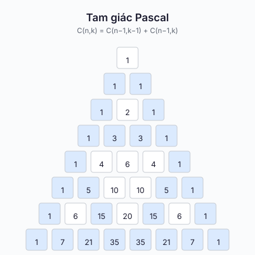
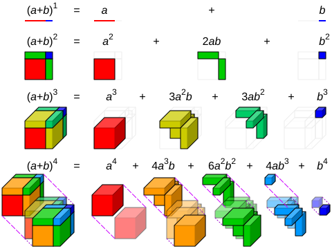
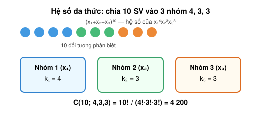

## Hệ số Nhị thức & Đồng nhất thức

**Toán Rời Rạc**

Tiết 20 (45 phút) — ch07 `07_04`

*Bài học: [Hệ số Nhị thức và Đồng nhất thức Tổ hợp](https://nglelinh.github.io/discrete-mathematics-for-computer-science-iuh/contents/chapter07/21/01/01/Binomial_Coefficients_and_Identities.html)*

---

## Mục tiêu tiết học

- Định nghĩa $$\binom{n}{k}$$ và ý nghĩa đếm
- Xây dựng **Tam giác Pascal**
- Chứng minh **Định lý nhị thức** bằng lập luận tổ hợp
- Nắm các **đồng nhất thức** quan trọng
- Đếm **đường đi** trên lưới vuông bằng $$\binom{n}{k}$$
- Áp dụng kiểm thử tổ hợp và xác suất

---

## Hệ số nhị thức

**Định nghĩa** ($$0 \leq k \leq n$$):

$$\binom{n}{k}=\frac{n!}{k!(n-k)!}$$

= số cách chọn $$k$$ phần tử từ $$n$$, không xét thứ tự.



*Hình 7.16 — $$\binom{n}{k}$$ là ô thứ $$k$$ trên hàng $$n$$ của tam giác Pascal.*

**Ví dụ**: $$\binom{10}{3}=120$$.

---

## Định lý Nhị thức Newton

$$(x+y)^{n}=\sum_{k=0}^{n}\binom{n}{k}x^{n-k}y^{k}$$

---

## Chứng minh nhị thức (đếm)

Nhân $$n$$ ngoặc $$(x+y)$$ — hạng $$x^{n-k}y^{k}$$:

chọn $$y$$ từ đúng $$k$$ ngoặc → $$\binom{n}{k}$$ cách.



*Hình 7.17 — Mỗi hạng = một cách chọn $$y$$.*

---

## Tìm hệ số — Công thức

Hệ số $$x^{a} y^{b}$$ trong $$(\alpha x + \beta y)^{n}$$ ($$a+b=n$$):

$$\binom{n}{b}\,\alpha^{a}\,\beta^{b}$$

---

## Ví dụ tìm hệ số

Hệ số $$x^{2}y^{4}$$ trong $$(3x+2y)^{6}$$:

$$\binom{6}{4}\cdot 3^{2}\cdot 2^{4} = 2160$$

---

## Ví dụ khai triển

$$(a+b)^{4}=a^{4}+4a^{3}b+6a^{2}b^{2}+4ab^{3}+b^{4}$$

---

## Tìm hệ số trong khai triển

Hệ số $$x^{3}y^{2}$$ trong $$(x+y)^{5}$$: $$\binom{5}{2}=10$$.

Hệ số $$x^{7}y^{3}$$ trong $$(x+y)^{10}$$: $$\binom{10}{3}=120$$.

---

## Tam giác Pascal — Bảng số (1/2)

```text
n=0:        1
n=1:       1 1
n=2:      1 2 1
```

---

## Đồng nhất thức Pascal

$$\binom{n}{k}=\binom{n-1}{k-1}+\binom{n-1}{k}$$

---

## Chứng minh Pascal

Chọn $$k$$ từ $$n$$ người, cố định tên **An**:

- Có An → $$\binom{n-1}{k-1}$$
- Không An → $$\binom{n-1}{k}$$

---


*Hình 7.19 — Mỗi ô = tổng hai ô phía trên: $$\binom{n}{k}=\binom{n-1}{k-1}+\binom{n-1}{k}$$.*

---

## Ví dụ: Đường đi trên lưới vuông

Từ **A** (góc dưới-trái) đến **B** (góc trên-phải) hình vuông $$n \times n$$ ô.

Chỉ được đi **phải** (R) hoặc **lên** (U) — không quay lại.

```text
  ●───●───● B
  │   │ ↗ │
  ●───●───●
  │↗  │   │
A ●───●───●
```

---

## Ví dụ lưới: Hình vuông 2×2

Cần đúng **2** bước R và **2** bước U → tổng **4** bước.

Mỗi đường đi = một xâu 4 ký tự có đúng 2 chữ R:

`RRUU`, `RURU`, `RUUR`, `URRU`, `URUR`, `UURR`

→ **6** đường đi.

Tổng quát hình vuông $$n \times n$$: $$\binom{2n}{n}$$; với $$n=2$$: $$\binom{4}{2}=6$$ ✓

---

## Ví dụ lưới: Công thức

Từ $$(0,0)$$ đến $$(a,b)$$ (lưới $$a \times b$$ ô, $$a,b \geq 0$$):

$$\#\text{đường} = \binom{a+b}{a} = \binom{a+b}{b}$$

**Chọn** vị trí đặt $$a$$ bước R trong $$a+b$$ bước.

---

## Ví dụ lưới: Liên hệ Pascal

Đặt $$N(i,j)$$ = số đường từ A đến ô $$(i,j)$$.

$$N(i,j) = N(i-1,j) + N(i,j-1)$$ — **cùng quy tắc** tam giác Pascal!

Bảng trên lưới 2×2:

```text
     j=0  j=1  j=2
i=0   1    1    1
i=1   1    2    3
i=2   1    3    6
```

$$N(2,2)=6=\binom{4}{2}$$ — góc B = hệ số nhị thức.

---

## Đồng nhất thức 1: Đối xứng

$$\binom{n}{k}=\binom{n}{n-k}$$

Chọn $$k$$ để **lấy** = chọn $$n-k$$ để **bỏ**.

**Ví dụ**: $$\binom{10}{3}=\binom{10}{7}=120$$.

---

## Đồng nhất thức 2: Tổng hàng

$$\sum_{k=0}^{n}\binom{n}{k}=2^{n}$$

---

## Chứng minh $$\sum \binom{n}{k}=2^{n}$$

- **Đại số**: $$(1+1)^{n}$$
- **Đếm**: mỗi phần tử thuộc hoặc không thuộc tập con

Biến thể: bỏ $$k=0$$ → $$2^{n}-1$$.

---

## Đồng nhất thức 3: Tổng xen kẽ

$$\sum_{k=0}^{n}(-1)^{k}\binom{n}{k}=0 \quad (n\geq1)$$

**Chứng minh**: $$(1-1)^{n}=0$$.

Ý nghĩa: số tập con có kích thước **chẵn** = số tập con có kích thước **lẻ**.

---

## Đồng nhất thức 4: Hockey Stick

$$\sum_{i=r}^{n}\binom{i}{r}=\binom{n+1}{r+1}$$

**Trực giác**: chọn $$r+1$$ từ $$\{1,\ldots,n+1\}$$, phần tử lớn nhất là $$i+1$$.

---

## Hệ số đa thức — Công thức

$$(x_1+\cdots+x_m)^{n} = \sum \binom{n}{k_1,\ldots,k_m} x_1^{k_1}\cdots x_m^{k_m}$$

$$\binom{n}{k_1,\ldots,k_m}=\frac{n!}{k_1!\cdots k_m!}, \quad \sum k_i = n$$

---

## Hệ số đa thức — Ý nghĩa

Chia $$n$$ vật vào $$m$$ nhóm có nhãn kích thước $$k_i$$.



*Hình 7.24 — Chia $$n$$ vật vào $$m$$ nhóm có nhãn.*

---

## Ví dụ Multinomial

Chia 10 SV vào 3 nhóm 4, 3, 3:

$$\binom{10}{4,3,3}=\frac{10!}{4!\cdot3!\cdot3!}=4{,}200$$

---

## Bài tập 1: Khai triển

Hệ số của $$x^{7}y^{3}$$ trong $$(x+y)^{10}$$?

---

## Đáp án — Bài tập 1

$$\binom{10}{3}=120$$

---

## Bài tập 2: Chứng minh

Chứng minh $$\binom{n}{1}+\cdots+\binom{n}{n}=2^{n}-1$$.

---

## Đáp án — Bài tập 2

Tổng hàng Pascal trừ $$k=0$$ (tập rỗng).

---

## Bài tập 3: Đường đi lưới

Từ góc dưới-trái đến góc trên-phải hình vuông **4×4** (chỉ R/U)?

---

## Đáp án — Bài tập 3

8 bước R + 8 bước U → $$\binom{16}{8}=12{,}870$$ đường.

---

## Bài tập 4: Vandermonde

5 SV CNTT + 4 SV Toán, chọn 3 người?

---

## Đáp án — Bài tập 4

$$\binom{5}{0}\binom{4}{3}+\binom{5}{1}\binom{4}{2}+\binom{5}{2}\binom{4}{1}+\binom{5}{3}\binom{4}{0}=84=\binom{9}{3}$$

---

## Tóm tắt Tiết 20

- $$\binom{n}{k}$$ = số cách chọn $$k$$ từ $$n$$
- **Lưới vuông** $$n \times n$$: $$N(n,n)=\binom{2n}{n}$$ đường (chỉ R/U)
- **Nhị thức**: $$(x+y)^{n}=\sum\binom{n}{k}x^{n-k}y^{k}$$
- **Pascal**: $$\binom{n}{k}=\binom{n-1}{k-1}+\binom{n-1}{k}$$
- **Đồng nhất thức**: đối xứng, $$2^{n}$$, xen kẽ, hockey stick, Vandermonde
- Chứng minh: **đại số** (thay giá trị) hoặc **đếm hai cách**

---

## Liên hệ chương trình

| Tiết | Bài | Nội dung |
|:---:|:---|:---|
| 17 | `07_02` | $$C(n,k)$$ cơ bản |
| **20** | `07_04` | Nhị thức, đồng nhất thức |
| 18 | `07_05` | Multinomial (tổng quát) |
| 22 | `07_06` | Ứng dụng bảo mật, kiểm thử |
