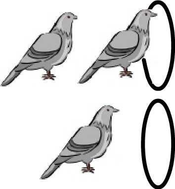
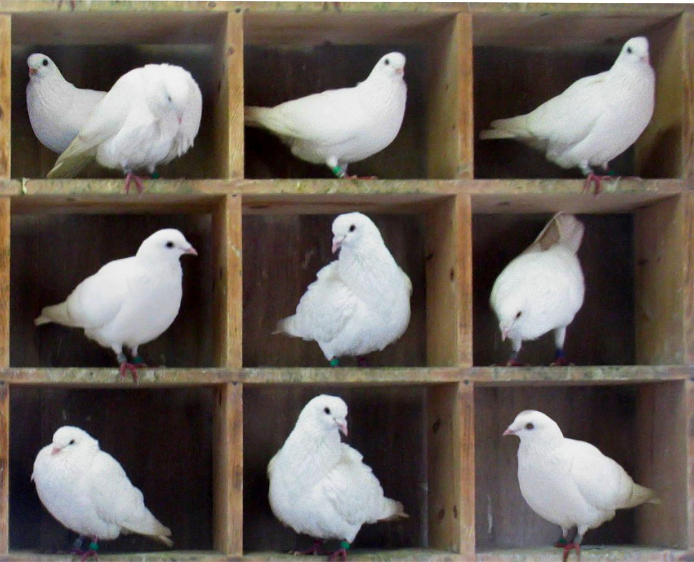
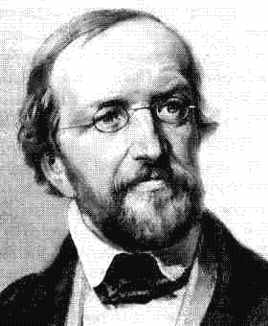
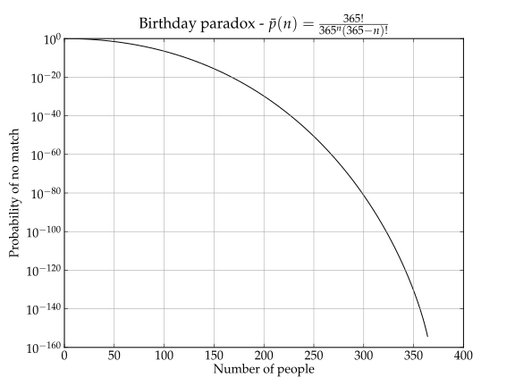

## Nguyên lý Dirichlet cơ bản

**Toán Rời Rạc**

Tiết 21 (45 phút) — ch08 `08_01`, `08_02`

*Bài học: [`08_01`](https://nglelinh.github.io/discrete-mathematics-for-computer-science-iuh/contents/chapter08/21/01/01/Pigeonhole_Principle_Basics.html) · [`08_02`](https://nglelinh.github.io/discrete-mathematics-for-computer-science-iuh/contents/chapter08/21/01/01/Advanced_Pigeonhole_Applications.html)*

---

## Mục tiêu tiết học

- Nắm phát biểu **cơ bản** và **tổng quát** nguyên lý Dirichlet
- Chứng minh bằng **phản chứng**
- Mô hình hóa: bồ câu / chuồng
- Giải ví dụ: sinh nhật (tháng/ngày), điểm số, tất
- Phân biệt **đảm bảo** (Dirichlet) và **xác suất** (birthday paradox)
- Liên hệ **hash collision** và load balancing

---

## Phát biểu cơ bản

**Nguyên lý chuồng bồ câu** (Pigeonhole / Dirichlet):

> $$n+1$$ bồ câu, $$n$$ chuồng → ít nhất **1** chuồng chứa **≥ 2** con.

**Dạng toán học**: $$N$$ đối tượng, $$n$$ nhóm, $$N > n$$ → tồn tại nhóm có ≥ 2.



*Hình 8.1 — Nhiều đối tượng hơn ngăn chứa.*

---

## Phát biểu tổng quát

$$N$$ đối tượng vào $$n$$ nhóm → ít nhất một nhóm chứa **≥ ⌈N/n⌉** đối tượng.

**Hệ quả**: $$N > n(k-1)$$ → có nhóm chứa **≥ k** đối tượng.



*Hình 8.2 — Phiên bản tổng quát.*

---

## Chứng minh (phản chứng)

**Cơ bản**: Giả sử mỗi chuồng ≤ 1 bồ câu → tổng ≤ $$n$$. Có $$n+1$$ bồ câu → mâu thuẫn. ∎

**Tổng quát**: Giả sử mọi nhóm < ⌈N/n⌉ → tổng < $$N$$ → mâu thuẫn. ∎

---

## Công thức 

**Phân phối đối tượng vào nhóm** ($$N$$ đối tượng, $$n$$ nhóm):

$$\left\lceil \frac{N}{n} \right\rceil$$

→ Ít nhất **một** nhóm chứa **tối thiểu** số đối tượng đó.

**Trình bày**: (1) Xác định bồ câu / chuồng · (2) Ghi công thức · (3) Tính · (4) Kết luận.

---

## Ví dụ: Phân tải server

**250** request → **11** server:

$$\lceil 250/11\rceil = 23$$

→ **Ít nhất một** server nhận **≥ 23** request.

---

## Ví dụ: Khung thời gian

**250** request trong **50** giây:

$$\lceil 250/50\rceil = 5$$

→ **Ít nhất một** giây nhận **≥ 5** request.

*(Chuồng = mốc thời gian, không cần cùng server.)*

---

## Ví dụ 1: Sinh nhật (tháng)

**13** học sinh → ít nhất **2** sinh cùng **tháng**.

- Bồ câu: 13 SV; Chuồng: 12 tháng
- $$13 > 12$$ ∎



*Hình 8.3 — Johann Dirichlet (1805–1859).*

---

## Ví dụ 2: Sinh nhật (ngày) — đảm bảo

**367** người → **chắc chắn** có ít nhất **2** người cùng **ngày sinh** (không tính năm).

$$367 > 366$$ (năm nhuận) ∎

Đây là kết luận **chắc chắn** (Dirichlet) — **không** phải xác suất.

---

## Ví dụ 3: Điểm kiểm tra

**11** bài, điểm 0–10 (11 mức):

- 11 bài: **có thể** mỗi bài một điểm khác
- **12** bài: **chắc chắn** có 2 bài cùng điểm

Bồ câu = bài kiểm tra; Chuồng = điểm số.

---

## Ví dụ 4: Tóc trên đầu

Hà Nội ~**8 triệu** người, tối đa ~**200.000** sợi tóc.

$$8{,}000{,}000 > 200{,}000$$ → ít nhất 2 người cùng số sợi tóc.

Minh họa: chuồng = số sợi tóc có thể, bồ câu = người.

---

## Ví dụ 5a: Tất cùng màu

10 đỏ + 15 xanh, chọn **16** tất:

$$16 > 2 \text{ màu}$$ → ít nhất **2** cùng màu.

---

## Ví dụ 5b: Găng tay đủ cặp

5 cặp (10 chiếc), chọn **6** chiếc:

$$6 > 5 \text{ cặp}$$ → ít nhất **1** cặp đủ.

---

## Kỹ thuật mô hình hóa

1. **Bồ câu**: đối tượng cần phân loại
2. **Chuồng**: nhóm / thuộc tính
3. **So sánh**: $$N$$ với $$n$$ hoặc $$n(k-1)$$
4. **Kết luận**: tồn tại nhóm thỏa tính chất

---

## Biến thể nâng cao

$$N > kn$$ → ít nhất một nhóm chứa **> k** đối tượng.

25 người, 12 tháng → ⌈25/12⌉ = **3** người cùng tháng.

---

## Dirichlet vs Birthday — Hai câu hỏi khác nhau

| | Dirichlet (đảm bảo) | Birthday paradox (xác suất) |
|:---|:---|:---|
| Câu hỏi | Khi nào **chắc chắn** trùng? | Khi nào xác suất trùng **~50%**? |
| Ngày sinh | **367** người | **~23** người |
| Hash ($$2^{b}$$) | $$2^{b} + 1$$ input | ~$$2^{b/2}$$ input |
| Kết luận | Tồn tại **chắc chắn** | Va chạm **rất có thể** sớm |

---

## Birthday Paradox — Ý tưởng

**Nghịch lý sinh nhật** (birthday paradox):

Với chỉ **23** người trong phòng, xác suất có **ít nhất 2** người **cùng ngày sinh** đã **> 50%**.

Trực giác thường đoán ~180 người — thực tế **nhỏ hơn rất nhiều**.

Lý do: đếm **cặp** $$(i,j)$$, không đếm “trùng với một mốc cố định”.

---

## Birthday Paradox — Đồ thị



*Hình 8.4 — Trục hoành: số người $$n$$ · Trục tung: xác suất có ít nhất một cặp cùng ngày sinh ($$d = 365$$). Đường cong tăng nhanh: ~23 người → ~50%, ~57 người → ~99%.*

---

## Đọc đồ thị (Hình 8.4)

- Đường cong **lõm rồi dốc** — xác suất tăng nhanh khi $$n$$ còn nhỏ
- Mốc quan trọng: $$n \approx 23$$ → $$P \approx 0{,}5$$; $$n \approx 57$$ → $$P \approx 0{,}99$$
- **Khác** Dirichlet: đến $$n = 366$$ vẫn **chưa chắc** trùng; $$n = 367$$ mới **đảm bảo**

---

## Birthday Paradox — Công thức

$$P(\text{có trùng}) = 1 - \frac{365!}{(365-n)! \cdot 365^{n}} \quad (n \le 365)$$

Xấp xỉ (khi $$n \ll 365$$):

$$P \approx 1 - e^{-n(n-1)/(2 \cdot 365)} \approx 1 - e^{-n^{2}/(2d)}, \quad d=365$$

Ngưỡng ~50%: $$n \approx 1{,}2\sqrt{d} \approx 23$$.

---

## Vì sao 23 mà đã ~50%?

Số **cặp** trong nhóm $$n$$ người:

$$\binom{n}{2} = \frac{n(n-1)}{2}$$

Với $$n=23$$: $$\binom{23}{2} = 253$$ cặp — mỗi cặp có xác suất $$1/365$$ trùng ngày.

Nhiều cặp độc lập “gần đúng” → xác suất **ít nhất một** cặp trùng tăng nhanh.

---

## So sánh hai “sinh nhật” trên slide

| Bài toán | Công cụ | Kết luận |
|:---|:---|:---|
| 13 SV → 2 cùng **tháng** | Dirichlet | **Chắc chắn** |
| 367 người → 2 cùng **ngày** | Dirichlet | **Chắc chắn** |
| 23 người → 2 cùng **ngày** | Birthday | **~50%** (không chắc) |

Đừng nhầm: *chắc chắn* ≠ *rất có thể*.

---

## Ứng dụng: Hash preview

Không gian hash $$N = 2^{b}$$ bucket:

- **Dirichlet**: $$N+1$$ khóa → collision **đảm bảo**
- **Birthday**: ~$$\sqrt{N} = 2^{b/2}$$ khóa → collision **~50%**

Đồ thị Hình 8.4 là cùng hiện tượng: “va chạm cặp” xảy ra sớm hơn trực giác.

*(Chi tiết birthday attack, MD5: tiết 22 — `08_03`.)*

---

## Hash Table — Code (Dirichlet)

```python
def hash_collision_guarantee(keys, buckets):
    if keys > buckets:
        return math.ceil(keys / buckets)
```

*1001 keys, 1000 buckets → collision **chắc chắn** (không phải ~50%).*

---

## Load Balancing

$$N$$ tác vụ, $$n$$ server → server bận nhất nhận ≥ **⌈N/n⌉** tác vụ.

```python
def load_balancing(tasks, servers):
    return math.ceil(tasks / servers)
```

Phân phối: $$(n-r)$$ server nhận $$\lfloor N/n\rfloor$$, $$r$$ server nhận thêm 1.

---

## Bài tập thực hành 1

1. **367** người → 2 người cùng ngày sinh? *(Dirichlet hay birthday?)*
2. **23** người → xác suất 2 người cùng ngày sinh ~? *(không cần tính chi tiết)*
3. **5** điểm trong hình vuông 2×2 → 2 điểm cách ≤ $$\sqrt{2}$$? *(chia 4 ô 1×1)*
4. **11** số nguyên → 2 số cùng chữ số cuối?

---

## Đáp án — Bài tập thực hành 1

(1) **Dirichlet**: $$367 > 366$$ → **chắc chắn** trùng ngày sinh.

(2) **Birthday paradox**: $$P \approx 50\%$$ (đồ thị Hình 8.4) — **không** đảm bảo.

(3) 5 điểm, 4 ô 1×1 → ≥ 2 điểm cùng ô → khoảng cách ≤ $$\sqrt{2}$$.

(4) Cần **11** số (10 chuồng chữ số cuối 0–9).

---

## Bài tập thực hành 2

1. **6** người → 3 quen nhau hoặc 3 không quen? *(Ramsey)*
2. **51** số từ 1–100 → 2 số, một chia hết cho số kia?
3. Hash **1000** bucket → bao nhiêu key đảm bảo ≥ **5** key/bucket?

---

## Đáp án — Bài tập thực hành 2

(1) $$R(3,3)=6$$ → đúng với 6 người.

(2) 51 số trong [1,100] → có cặp $$(a,b)$$ với $$a \mid b$$.

(3) $$N > 4 \times 1000$$ → cần **4001** keys.

---

## Checklist Dirichlet & Birthday

1. **Bồ câu** = đối tượng cần phân loại (request, file, SV…)
2. **Chuồng** = nhóm / ô / mốc thời gian
3. Ghi $$\lceil N/n\rceil$$ khi cần cận **đảm bảo**
4. Câu “khi nào ~50% trùng?” → birthday ($$\sim\sqrt{d}$$), **không** dùng $$d+1$$
5. Đọc đồ thị: $$n$$ nhỏ đã $$P$$ lớn — khác ngưỡng Dirichlet

---

## Tóm tắt Tiết 21

- **Cơ bản**: $$n+1$$ vào $$n$$ chuồng → ≥ 2 trong một chuồng
- **Tổng quát**: $$N$$ vào $$n$$ nhóm → ≥ ⌈N/n⌉
- **Birthday**: ~23 người → $$P>50\%$$; đồ thị $$P(n)$$ tăng nhanh
- **CNTT**: hash — đảm bảo (Dirichlet) vs sớm (birthday ~$$\sqrt{N}$$)
- **Tiếp theo**: birthday attack, nén, parity (tiết 22 — `08_03`)

---

## Liên hệ chương trình

| Tiết | Bài | Nội dung |
|:---:|:---|:---|
| 16 | `07_01` | Chuồng bồ câu cơ bản (trong bài cộng/nhân) |
| **21** | `08_01`, `08_02` | Dirichlet + birthday paradox (đồ thị) |
| 22 | `08_03` | Hash attack, nén, parity, Ramsey trong CS |
