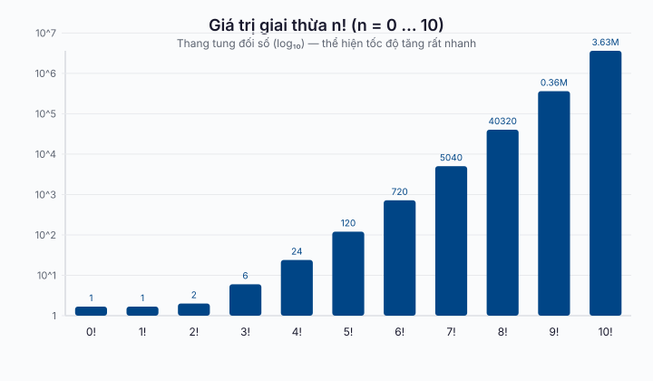
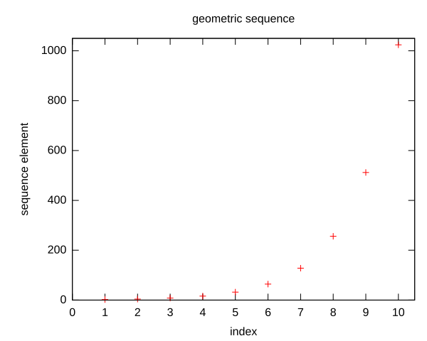

## Hệ thức Truy hồi — Giới thiệu

**Toán Rời Rạc**

Tiết 24 (45 phút) — ch10 `10_01`

*Bài học: [Giới thiệu Quan hệ Truy hồi](https://nglelinh.github.io/discrete-mathematics-for-computer-science-iuh/contents/chapter10/21/01/01/Introduction_to_Recurrence_Relations.html)*

---

## Mục tiêu tiết học

- Định nghĩa **hệ thức truy hồi (HTTH)**, **bậc**, **điều kiện đầu**
- **Phân loại**: tuyến tính / phi tuyến, thuần nhất / không thuần nhất
- Nhận biết ví dụ: **Fibonacci**, **giai thừa**, **Hà Nội**
- **Mô hình hóa** bài toán thực tế (3 bước)
- Tính vài số hạng đầu / đoán mẫu — **chưa** giải đặc trưng

**Viết tắt**: **HTTH** = **H**ệ **t**hức **t**ruy **h**ồi.

---

## Phạm vi tiết 24 vs tiết sau

| Tiết | Việc làm |
|:---:|:---|
| **24** | Định nghĩa, phân loại, **thiết lập** HTTH |
| **25** | Giải TT **thuần nhất** (phương trình đặc trưng, Binet) |
| **26** | Giải **không thuần nhất** ($$+f(n)$$, nghiệm riêng) |
| **27** | Ứng dụng thuật toán (Hanoi chi tiết, Master Theorem) |

---

## Định nghĩa

**Hệ thức truy hồi** — **HTTH** (recurrence relation):

phương trình biểu diễn số hạng thứ $$n$$ qua **các số hạng trước**.

$$a_n = f(a_{n-1}, a_{n-2}, \ldots, a_{n-k}, n)$$

| Thành phần | Ý nghĩa |
|:---|:---|
| $$a_n$$ | số hạng cần tính |
| $$k$$ | **bậc** (order) |
| $$a_0,\ldots,a_{k-1}$$ | **điều kiện đầu** |

---

## Vì sao cần điều kiện đầu?

HTTH chỉ cho **cách nhảy** — không cố định điểm xuất phát.

- Cùng $$a_n = a_{n-1} + a_{n-2}$$ nhưng $$(0,1)$$ vs $$(1,1)$$ → dãy **khác**
- Thiếu điều kiện đầu → **vô số** dãy thỏa cùng quan hệ

Bậc $$k$$ cần **đúng** $$k$$ điều kiện đầu.

---

## Ví dụ: Fibonacci

**Bài toán thỏ** (Fibonacci, 1202): đôi thỏ trưởng thành (2 tháng) sinh thêm một đôi mỗi tháng.

$$F_n = F_{n-1} + F_{n-2}, \quad F_1 = 1,\ F_2 = 1$$

**Dãy**: 1, 1, 2, 3, 5, 8, 13, 21, …

**Phân loại**: TT, thuần nhất, bậc 2, hệ số hằng.

*(Công thức đóng / Binet → tiết 25.)*

---

## Fibonacci — Phân tích & hình

| Tháng | Ý nghĩa | $$F_n$$ |
|:---:|:---|:---:|
| 1 | đôi ban đầu | 1 |
| 2 | chưa đẻ | 1 |
| $$n$$ | còn tháng $$n-1$$ + con mới (= tháng $$n-2$$) | $$F_{n-1}+F_{n-2}$$ |

*Hình 10.1 — Quan hệ $$F_n = F_{n-1}+F_{n-2}$$.*

---

## Giai thừa

$$n! = n \cdot (n-1)!, \quad 0! = 1$$

**Dãy**: 1, 1, 2, 6, 24, 120, …

| | |
|:---|:---|
| Bậc | 1 |
| Tuyến tính | Có ($$a_n = c(n)\,a_{n-1}$$) |
| Hệ số | **Biến** theo $$n$$ (không hằng) |

---

## Tháp Hà Nội — Thiết lập

$$n$$ đĩa, 3 cọc; 1 đĩa/lần; không đặt lớn lên nhỏ.

$$H_n = 2H_{n-1} + 1, \quad H_1 = 1$$

1. Chuyển $$n-1$$ → phụ: $$H_{n-1}$$
2. Đĩa lớn nhất: **1**
3. Chuyển $$n-1$$ → đích: $$H_{n-1}$$

**Phân loại**: TT, **không** thuần nhất (có $$+1$$), bậc 1.

*(Giải đóng + chứng minh chi tiết → tiết 26–27.)*

---

## Tháp Hà Nội — Hình & vài số hạng

*Hình 10.2*

Tính tay: $$H_1=1,\ H_2=3,\ H_3=7,\ H_4=15$$ → đoán $$H_n = 2^{n}-1$$.

---

## Phân loại — Ba trục

| Trục | Có / Thuận | Không / Đối |
|:---|:---|:---|
| **Tuyến tính** | tổng $$c_i a_{n-i}$$ | tích, lũy thừa, căn |
| **Thuần nhất** | không $$f(n)$$ | có $$+f(n)$$ |
| **Hệ số** | hằng | phụ thuộc $$n$$ |

**Bậc** ≠ **tuyến tính**: bậc cao vẫn có thể TT; bậc 1 vẫn có thể phi tuyến.

---

## Bảng ví dụ phân loại

| HTTH | Phân loại |
|:---|:---|
| $$F_n = F_{n-1}+F_{n-2}$$ | TT, thuần nhất, bậc 2 |
| $$H_n = 2H_{n-1}+1$$ | TT, **không** thuần nhất, bậc 1 |
| $$a_n = 3a_{n-1}-2a_{n-2}$$ | TT, thuần nhất, bậc 2 |
| $$a_n = a_{n-1}\cdot a_{n-2}$$ | **Phi** tuyến, bậc 2 |
| $$a_n = a_{n-1}^{2}+1$$ | **Phi** tuyến, bậc 1 |

---

## Phân loại — Từ giáo trình (slide gốc)

| HTTH | Kết luận |
|:---|:---|
| $$f_n=4f_{n-1}+f_{n-2}$$ | **Linear** |
| $$f_n=3f_{n-1}+2f_{n-2}+n$$ | **Linear** (+$$f(n)$$) |
| $$f_n=3(f_{n-1})^{2}+2f_{n-2}+n$$ | **Non-linear** |
| $$f_n=2f_{n-1}\cdot f_{n-2}+n$$ | **Non-linear** |
| $$f_n=n\cdot f_{n-2}+n$$ | **Non-linear*** |

\*Hệ số phụ thuộc $$n$$ — không giải bằng đặc trưng “hệ số hằng”.

---

## Mô hình 1: Lãi kép

Gửi 10 triệu, lãi 0.5%/tháng, lãi nhập gốc.

$$a_n = 1.005\, a_{n-1}, \quad a_0 = 10^{7}$$

→ TT, thuần nhất, bậc 1.

**Dạng đặc biệt** (cấp số nhân): $$a_n = 10^{7}\cdot(1.005)^{n}$$

*Hình 10.4 — $$a_n = r\, a_{n-1}$$.*

---

## Mô hình 2: Xâu không có 00

Đếm xâu nhị phân độ dài $$n$$ **không** hai bit 0 liên tiếp.

- Cuối **1** → $$a_{n-1}$$ xâu đầu hợp lệ
- Cuối **0** → kề phải là 1 → $$a_{n-2}$$

$$a_n = a_{n-1} + a_{n-2}, \quad a_1 = 2,\ a_2 = 3$$

*(Cùng dạng Fibonacci — giải đóng: tiết 25.)*

---

## Mô hình 3: Leo cầu thang

$$n$$ bậc; mỗi bước 1 hoặc 2 bậc.

$$a_n = a_{n-1} + a_{n-2}, \quad a_1 = 1,\ a_2 = 2$$

**Dãy**: 1, 2, 3, 5, 8, … (Fibonacci lệch chỉ số).

**Nhiệm vụ tiết 24**: **thiết lập** đúng — chưa cần Binet.

---

## Trường hợp đơn giản: bậc 1 thuần nhất

$$a_n = c \cdot a_{n-1}, \quad a_0 = A \quad\Rightarrow\quad a_n = A\cdot c^{n}$$

**Chứng minh** (quy nạp ngắn): $$a_n = c\cdot A c^{n-1} = A c^{n}$$.

**Ví dụ**: user gấp đôi mỗi tháng: $$u_n = 2u_{n-1}$$, $$u_1=1000$$ → $$u_n = 1000\cdot 2^{n-1}$$.

*(Bậc ≥ 2 thuần nhất → tiết 25.)*

---

## Không thuần nhất — chỉ nhận dạng

$$a_n = c\cdot a_{n-1} + f(n)$$

Ví dụ: Hà Nội $$H_n = 2H_{n-1}+1$$; ngân hàng rút tiền: $$a_n = 1.007 a_{n-1}-3$$.

| Tiết 24 | Tiết 26 |
|:---|:---|
| Nhận “có $$+f(n)$$” | Nghiệm riêng, cộng hưởng |
| Tính vài số hạng / đoán mẫu | Công thức đóng đầy đủ |

---

## Thực hành 1 — Thiết lập

Gốc 50 triệu, lãi 0.7%/tháng, rút 3 triệu/tháng.

Viết $$a_n$$ và $$a_0$$. Phân loại (TT? thuần nhất? bậc?).

---

## Đáp án — Thực hành 1

$$a_n = 1.007\, a_{n-1} - 3, \quad a_0 = 50$$

→ TT, **không** thuần nhất, bậc 1.

*(Chưa giải đóng — tiết 26.)*

---

## Thực hành 2 — Phân loại

a) $$a_n = 3a_{n-1}-2a_{n-2}$$  
b) $$a_n = a_{n-1}^{2}+1$$  
c) $$a_n = 2a_{n-1}+n^{2}$$  
d) $$a_n = a_{n-1}\cdot a_{n-2}+a_{n-3}$$

---

## Đáp án — Thực hành 2

| | TT? | Thuần nhất? | Bậc |
|:---:|:---:|:---:|:---:|
| a | Có | Có | 2 |
| b | Không | Không | 1 |
| c | Có | Không | 1 |
| d | Không | — | 3 |

---

## Thực hành 3 — Liệt kê

$$a_n = 2a_{n-1}+1$$, $$a_0=1$$. Tính 5 số hạng đầu. Đoán công thức?

---

## Đáp án — Thực hành 3

1, 3, 7, 15, 31 → đoán $$a_n = 2^{n+1}-1$$ (hoặc $$2\cdot 2^{n}-1$$).

Kiểm tra quy nạp / giải formal → tiết 26.

---

## Tóm tắt Tiết 24

- **HTTH** (hệ thức truy hồi) = quy tắc + **điều kiện đầu**
- Phân loại: TT / phi TT, thuần nhất / không, bậc
- Mô hình hóa **3 bước**
- Bậc 1 thuần nhất: $$a_n = A c^{n}$$
- **Tiết 25**: đặc trưng · **26**: $$+f(n)$$ · **27**: thuật toán

---

## Liên hệ chương trình

| Tiết | Nội dung |
|:---:|:---|
| **24** | Định nghĩa, phân loại, mô hình hóa |
| 25 | Giải TT thuần nhất (đặc trưng, Fibonacci/Binet) |
| 26 | Không thuần nhất |
| 27 | Hanoi, Master Theorem, DP |

---

## Bài tập ôn tập

1. Leo $$n$$ bậc (bước 1 hoặc 2): HTTH + ĐKĐ.
2. Phân loại **5 dòng** bảng “từ giáo trình”.
3. User 1000 tháng 1, gấp đôi mỗi tháng: $$u_n$$, $$u_{12}$$.
4. $$H_1\ldots H_4$$ (Hà Nội). Vì sao **chưa** cần đặc trưng?

---

## Gợi ý đáp án

1. $$a_n=a_{n-1}+a_{n-2}$$, $$a_1=1,a_2=2$$  
2. L / L(+n) / NL / NL / NL (hệ số $$n$$)  
3. $$u_n=2u_{n-1}$$, $$u_1=1000$$ → $$u_{12}=2{,}048{,}000$$  
4. 1, 3, 7, 15 — liệt kê đủ intro; đóng $$2^{n}-1$$ → tiết 26
