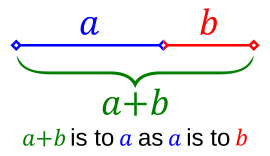
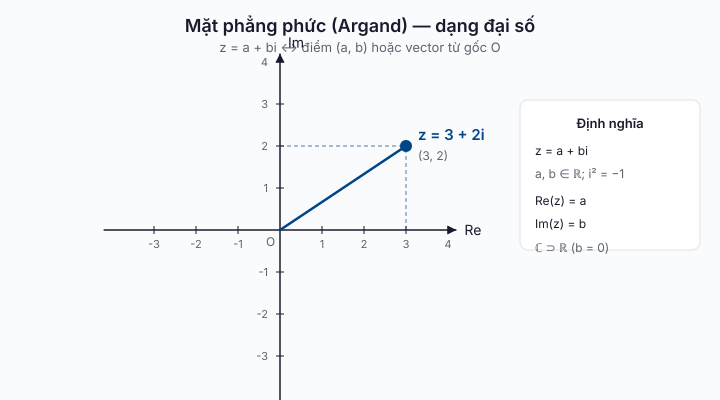

## Giải Hệ thức Truy hồi Tuyến tính Thuần nhất bậc cao

**Toán Rời Rạc**

Tiết 25 (45 phút) — ch10 `10_02`

*Bài học: [Giải Quan hệ Truy hồi Tuyến tính](https://nglelinh.github.io/discrete-mathematics-for-computer-science-iuh/contents/chapter10/21/01/01/Solving_Linear_Recurrence_Relations.html)*

---

## Mục tiêu tiết học

- Giải HTTH dạng $$a_n = c_1 a_{n-1} + \cdots + c_k a_{n-k}$$
- Xây dựng **phương trình đặc trưng**
- Nhắc **số phức** và các **cách biểu diễn** (đại số, hình học, cực)
- Xử lý **nghiệm phân biệt**, **nghiệm kép**, **nghiệm phức**

---

## Nhắc lại

**Tuyến tính + thuần nhất**

$$a_n = c_1 a_{n-1} + \cdots + c_k a_{n-k}, \quad c_k \neq 0$$

- Cần $$k$$ **điều kiện đầu**
- Không có $$f(n)$$ bên ngoài

---

##  Ví dụ: $$F_n = F_{n-1}+F_{n-2}$$ 
(bậc 2, $$c_1=c_2=1$$).

---

## Ý tưởng: nghiệm dạng $$r^{n}$$

Giả sử dãy “nhân lặp” → thử $$a_n = r^{n}$$ ($$r \neq 0$$).

Thay vào bậc 2: $$a_n = c_1 a_{n-1} + c_2 a_{n-2}$$

$$r^{n} = c_1 r^{n-1} + c_2 r^{n-2}$$

Chia $$r^{n-2}$$:

$$r^{2} - c_1 r - c_2 = 0$$

→ **Phương trình đặc trưng**

---

## Phương trình đặc trưng — Hình

* Đặc trưng $$r^{k} - c_1 r^{k-1} - \cdots - c_k = 0$$ quyết định cấu trúc nghiệm.*

**Trực giác**: tỉ số $$a_n/a_{n-1}$$ ổn định ≈ $$r$$ → nghiệm mũ $$r^{n}$$ là ứng viên tự nhiên.

---

## Quy trình giải (bậc 2)

1. Viết đặc trưng: $$r^{2} - c_1 r - c_2 = 0$$
2. Tìm nghiệm $$r_1, r_2$$
3. Viết dạng nghiệm tổng quát (phân biệt / kép / phức)
4. Dùng **điều kiện đầu** → hệ phương trình cho hệ số
5. **Kiểm tra** vài số hạng đầu

---

## Nghiệm phân biệt (bậc 2)

Nếu $$r_1 \neq r_2$$:

$$a_n = \alpha r_1^{n} + \beta r_2^{n}$$

$$\alpha, \beta$$ từ điều kiện đầu (hệ 2 ẩn).

---

## Ví dụ: nghiệm phân biệt (1/2)

$$a_n = 5a_{n-1} - 6a_{n-2}, \quad a_0=2,\ a_1=5$$

Đặc trưng:

$$r^{2} - 5r + 6 = (r-2)(r-3) = 0$$

→ $$r_1=2,\ r_2=3$$

$$a_n = \alpha\, 2^{n} + \beta\, 3^{n}$$

---

## Ví dụ: nghiệm phân biệt (2/2)

$$a_0=2$$: $$\alpha + \beta = 2$$  
$$a_1=5$$: $$2\alpha + 3\beta = 5$$

→ $$\alpha=1,\ \beta=1$$

$$a_n = 2^{n} + 3^{n}$$

**Kiểm tra**: $$a_2 = 4+9=13$$; $$5\cdot 5 - 6\cdot 2 = 13$$ ✓

---

## Nghiệm kép

Nếu $$r_1 = r_2 = r$$ (nghiệm bội 2):

$$a_n = (\alpha + \beta n)\, r^{n}$$

**Tổng quát**: bội $$m$$ →

$$r^{n},\ nr^{n},\ n^{2} r^{n},\ \ldots,\ n^{m-1} r^{n}$$

---

## Ví dụ: nghiệm kép

$$a_n = 4a_{n-1} - 4a_{n-2}, \quad a_0=1,\ a_1=4$$

Đặc trưng: $$r^{2} - 4r + 4 = (r-2)^{2} = 0$$

$$a_n = (\alpha + \beta n)\, 2^{n}$$

$$a_0=1$$: $$\alpha = 1$$  
$$a_1=4$$: $$(\alpha+\beta)\cdot 2 = 4 \Rightarrow \alpha+\beta=2 \Rightarrow \beta=1$$

$$a_n = (1+n)\, 2^{n}$$

---

## Ví dụ kép (giáo trình): $$r=1$$

$$X_n = 2X_{n-1} - X_{n-2},\quad X_0=1,\ X_1=3$$

Đặc trưng: $$r^{2}-2r+1=(r-1)^{2}=0$$

**Sai**: $$X_n=A\cdot 1^{n}+B\cdot 1^{n}=A+B$$ (hằng)  
→ mâu thuẫn $$X_0\neq X_1$$.

**Đúng**: $$X_n = A_1 + A_2 n$$

$$A_1=1$$, $$A_1+A_2=3\Rightarrow A_2=2$$

$$\boxed{X_n = 1 + 2n}$$
(dãy lẻ: 1, 3, 5, 7, …)

---

## Fibonacci: đặc trưng

$$F_n = F_{n-1} + F_{n-2}, \quad F_0=0,\ F_1=1$$

$$r^{2} - r - 1 = 0 \Rightarrow r = \frac{1 \pm \sqrt{5}}{2}$$

Đặt:

$$\varphi = \frac{1+\sqrt{5}}{2},\quad \hat\varphi = \frac{1-\sqrt{5}}{2}$$

$$F_n = \alpha \varphi^{n} + \beta \hat\varphi^{n}$$

---

## Fibonacci: xác định hệ số

$$F_0=0$$: $$\alpha + \beta = 0$$ → $$\beta = -\alpha$$

$$F_1=1$$: $$\alpha\varphi + \beta\hat\varphi = 1$$

$$\alpha(\varphi - \hat\varphi) = 1,\quad \varphi - \hat\varphi = \sqrt{5}$$

→ $$\alpha = 1/\sqrt{5}$$, $$\beta = -1/\sqrt{5}$$

---

## Công thức Binet

$$F_n = \frac{\varphi^{n} - \hat\varphi^{n}}{\sqrt{5}}$$

**Kiểm tra**: $$F_5 = 5$$ ✓ · $$F_n$$ luôn **nguyên** dù công thức có $$\sqrt{5}$$.

**Tăng trưởng**: $$|\hat\varphi| < 1$$ → $$F_n \sim \varphi^{n} / \sqrt{5}$$

**Tỷ lệ vàng**: $$\lim_{n\to\infty} F_{n+1}/F_n = \varphi$$

---

## Tỷ lệ vàng — Hình

---

*Hình 10.8 — $$\varphi = (1+\sqrt{5})/2 \approx 1.618$$ là nghiệm dương của $$r^{2}-r-1=0$$.*

---

## Số phức

Khi $$\Delta < 0$$, nghiệm đặc trưng **không nằm trên trục thực**.

Muốn viết $$r^{n}$$ và dạng **thực** của dãy, cần:

1. **Số phức** là gì?
2. **Biểu diễn** thế nào? (đại số · mặt phẳng · cực)
3. **Lũy thừa** $$r^{n}$$ → **De Moivre** → sin / cos

---

## Số phức — Định nghĩa

**Số phức** (complex number) $$z \in \mathbb{C}$$:

$$z = a + bi,\qquad a,b \in \mathbb{R},\quad i^{2} = -1$$

| Ký hiệu | Ý nghĩa |
|:---|:---|
| $$a = \operatorname{Re}(z)$$ | **phần thực** (real part) |
| $$b = \operatorname{Im}(z)$$ | **phần ảo** (imaginary part) |
| $$i$$ | đơn vị ảo: $$i^{2}=-1$$ |

- $$b = 0$$ → $$z$$ là số **thực** ($$\mathbb{R} \subset \mathbb{C}$$)
- $$a = 0$$, $$b \neq 0$$ → **thuần ảo**

---

## Ví dụ nhanh

| $$z$$ | $$\operatorname{Re}$$ | $$\operatorname{Im}$$ |
|:---|:---:|:---:|
| $$3+2i$$ | 3 | 2 |
| $$-1$$ | $$-1$$ | 0 |
| $$i$$ | 0 | 1 |
| $$1-i$$ | 1 | $$-1$$ |

**Hai số bằng nhau** iff phần thực **và** phần ảo bằng nhau:

$$a+bi = c+di \iff a=c\ \text{và}\ b=d$$

---

## Liên hợp phức

**Liên hợp** (conjugate) của $$z = a + bi$$:

$$\bar z = a - bi$$

Tính chất hay dùng:

- $$z + \bar z = 2a$$ (thực)
- $$z - \bar z = 2bi$$ (thuần ảo)
- $$z \cdot \bar z = a^{2} + b^{2}$$ (thực, $$\ge 0$$)
- $$\overline{z_1 z_2} = \bar z_1\, \bar z_2$$

**CS / HTTH**: hệ số thực ⇒ nghiệm phức đi **cặp liên hợp**.

---

## Ba cách biểu diễn

| Dạng | Công thức | Khi dùng |
|:---|:---|:---|
| **Đại số** | $$z = a + bi$$ | cộng, trừ, so sánh |
| **Hình học** | điểm $$(a,b)$$ / vector | trực giác, khoảng cách |
| **Cực (polar)** | $$z = \rho(\cos\theta + i\sin\theta)$$ | **nhân, lũy thừa** $$z^{n}$$ |

Dạng mũ (Euler): $$z = \rho e^{i\theta}$$ — gọn, cùng ý với cực.

---

## Dạng đại số — Phép toán

Với $$z_1 = a+bi$$, $$z_2 = c+di$$:

**Cộng / trừ** (theo tọa độ):

$$z_1 \pm z_2 = (a\pm c) + (b\pm d)i$$

**Nhân**:

$$z_1 z_2 = (ac - bd) + (ad + bc)i$$

**Chia** (nhân liên hợp mẫu):

$$\frac{z_1}{z_2} = \frac{z_1 \bar z_2}{|z_2|^{2}},\quad z_2 \neq 0$$

---

## Biểu diễn hình học — Mặt phẳng phức

Mỗi $$z = a + bi$$ ↔ **một điểm** $$(a,b)$$ trên mặt phẳng (Argand):

- Trục ngang: **Re** (phần thực)
- Trục đứng: **Im** (phần ảo)
- Gốc $$O$$: số $$0$$
- Vector $$\overrightarrow{Oz}$$: hướng + độ dài của $$z$$

---

---

## Modulus (mô-đun) và argument

Với $$z = a + bi$$:

**Mô-đun** (modulus / absolute value):

$$|z| = \rho = \sqrt{a^{2} + b^{2}}$$

= khoảng cách từ $$O$$ tới điểm $$(a,b)$$.

**Argument** (đối số, góc):

$$\theta = \operatorname{arg}(z)$$

= góc từ trục Re dương tới vector $$\overrightarrow{Oz}$$ (thường lấy trong $$(-\pi,\pi]$$).

---

## Tính chất modulus

- $$|z| \ge 0$$; $$|z| = 0 \iff z = 0$$
- $$|\bar z| = |z|$$
- $$|z_1 z_2| = |z_1|\,|z_2|$$
- $$|z^{n}| = |z|^{n}$$
- Bất đẳng thức tam giác: $$|z_1 + z_2| \le |z_1| + |z_2|$$

---

## Dạng cực (polar)

Nếu $$\rho = |z|$$, $$\theta = \operatorname{arg}(z)$$:

$$z = \rho \bigl(\cos\theta + i\sin\theta\bigr)$$

Chuyển đổi:

| Chiều | Công thức |
|:---|:---|
| Đại số → cực | $$\rho=\sqrt{a^{2}+b^{2}}$$, $$\theta=\arctan\left(\frac{b}{a}\right)$$ ($$a>0$$) |
| Cực → đại số | $$a = \rho\cos\theta$$, $$b = \rho\sin\theta$$ |

Liên hợp: $$\bar z = \rho\bigl(\cos\theta - i\sin\theta\bigr)$$ (cùng $$\rho$$, góc $$-\theta$$).

---

## Dạng mũ (Euler)

Công thức Euler:

$$e^{i\theta} = \cos\theta + i\sin\theta$$

⇒ dạng cực gọn:

$$z = \rho e^{i\theta}$$

Nhân / lũy thừa **rất tiện**:

$$z_1 z_2 = \rho_1\rho_2\, e^{i(\theta_1+\theta_2)}$$

$$z^{n} = \rho^{n}\, e^{in\theta}$$

(cùng ý De Moivre bên dưới.)

---

## Ví dụ: chuyển đổi dạng

$$z = 1 + i$$

1. $$\rho = \sqrt{1^{2}+1^{2}} = \sqrt{2}$$
2. $$\theta = \arctan\left(\frac{1}{1}\right) = \arctan(1) = \frac{\pi}{4}$$
3. Cực: $$z = \sqrt{2}\bigl(\cos\tfrac{\pi}{4} + i\sin\tfrac{\pi}{4}\bigr)$$
4. Mũ: $$z = \sqrt{2}\, e^{i\pi/4}$$

Kiểm tra lại: $$\sqrt{2}\cdot \tfrac{\sqrt{2}}{2} + i\sqrt{2}\cdot\tfrac{\sqrt{2}}{2} = 1+i$$ ✓

---

## Ví dụ: $$z = -1$$, $$z = i$$, $$z = -i$$

| $$z$$ | $$\rho$$ | $$\theta$$ | Dạng cực |
|:---|:---:|:---:|:---|
| $$-1$$ | 1 | $$\pi$$ | $$\cos\pi + i\sin\pi$$ |
| $$i$$ | 1 | $$\pi/2$$ | $$\cos\tfrac{\pi}{2}+i\sin\tfrac{\pi}{2}$$ |
| $$-i$$ | 1 | $$-\pi/2$$ | $$\cos(-\tfrac{\pi}{2})+i\sin(-\tfrac{\pi}{2})$$ |

Các điểm này nằm trên **đường tròn đơn vị** $$\rho = 1$$.

---

## Định lý De Moivre

Nếu $$z = \rho(\cos\theta + i\sin\theta)$$ thì với $$n \in \mathbb{Z}$$:

$$z^{n} = \rho^{n}\bigl(\cos n\theta + i\sin n\theta\bigr)$$

**Đọc**:

- Bán kính: $$\rho \mapsto \rho^{n}$$
- Góc: $$\theta \mapsto n\theta$$

---

## De Moivre — Tại sao quan trọng với HTTH?

Nghiệm đặc trưng phức $$r = \rho e^{i\theta}$$:

$$r^{n} = \rho^{n} e^{in\theta} = \rho^{n}\bigl(\cos n\theta + i\sin n\theta\bigr)$$

---

## Câu hỏi cần trả lời

Từ

$$a_n = C\, r^{n} + \bar C\, \bar r^{n}$$

làm sao ra

$$a_n = \rho^{n}(A\cos n\theta + B\sin n\theta)\ ?$$

Vì sao đáp án cuối **không còn** $$i$$?

---

## Ý chính (5 ý)

1. Nghiệm phức đi **cặp** $$r$$ và $$\bar r$$
2. $$a_n$$ thực **⇒ chứng minh** $$D=\bar C$$ (bắt buộc)
3. $$r^{n}$$ viết bằng **cos / sin** (De Moivre)
4. Cộng liên hợp → phần ảo **hủy**
5. Làm bài: **bỏ** $$C$$, viết thẳng sin–cos, tìm $$A,B$$

---

## Bước 1 — Khung nghiệm

Hai nghiệm phân biệt $$r,\bar r$$:

$$a_n = C\, r^{n} + D\, \bar r^{n}$$

Giống $$\alpha r_1^{n}+\beta r_2^{n}$$ (nghiệm thực),
chỉ khác: $$r$$ **phức**.

---

## Bước 2 — Không được giả định $$D=\bar C$$

Nghiệm tổng quát:

$$a_n = C\, r^{n} + D\, \bar r^{n}$$

$$C,D\in\mathbb{C}$$ **chưa biết**.

Ta **chưa** được phép viết $$D=\bar C$$.
Đó không phải lựa chọn — phải **chứng minh**.

---

## Vì $$a_n$$ thực

Hệ số HTTH thực + điều kiện đầu thực
⇒ mọi $$a_n$$ **thực**.

Số thực $$z$$ thỏa $$z=\bar z$$. Vậy

$$a_n = \overline{a_n}\qquad (\forall n).$$

---

## Lấy liên hợp hai vế

Từ $$a_n = C r^{n} + D\, \bar r^{n}$$:

$$
\overline{a_n}
= \overline{C}\, \bar r^{n} + \overline{D}\, r^{n}
$$

(dùng $$\overline{zw}=\bar z\,\bar w$$,
$$\overline{r^{n}}=\bar r^{n}$$,
$$\overline{\bar r^{n}}=r^{n}$$).

---

## Hai biểu thức bằng nhau

Vì $$a_n=\overline{a_n}$$:

$$
C r^{n} + D\, \bar r^{n}
=
\overline{D}\, r^{n} + \overline{C}\, \bar r^{n}
$$

Đưa về 0:

$$
(C-\overline{D})\, r^{n}
+
(D-\overline{C})\, \bar r^{n}
= 0
\quad (\forall n).
$$

---

## Độc lập tuyến tính

Vì $$r\neq\bar r$$ (nghiệm không thuần thực),

hai dãy $$r^{n}$$ và $$\bar r^{n}$$ **độc lập tuyến tính**.

⇒ mỗi hệ số phải bằng 0:

$$C-\overline{D}=0,\qquad D-\overline{C}=0$$

---

## Kết luận bắt buộc

$$
C=\overline{D},\qquad D=\overline{C}
$$

(hai đẳng thức tương đương).

Vậy

$$
\boxed{D=\overline{C}}
$$

**không phải giả định** — là **hệ quả** của $$a_n$$ thực.

---

## Đủ và cần

**Cần:** $$a_n$$ thực ⇒ $$D=\bar C$$ (vừa chứng minh).

**Đủ:** nếu $$D=\bar C$$, đặt $$w=Cr^{n}$$:

$$a_n=w+\bar w=2\operatorname{Re}(w)\in\mathbb{R}.$$

⇒ dạng dãy thực:

$$a_n = C r^{n} + \bar C\, \bar r^{n}.$$

---

## Bước 3 — Ví dụ số: $$r=i$$

Truy hồi $$a_n=-a_{n-2}$$: $$r=\pm i$$

$$\rho=1,\quad \theta=\pi/2$$

$$i^{n}=\cos\frac{n\pi}{2}+i\sin\frac{n\pi}{2}$$

$$(-i)^{n}=\cos\frac{n\pi}{2}-i\sin\frac{n\pi}{2}$$

---

## Ví dụ số — chọn $$C=\frac12$$

$$
a_n
=\frac12 i^{n}+\frac12(-i)^{n}
$$

$$
=\frac12\Bigl(
\cos\frac{n\pi}{2}+i\sin\frac{n\pi}{2}
+\cos\frac{n\pi}{2}-i\sin\frac{n\pi}{2}
\Bigr)
$$

$$+i\sin$$ và $$-i\sin$$ **hủy nhau**

$$a_n=\cos\frac{n\pi}{2}$$

---

## Ví dụ số — đối chiếu

$$\cos\frac{n\pi}{2}
=1^{n}\Bigl(
1\cdot\cos\frac{n\pi}{2}
+0\cdot\sin\frac{n\pi}{2}
\Bigr)$$

⇒ $$A=1$$, $$B=0$$

**Không còn $$i$$** trong đáp án.
Dãy: $$1,0,-1,0,1,\ldots$$

---

## Bước 4 — Tổng quát: $$C=p+qi$$

$$C=p+qi,\quad \bar C=p-qi\quad (p,q\in\mathbb{R})$$

$$
a_n=\rho^{n}\Big[
(p+qi)(\cos n\theta+i\sin n\theta)
+(p-qi)(\cos n\theta-i\sin n\theta)
\Big]
$$

---

## Nhân từng ngoặc

Ngoặc 1:

$$(p\cos n\theta-q\sin n\theta)+i(p\sin n\theta+q\cos n\theta)$$

Ngoặc 2:

$$(p\cos n\theta-q\sin n\theta)-i(p\sin n\theta+q\cos n\theta)$$

**Cộng:** ảo hủy; thực **nhân đôi**

---

## Kết quả

$$a_n=\rho^{n}\cdot 2(p\cos n\theta-q\sin n\theta)$$

Đặt $$A=2p$$, $$B=-2q$$:

$$
\boxed{a_n=\rho^{n}(A\cos n\theta+B\sin n\theta)}
$$

$$A,B\in\mathbb{R}$$ — đúng 2 hằng số tự do.

---

## Bảng chuyển đổi

| Phức (trung gian) | Thực (dùng) |
|:---|:---|
| $$r,\bar r$$ | $$\rho$$, $$\theta$$ |
| $$C=p+qi$$ | $$A,B$$ |
| $$Cr^{n}+\bar C\,\bar r^{n}$$ | $$\rho^{n}(A\cos+B\sin)$$ |
| phần ảo | **biến mất** |

---

## Làm bài: bỏ qua $$C$$

1. Tìm $$r=\alpha\pm i\beta$$
2. Tính $$\rho$$, $$\theta$$
3. Viết **thẳng**
   $$a_n=\rho^{n}(A\cos n\theta+B\sin n\theta)$$
4. $$n=0,1$$ → giải $$A,B$$
5. Kiểm tra bằng truy hồi

Số phức chỉ ở bước 1–2.

---

## Nghiệm phức — Khi nào xuất hiện?

Với HTTH **hệ số thực**, đặc trưng bậc 2:

$$r^{2} - c_1 r - c_2 = 0$$

Nếu $$\Delta = c_1^{2} + 4c_2 < 0$$ → hai nghiệm **phức liên hợp**:

$$r,\ \bar r = \alpha \pm i\beta \quad (\beta \neq 0)$$

**Không** lấy chỉ $$r^{n}$$ phức rồi “bỏ qua” phần ảo — dãy thực cần dạng **thực** bên dưới.

---

## Vì sao luôn cặp liên hợp?

Hệ số $$c_i$$ **thực** ⇒ đa thức đặc trưng hệ số thực.

Nếu $$r$$ là nghiệm phức thì $$\bar r$$ cũng là nghiệm.

→ Trong không gian nghiệm, $$r^{n}$$ và $$\bar r^{n}$$ đi **cặp**.

---

## Nhắc lại (sau khi đã dẫn ra)

Đã thấy bằng ví dụ số + khai triển $$C=p+qi$$:

$$C r^{n} + \bar C\, \bar r^{n}
=\rho^{n}(A\cos n\theta + B\sin n\theta)$$

**Làm bài**: bỏ $$C$$; viết thẳng dạng thực.

---

## Dạng nghiệm phức (tóm tắt)

$$a_n = \rho^{n} \bigl(A\cos n\theta + B\sin n\theta\bigr)$$

1. $$r=\alpha\pm i\beta$$ → $$\rho,\theta$$
2. Viết dạng sin–cos
3. $$A,B$$ từ $$a_0,a_1$$

---

## Ví dụ 1: $$a_n = -a_{n-2}$$

$$a_n + a_{n-2} = 0,\quad a_0 = 1,\ a_1 = 0$$

Đặc trưng: $$r^{2} + 1 = 0 \Rightarrow r = \pm i$$

$$\rho = 1,\quad \theta = \pi/2$$

$$a_n = 1^{n}\bigl(A\cos\tfrac{n\pi}{2} + B\sin\tfrac{n\pi}{2}\bigr)$$

---

## Ví dụ 1 — Hệ số & dãy

$$a_0=1$$: $$A = 1$$  
$$a_1=0$$: $$A\cdot 0 + B\cdot 1 = 0 \Rightarrow B = 0$$

$$a_n = \cos\frac{n\pi}{2}$$

| $$n$$ | 0 | 1 | 2 | 3 | 4 | 5 | … |
|:---:|:---:|:---:|:---:|:---:|:---:|:---:|:---:|
| $$a_n$$ | 1 | 0 | −1 | 0 | 1 | 0 | … |

**Chu kỳ 4** — khớp trực tiếp từ truy hồi.

---

## Ví dụ 2: $$a_n = 2a_{n-1} - 2a_{n-2}$$

$$a_0 = 1,\ a_1 = 2$$

Đặc trưng: $$r^{2} - 2r + 2 = 0$$

$$\Delta = 4 - 8 = -4 < 0$$

$$r = 1 \pm i$$

$$\rho = \sqrt{1^{2}+1^{2}} = \sqrt{2},\quad \theta = \pi/4$$

$$a_n = (\sqrt{2})^{n}\bigl(A\cos\tfrac{n\pi}{4} + B\sin\tfrac{n\pi}{4}\bigr)$$

---

## Ví dụ 2 — Điều kiện đầu

$$a_0=1$$: $$A = 1$$

$$a_1=2$$: $$\sqrt{2}\bigl(A\cos\tfrac{\pi}{4} + B\sin\tfrac{\pi}{4}\bigr) = 2$$

$$\sqrt{2}\cdot \tfrac{\sqrt{2}}{2}(A+B) = 2 \Rightarrow A+B = 2$$

$$B = 1$$ (vì $$A=1$$)

$$a_n = (\sqrt{2})^{n}\Bigl(\cos\tfrac{n\pi}{4} + \sin\tfrac{n\pi}{4}\Bigr)$$

Kiểm tra: $$a_2 = 2\cdot 2 - 2\cdot 1 = 2$$; công thức: $$2\bigl(0+1\bigr)=2$$ ✓

---

## Ví dụ 3: $$a_n = -a_{n-1} - a_{n-2}$$

$$a_0 = 2,\ a_1 = -1$$

Đặc trưng: $$r^{2} + r + 1 = 0$$

$$\Delta = 1-4 = -3 < 0$$

$$r = \frac{-1 \pm i\sqrt{3}}{2}$$

Đây là **căn bậc 3 của đơn vị** (khác 1): $$\rho = 1$$, $$\theta = 2\pi/3$$.

$$a_n = A\cos\tfrac{2n\pi}{3} + B\sin\tfrac{2n\pi}{3}$$

---

## Ví dụ 3 — Hệ số & dãy

$$a_0=2$$: $$A = 2$$

$$a_1=-1$$: $$A\cos\tfrac{2\pi}{3} + B\sin\tfrac{2\pi}{3} = -1$$

$$2\cdot\bigl(-\tfrac12\bigr) + B\cdot\tfrac{\sqrt{3}}{2} = -1$$

$$-1 + B\tfrac{\sqrt{3}}{2} = -1 \Rightarrow B = 0$$

$$a_n = 2\cos\frac{2n\pi}{3}$$

| $$n$$ | 0 | 1 | 2 | 3 | 4 | 5 |
|:---:|:---:|:---:|:---:|:---:|:---:|:---:|
| $$a_n$$ | 2 | −1 | −1 | 2 | −1 | −1 |

**Chu kỳ 3** (vì $$\rho=1$$, $$\theta=2\pi/3$$).

---

## Ví dụ 4: $$a_n = 4a_{n-1} - 5a_{n-2}$$

**Giáo trình**: $$X_0=1$$, $$X_1=2$$  
(biến thể lớp: $$a_1=1$$ → $$B=-1$$)

Đặc trưng: $$r^{2}-4r+5=0$$ → $$r=2\pm i$$

$$\rho=\sqrt{5},\quad \theta=\arctan\tfrac12$$

$$X_n=(\sqrt{5})^{n}\bigl(A\cos n\theta + B\sin n\theta\bigr)$$

---

## Ví dụ 4 — Điều kiện đầu ($$X_1=2$$)

$$X_0=1\Rightarrow A=1$$

$$\cos\theta=2/\sqrt{5}$$, $$\sin\theta=1/\sqrt{5}$$

$$X_1=2$$:
$$\sqrt{5}\bigl(A\cos\theta+B\sin\theta\bigr)=2$$

$$\sqrt{5}\bigl(\tfrac{2}{\sqrt{5}}+B\tfrac{1}{\sqrt{5}}\bigr)=2
\Rightarrow 2+B=2\Rightarrow B=0$$

$$\boxed{X_n=(\sqrt{5})^{n}\cos\bigl(n\arctan\tfrac12\bigr)}$$

$$\rho>1$$ → biên độ **phình**.

---

## Ví dụ 4b — Nếu $$a_1=1$$

Cùng $$r=2\pm i$$, $$a_0=1$$, $$a_1=1$$:

$$B=-1$$

$$a_n=(\sqrt{5})^{n}\bigl(\cos n\theta - \sin n\theta\bigr)$$

*(So sánh nhanh với $$B=0$$ khi $$a_1=2$$.)*

---

## Ví dụ 5: dao động tắt ($$\rho<1$$)

$$a_n = a_{n-1} - \tfrac12 a_{n-2},\quad a_0=1,\ a_1=0$$

Đặc trưng: $$r^{2} - r + \tfrac12 = 0$$

$$\Delta = 1-2 = -1$$ → $$r = \tfrac12 \pm i\tfrac12$$

$$\rho = \sqrt{\tfrac14+\tfrac14} = \tfrac{\sqrt{2}}{2} < 1,\quad
\theta = \pi/4$$

$$a_n = \Bigl(\tfrac{\sqrt{2}}{2}\Bigr)^{n}
\bigl(A\cos\tfrac{n\pi}{4} + B\sin\tfrac{n\pi}{4}\bigr)$$

---

## Ví dụ 5 — Hệ số

$$a_0=1$$: $$A=1$$

$$a_1=0$$: $$\tfrac{\sqrt{2}}{2}\bigl(A\cos\tfrac{\pi}{4}+B\sin\tfrac{\pi}{4}\bigr)=0$$

$$\tfrac{\sqrt{2}}{2}\cdot\tfrac{\sqrt{2}}{2}(A+B)=0 \Rightarrow A+B=0 \Rightarrow B=-1$$

$$a_n = \Bigl(\tfrac{\sqrt{2}}{2}\Bigr)^{n}
\Bigl(\cos\tfrac{n\pi}{4} - \sin\tfrac{n\pi}{4}\Bigr)$$

Khi $$n\to\infty$$: $$a_n \to 0$$ (tắt dần).

---

## So sánh ba trường hợp (bậc 2)

| $$\Delta$$ | Nghiệm | Dạng $$a_n$$ |
|:---:|:---|:---|
| $$>0$$ | $$r_1 \neq r_2$$ thực | $$\alpha r_1^{n}+\beta r_2^{n}$$ |
| $$=0$$ | $$r$$ kép | $$(\alpha+\beta n)r^{n}$$ |
| $$<0$$ | $$\rho e^{\pm i\theta}$$ | $$\rho^{n}(A\cos n\theta+B\sin n\theta)$$ |

---

## Bậc cao hơn

$$a_n = c_1 a_{n-1} + \cdots + c_k a_{n-k}$$

Đặc trưng:

$$r^{k} - c_1 r^{k-1} - c_2 r^{k-2} - \cdots - c_k = 0$$

- Mỗi $$r_i$$ bội $$m_i$$ → $$\alpha_0 r_i^{n} + \alpha_1 n r_i^{n} + \cdots + \alpha_{m_i-1} n^{m_i-1} r_i^{n}$$
- Không gian nghiệm **$$k$$ chiều**

**Ví dụ**: Tribonacci $$a_n = a_{n-1}+a_{n-2}+a_{n-3}$$ → đặc trưng bậc 3.

---

## Chứng minh ý tưởng (sketch)

1. Mỗi $$r_i^{n}$$ (và $$n^{j} r_i^{n}$$ nếu bội) **thỏa** HTTH khi $$r_i$$ là nghiệm đặc trưng.
2. Các thành phần này **độc lập tuyến tính**.
3. Không gian nghiệm bậc $$k$$ có chiều $$k$$ → tổ hợp tuyến tính = nghiệm **tổng quát**.

**Edge case**: đặc trưng có nghiệm 0 — hiếm (thường $$c_k\neq 0$$ giữ bậc đúng).

---

## Đáp án — Thực hành 1

$$r^{2} - 3r + 2 = (r-1)(r-2)=0$$ → $$r=1,2$$

$$a_n = \alpha \cdot 1^{n} + \beta \cdot 2^{n} = \alpha + \beta\, 2^{n}$$

$$a_0=1$$: $$\alpha+\beta=1$$  
$$a_1=4$$: $$\alpha+2\beta=4$$ → $$\beta=3$$, $$\alpha=-2$$

$$a_n = -2 + 3\cdot 2^{n}$$

$$a_5 = -2 + 3\cdot 32 = 94$$

---

## Thực hành 2

Giải $$a_n = 6a_{n-1} - 9a_{n-2}$$, $$a_0=1$$, $$a_1=6$$.

*(Nghiệm kép $$r=3$$)*

---

## Đáp án — Thực hành 2

$$r^{2} - 6r + 9 = (r-3)^{2}=0$$

$$a_n = (\alpha + \beta n)\, 3^{n}$$

$$a_0=1$$: $$\alpha=1$$  
$$a_1=6$$: $$(\alpha+\beta)\cdot 3 = 6 \Rightarrow \alpha+\beta=2 \Rightarrow \beta=1$$

$$a_n = (1+n)\, 3^{n}$$

---

## Thực hành 3 — Binet

Dùng Binet (hoặc $$\varphi^{n}/\sqrt{5}$$): $$F_{20}$$ có lớn hơn $$10^{4}$$ không?

---

## Đáp án — Thực hành 3

$$\varphi^{20}/\sqrt{5} \approx 1.618^{20}/2.236$$

$$1.618^{10}\approx 122$$, $$1.618^{20}\approx 15127$$ → $$/\sqrt{5} \approx 6765$$

$$F_{20} = 6765 < 10^{4}$$; $$F_{21}=10946 > 10^{4}$$.

---

## Thực hành 4 — Nghiệm phức (chu kỳ)

Giải $$a_n = -a_{n-2}$$, $$a_0 = 0$$, $$a_1 = 1$$.

Viết dạng $$\rho^{n}(A\cos n\theta + B\sin n\theta)$$ và 6 số hạng đầu.

---

## Đáp án — Thực hành 4

$$r^{2}+1=0$$ → $$r=\pm i$$, $$\rho=1$$, $$\theta=\pi/2$$

$$a_n = A\cos\tfrac{n\pi}{2} + B\sin\tfrac{n\pi}{2}$$

$$a_0=0\Rightarrow A=0$$; $$a_1=1\Rightarrow B=1$$

$$a_n = \sin\tfrac{n\pi}{2}$$

Dãy: 0, 1, 0, −1, 0, 1, … (chu kỳ 4).

---

## Thực hành 5 — Nghiệm phức (chu kỳ 3)

Giải $$a_n = -a_{n-1} - a_{n-2}$$, $$a_0 = 1$$, $$a_1 = 0$$.

Tìm $$\rho$$, $$\theta$$, $$A$$, $$B$$ và $$a_2,a_3$$.

---

## Đáp án — Thực hành 5

$$r^{2}+r+1=0$$ → $$\rho=1$$, $$\theta=2\pi/3$$

$$a_n = A\cos\tfrac{2n\pi}{3} + B\sin\tfrac{2n\pi}{3}$$

$$A=1$$; $$a_1=0$$: $$\cos\tfrac{2\pi}{3}+B\sin\tfrac{2\pi}{3}=0$$

$$-\tfrac12 + B\tfrac{\sqrt{3}}{2}=0 \Rightarrow B=\tfrac{1}{\sqrt{3}}$$

$$a_2 = -a_1-a_0 = -1$$; $$a_3 = -a_2-a_1 = 1$$ (chu kỳ 3: 1, 0, −1, 1, …).

---

## Thực hành 6 — Dao động tắt

Với $$a_n = a_{n-1}-\frac12 a_{n-2}$$, $$a_0=1,a_1=0$$ (ví dụ 5):

Tại sao $$a_n\to 0$$? Ước lượng $$|a_{10}|$$ (cận thô).

---

## Đáp án — Thực hành 6

$$\rho = \sqrt{2}/2 \approx 0.707 < 1$$ → nhân $$\rho^{n}\to 0$$.

$$|a_n| \le (\sqrt{2}/2)^{n}\cdot\sqrt{2}$$ (vì $$|\cos-\sin|\le\sqrt{2}$$)

$$|a_{10}| \le (\sqrt{2}/2)^{10}\cdot\sqrt{2} = 2^{-5}\sqrt{2} = \sqrt{2}/32 \approx 0.044$$.

---

## Checklist giải HTTH

1. Xác nhận: TT + thuần nhất + hệ số hằng?
2. Viết đặc trưng đúng dấu ($$r^{k} - c_1 r^{k-1} - \cdots$$)
3. Phân biệt / kép / **phức** ($$\Delta$$) → chọn dạng nghiệm
4. Phức: $$a+bi$$ → $$\rho=|r|$$, $$\theta=\arg(r)$$ (cực / De Moivre)
5. Viết $$a_n=\rho^{n}(A\cos n\theta+B\sin n\theta)$$; $$A,B$$ từ điều kiện đầu
6. Kiểm tra $$a_0,a_1$$ (và một số hạng tiếp)

---

## Tóm tắt Tiết 25

- **Đặc trưng**: $$r^{k} - c_1 r^{k-1} - \cdots - c_k = 0$$
- **Phân biệt**: $$a_n = \sum \alpha_i r_i^{n}$$ · **Kép**: $$(\alpha+\beta n)r^{n}$$
- **Số phức**: $$a+bi$$ · mặt phẳng · $$\rho e^{i\theta}$$ · De Moivre
- **Phức (HTTH)**: $$a_n = \rho^{n}(A\cos n\theta + B\sin n\theta)$$
- **Fibonacci**: Binet · asymptotic ~$$r_{\max}^{n}$$

---

## Liên hệ

| Chủ đề | Liên hệ |
|:---|:---|
| Quy nạp | Chứng minh công thức đóng đúng |
| Số phức / De Moivre | Biểu diễn $$r^{n}$$ → dạng sin–cos |
| Big-O | $$|r_{\max}|^{n}$$ (hoặc $$\rho^{n}$$) chi phối |
| Tín hiệu / ổn định | $$\rho \lessgtr 1$$ |

---

## Bài tập ôn tập (1/2)

1. Dạng cực + mũ: $$z=-1+i\sqrt{3}$$.
2. De Moivre: $$(1+i)^{4}$$.
3. Giải $$a_n=2a_{n-1}+3a_{n-2}$$, $$a_0=1,a_1=2$$.
4. **Kép (giáo trình)**: $$X_n=2X_{n-1}-X_{n-2}$$, $$X_0=1,X_1=3$$.

---

## Bài tập ôn tập (2/2)

5. Kép: $$a_n=4a_{n-1}-4a_{n-2}$$, $$a_0=1,a_1=4$$.
6. **Phức (giáo trình)**: $$X_n=4X_{n-1}-5X_{n-2}$$, $$X_0=1,X_1=2$$.
7. **Thách thức**: Tribonacci — đặc trưng bậc 3; vì sao 3 ĐKĐ?

---

## Gợi ý đáp án nhanh

1. $$\rho=2$$, $$\theta=2\pi/3$$  
2. $$-4$$  
3. $$a_n=\frac34 3^{n}+\frac14(-1)^{n}$$  
4. $$X_n=1+2n$$  
5. $$a_n=(1+n)2^{n}$$  
6. $$X_n=(\sqrt{5})^{n}\cos(n\arctan\frac12)$$  
7. $$r^{3}-r^{2}-r-1=0$$; bậc 3 → 3 ĐKĐ
