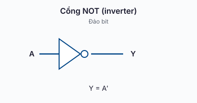
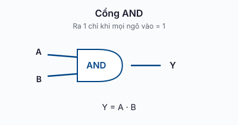
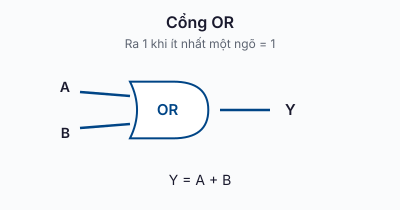
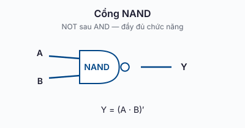
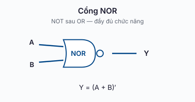
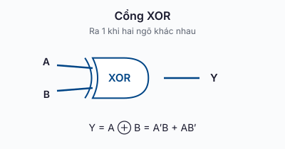
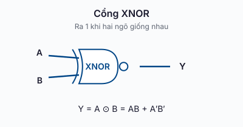

## Cổng logic & Tối thiểu hóa đại số

**Toán Rời Rạc** · Chương 13 · Bài 13.3

Tiết 32 (45 phút)

---

## Mục tiêu tiết học

- Nhận biết **bảy cổng** + bảng chân trị
- XOR / XNOR / NAND / NOR bằng công thức
- **Rút gọn đại số**: hấp thụ, De Morgan, đồng nhất
- NAND / NOR **đầy đủ chức năng** (công thức)
- Thiết kế mạch → **tiết 35 / bài 13.6**

---

## Cổng logic là gì?

**Cổng** = khối 0/1 → 0/1 theo **bảng chân trị**

Ba phép cơ bản:

| Phép | Cổng |
|:---|:---|
| OR $$+$$ | OR |
| AND $$\cdot$$ | AND |
| NOT $$'$$ | NOT |

$$1+1=1$$ (logic, không phải số)

---

## NOT

$$Y=A'$$

| $$A$$ | $$Y$$ |
|:---:|:---:|
| 0 | 1 |
| 1 | 0 |

---

## AND

Ra **1** khi **mọi** ngõ = **1**

| $$A$$ | $$B$$ | $$AB$$ |
|:---:|:---:|:---:|
| 0 | 0 | 0 |
| 0 | 1 | 0 |
| 1 | 0 | 0 |
| 1 | 1 | 1 |

---

## OR

Ra **1** khi **≥ 1** ngõ = **1**

| $$A$$ | $$B$$ | $$A+B$$ |
|:---:|:---:|:---:|
| 0 | 0 | 0 |
| 0 | 1 | 1 |
| 1 | 0 | 1 |
| 1 | 1 | 1 |

---

## NAND và NOR

| | Định nghĩa |
|:---|:---|
| NAND | $$(AB)'$$ |
| NOR | $$(A+B)'$$ |

---

## XOR và XNOR

| | Ra **1** khi… | Công thức |
|:---|:---|:---|
| XOR | **khác** | $$A'B+AB'$$ |
| XNOR | **giống** | $$AB+A'B'$$ |

---

## Bảng tóm tắt (1)

| Cổng | 00 | 01 | 10 | 11 |
|:---|:---:|:---:|:---:|:---:|
| AND | 0 | 0 | 0 | 1 |
| OR | 0 | 1 | 1 | 1 |
| NAND | 1 | 1 | 1 | 0 |

---

## Bảng tóm tắt (2)

| Cổng | 00 | 01 | 10 | 11 |
|:---|:---:|:---:|:---:|:---:|
| NOR | 1 | 0 | 0 | 0 |
| XOR | 0 | 1 | 1 | 0 |
| XNOR | 1 | 0 | 0 | 1 |

---

## Tối thiểu hóa đại số — mục tiêu

Cùng bảng chân trị → ưa:

- ít **hạng**
- ít **litera**

Dùng hằng đẳng thức 13.1  
(K-map / QM → tiết 33–34)

---

## Kỹ thuật 1 — Đồng nhất

$$xy + x\bar y = x$$

$$xyz + x\bar y z = xz$$

---

## Kỹ thuật 2 — Hấp thụ

$$x + xy = x$$

$$x + \bar x y = x + y$$

---

## Kỹ thuật 3 — Gom nhân tử

$$xy + x\bar y + \bar x y = x + y$$

---

## Kỹ thuật 4 — De Morgan

$$(x+y)' = x'y'$$

$$(xy)' = x' + y'$$

**Không** viết $$(x+y)'=x'+y'$$

---

## Kiểm chứng

Sau khi rút:

- So bảng chân trị ($$n$$ nhỏ), hoặc  
- Thử vài vector $$F=1$$ và $$F=0$$

---

## NAND đầy đủ (công thức)

| Phép | NAND |
|:---|:---|
| NOT | $$x\mid x$$ |
| AND | $$(x\mid y)\mid(x\mid y)$$ |
| OR | $$x'\mid y'$$ |

Rút gọn **trước** — map sơ đồ → bài 13.6

---

## NOR đầy đủ (công thức)

| Phép | NOR |
|:---|:---|
| NOT | $$x\downarrow x$$ |
| OR | $$(x\downarrow y)\downarrow(x\downarrow y)$$ |
| AND | $$x'\downarrow y'$$ |

---

## Lộ trình

| Bài | Nội dung |
|:---|:---|
| **13.3** | Cổng + rút **đại số** |
| 13.4–13.5 | K-map, QM |
| **13.6** | Mạch, 5 bước, công tắc–đèn |
| 13.7 | Adder, MUX |

---

## Thực hành 1

Rút gọn:

1. $$ab+ab'+a'b$$
2. $$(x'+y)'+x$$

---

## Thực hành 2

$$F=xyz+x\bar y z$$

→ dạng gọn nhất?

---

## Tóm tắt Tiết 32

- 7 cổng + bảng 0/1
- XOR / XNOR / NAND / NOR
- Rút đại số: hấp thụ, De Morgan, đồng nhất
- NAND/NOR đầy đủ (công thức)
- **Mạch & thiết kế** → tiết 35 / 13.6

---

## Bài tập ôn

1. Bảng XOR, XNOR; XOR bằng AND/OR/NOT  
2. Rút: $$ab+ab'+a'b$$; $$(x'+y)'+x$$  
3. NAND → NOT, AND, OR (công thức)  
4. $$F=xyz+x\bar y z$$ → rút gọn  
