## Bản đồ Karnaugh

**Toán Rời Rạc** · Chương 13 · Bài 13.4

Tiết 33 (45 phút)

---

## Mục tiêu tiết học

- Mã Gray và trục K-map
- K-map 2, 3, 4 biến
- Quy tắc gom nhóm
- **5 bước** phủ tối tiểu (tế bào lớn)
- Don't-care; liên hệ QM

---

## Tại sao cần K-map?

Đại số dễ **sót** cặp $$xy+xy'=x$$

K-map: sắp bảng trên lưới  
→ gộp “bằng mắt” → **SOP (tổng các tích)** tối tiểu

Phù hợp **2–4 biến**

---

## Ý tưởng K-map

| Ý | Giải thích |
|:---|:---|
| **Ô** | Một minterm |
| **Kề** | Khác đúng 1 bit |
| **Gộp** | $$xy+xy'=x$$ |

Nhóm $$2^{k}$$ ô → loại $$k$$ biến

---

## 1. Mã Gray

Hai giá trị liên tiếp  
chỉ khác **đúng 1 bit**

Gray 2 bit: $$00,01,11,10$$

---

## Hình: Gray vs nhị phân

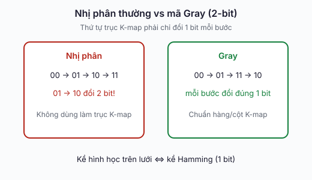

Nhị phân thường: $$01\to10$$ đổi **2** bit

---

## Bảng Gray 3-bit

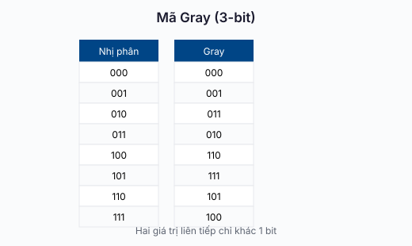

---

## 2. Quy tắc gom nhóm

1. Chỉ ô **1** (hoặc **X**)
2. Cỡ = $$2^{k}$$
3. Nhóm **lớn** hơn tốt hơn
4. Được **chồng**
5. Mọi **1** phủ ≥ 1 lần

---

## Hình: quy tắc

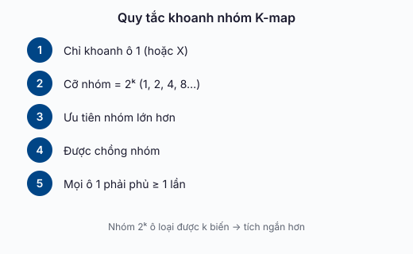

---

## Tế bào lớn

**Tế bào lớn**  
= nhóm không mở rộng thêm được  
= **nguyên nhân nguyên tố**

$$X$$ (don't-care) **không** bắt buộc phủ

---

## 3. K-map 2 biến — cấu trúc

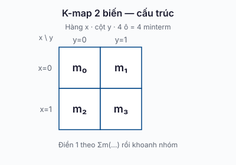

---

## Ví dụ: một hàng

$$F=xy+x\bar y$$

Hai ô hàng $$x=1$$ → nhóm 2:

$$F=x$$

(đúng $$x(y+\bar y)=x$$)

---

## Ví dụ: hàng **0, 1, 3**

$$A=\bar x+y$$

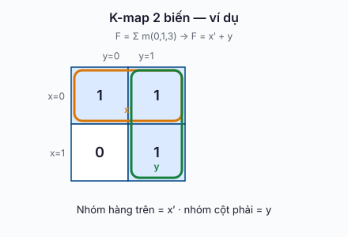

---

## 4. K-map 3 biến — cấu trúc

Hàng Gray $$xy$$: **00, 01, 11, 10**

Hàng 10 **kề** hàng 00 (wrap)

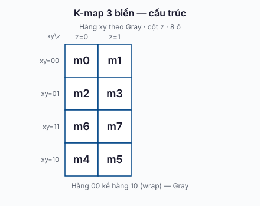

---

## Ví dụ slide 3 biến

$$
F=xy\bar z+x\bar y\bar z+\bar x y z+\bar x y\bar z+\bar x\bar y\bar z
$$

→ nhóm $$\bar z$$ + $$\bar x y$$

$$F=\bar z+\bar x y$$

---

## Ví dụ: hàng **0, 1, 2, 5, 7**

Một cover:

$$F=x'y'+x'z'+xz$$

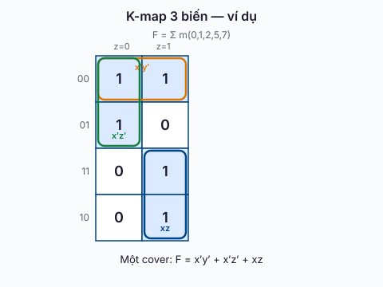

---

## 5. K-map 4 biến — cấu trúc

Hàng $$xy$$, cột $$zw$$: Gray **00, 01, 11, 10**

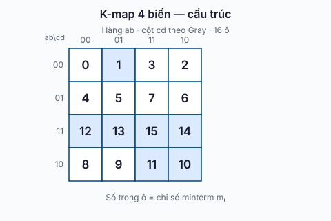

---

## Wrap-around 4 biến

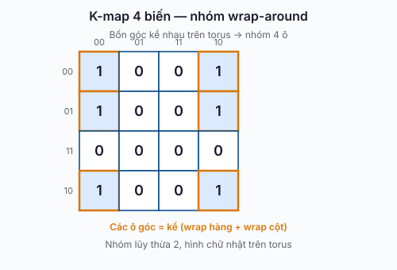

Bốn góc kề trên torus → nhóm 4 hợp lệ

---

## 6. Phủ tối tiểu

**Phủ**: hợp các tập = toàn $$X$$

**Phủ tối tiểu**: bỏ bất kỳ tập nào  
→ **không** còn phủ

Trên K-map: $$X$$ = các ô **1**

---

## Hình: phủ tập

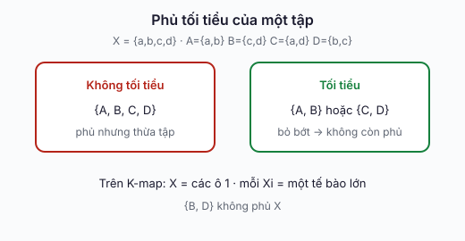

---

## Tế bào cốt yếu

Ô **1** chỉ thuộc **một** tế bào lớn  
→ tế bào đó **cốt yếu** (essential)

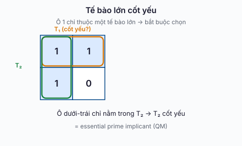

---

## Năm bước — liệt kê

1. Vẽ K-map, điền 1 (và X)  
2. Liệt kê mọi tế bào lớn  
3. Chọn tế bào **cốt yếu**  
4. Hoàn tất phủ (nhánh nếu cần)  
5. Đọc SOP tối tiểu  

---

## Bước 1 — Vẽ & điền

---

## Bước 2 — Tế bào lớn

---

## Bước 3 — Cốt yếu

Chọn tế bào **cốt yếu**

---

## Bước 4 — Hoàn tất phủ

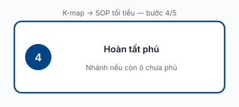

---

## Bước 5 — Đọc SOP

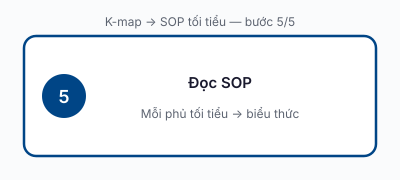

---

## Lưu ý bước 4–5

- Có thể **nhiều** SOP tối tiểu “đơn giản như nhau”
- = nguyên nhân nguyên tố + cover của **QM** (tiết 34)

---

## 7. Don't-care (X)

$$F$$ bằng **1** tại các hàng **0, 1, 3**, don't-care tại **5, 7**

- Coi $$X$$ = 0/1 **tùy lợi**
- **Không** bắt buộc phủ $$X$$

---

## Hình don't-care

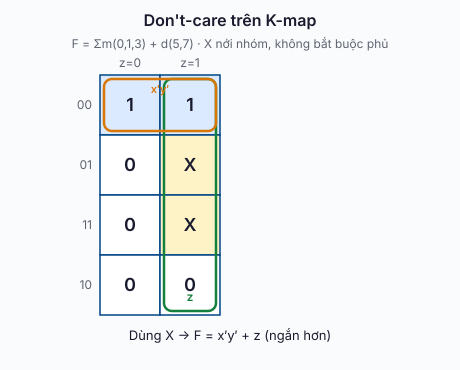

Có thể nhận $$F=x'y'+z$$ ngắn hơn

---

## K-map vs đại số

| | K-map | Đại số |
|:---|:---|:---|
| Biến | 2–4 | Mọi $$n$$ (tay) |
| Trực quan | Cao | Thấp |
| Don't-care | Dễ | Khó hơn |

$$n$$ lớn → QM / phần mềm

---

## Thực hành 1

$$F$$ bằng **1** tại các hàng **0, 1, 3** (2 biến)

K-map → so SOP chuẩn

---

## Thực hành 2

$$F$$ bằng **1** tại các hàng **1, 3, 5, 7** (3 biến)

Gợi ý: còn **1 biến**?

---

## Tóm tắt Tiết 33

- Gray → kề = khác 1 bit
- Gom nhóm $$2^{k}$$, wrap, chồng
- Tế bào lớn + **5 bước**
- Don't-care nới nhóm
- Nền cho Quine–McCluskey

---

## Liên hệ

**Cơ sở**: ô kề ⟺ $$xy+xy'=x$$

**Edge case**: nhóm không $$2^{k}$$ → sai

**Tiết 34**: cùng tư duy, dạng **bảng**

---

## Bài tập ôn (1)

1. Vì sao dùng Gray?
2. **1** tại các hàng **0, 2, 3**; $$F=xy+x\bar y$$
3. **1** tại các hàng **0, 2, 4, 6**; ví dụ slide → $$\bar z+\bar x y$$

---

## Bài tập ôn (2)

4. $$F$$ bằng **1** tại **0, 1**; don't-care **2, 3** (2 biến)
5. Phủ: $$\{A,B\}$$ vs $$\{C,D\}$$ trên $$X=\{a,b,c,d\}$$
6. $$F$$ bằng **1** tại các hàng **0, 2, 4, 5, 6**: B1–B5 phác
