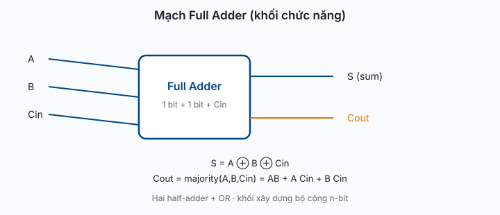
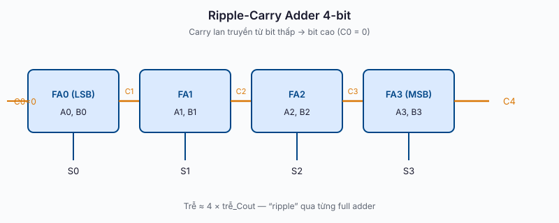
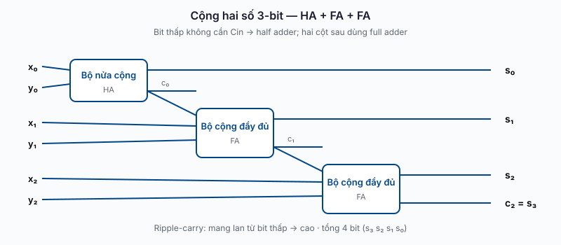
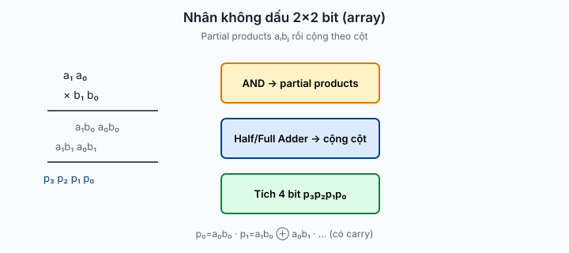
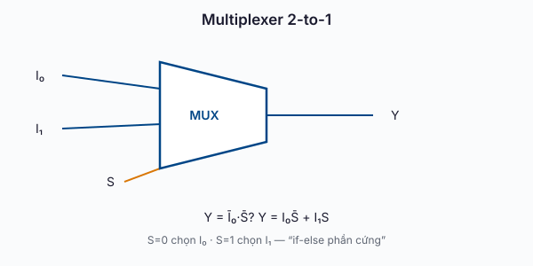
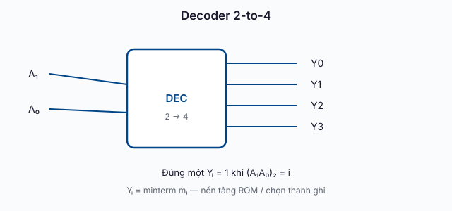

## Mạch Cộng, Mạch Nhân & Tổ hợp Cơ bản

**Toán Rời Rạc**

Tiết 35b (45 phút) — ch13 `13_07`

*Bài học: [Mạch Cộng, Mạch Nhân và Các Mạch Tổ hợp Cơ bản](https://nglelinh.github.io/discrete-mathematics-for-computer-science-iuh/contents/chapter13/21/01/01/Arithmetic_and_Basic_Combinational_Circuits.html)*

---

## Mục tiêu tiết học

- Xây **half adder** và **full adder** từ bảng + cổng
- Ghép FA thành **ripple-carry** $$n$$-bit; ước lượng trễ carry
- Mô tả **nhân** bằng partial products (array 2×2)
- Viết hàm Boole cho **MUX**, **decoder**, comparator 1-bit
- Liên hệ các khối với **ALU**

---

## Mạch tổ hợp

**Tổ hợp** (combinational):

đầu ra(t) chỉ phụ thuộc **đầu vào(t)** (+ trễ lan truyền)

**Không** có flip-flop / trạng thái nhớ.

Tuần tự (sequential) → FSM, chương sau.

---

## Từ cổng → ALU

| Mạch | Vai trò |
|:---|:---|
| Half / Full adder | cộng bit |
| Ripple-carry | cộng $$n$$-bit |
| Array multiplier | nhân |
| MUX | chọn phép / nguồn |
| Decoder | one-hot, chọn thanh ghi |

---

## Half adder — Bài toán

Cộng **2 bit** $$A,B$$ (không Cin):

$$A + B = 2C + S$$

$$S$$ = sum (0/1), $$C$$ = carry (0/1)

---

## Half adder — Bảng

| $$A$$ | $$B$$ | $$C$$ | $$S$$ |
|:---:|:---:|:---:|:---:|
| 0 | 0 | 0 | 0 |
| 0 | 1 | 0 | 1 |
| 1 | 0 | 0 | 1 |
| 1 | 1 | 1 | 0 |

$$1+1=2=10_2$$ → carry 1, sum 0

---

## Half adder — Biểu thức

$$
S = A \oplus B = \bar A B + A \bar B
$$

$$
C = A \cdot B
$$

**Half** = chưa có nhớ vào → chưa ghép được cột giữa $$n$$-bit.

---

## Half adder — Hình


XOR → Sum · AND → Carry

---

## Full adder — Vì sao cần?

Cột thứ $$i$$ khi cộng $$n$$-bit nhận:

$$A_i,\ B_i,\ C_i$$ (carry từ cột thấp)

→ phải cộng **3 bit** → **Full Adder (FA)**

---

## Full adder — Quan hệ số học

$$
A + B + C_{in} = 2\, C_{out} + S
$$

$$S$$ = tổng mod 2  
$$C_{out}$$ = 1 khi **≥ 2** bit bằng 1 (majority)

---

## Full adder — Bảng (rút)

| $$A$$ | $$B$$ | Cin | Cout | $$S$$ | Tổng |
|:---:|:---:|:---:|:---:|:---:|:---:|
| 0 | 0 | 0 | 0 | 0 | 0 |
| 0 | 1 | 1 | 1 | 0 | 2 |
| 1 | 1 | 0 | 1 | 0 | 2 |
| 1 | 1 | 1 | 1 | 1 | 3 |

(Đủ 8 dòng trong bài học.)

---

## Full adder — Biểu thức

$$
S = A \oplus B \oplus C_{in}
$$

$$
C_{out} = AB + A C_{in} + B C_{in}
$$

Tương đương: $$C_{out} = AB + (A\oplus B)C_{in}$$

---

## Full adder — Hai half adder

1. HA1: $$A,B$$ → $$S_1=A\oplus B$$, $$C_1=AB$$
2. HA2: $$S_1,C_{in}$$ → $$S$$, $$C_2$$
3. $$C_{out} = C_1 + C_2$$ (OR)

---

## Full adder — Hình



Mạch IP: 3 vào → S, Cout

---

## Ví dụ FA

$$A=1,\ B=0,\ C_{in}=1$$

$$S = 1\oplus 0\oplus 1 = 0$$

$$C_{out} = 1\cdot0 + 1\cdot1 + 0\cdot1 = 1$$

Tổng $$2$$ → nhị phân $$10_2$$ ✓

---

## Ripple-carry adder

$$C_0 = 0$$ (hoặc Cin ngoài)

Với $$i=0,\ldots,n-1$$:

$$(S_i, C_{i+1}) = \mathrm{FA}(A_i, B_i, C_i)$$

$$S=(S_{n-1}\ldots S_0)_2$$ · $$C_n$$ = overflow nếu chỉ giữ $$n$$ bit

---

## RCA 4-bit — Hình



Carry **gợn** LSB → MSB

---

## Mẫu 3-bit: HA + FA + FA

Bit thấp Cin = 0 → dùng **half adder**.  
Hai cột sau: **full adder**.



Tổng 4 bit: $$(s_3 s_2 s_1 s_0)$$ với $$s_3 = c_2$$.

---

## Ví dụ RCA: $$5+3$$

$$A=0101_2$$, $$B=0011_2$$ → kỳ vọng $$8=1000_2$$

| $$i$$ | $$A_i$$ | $$B_i$$ | $$C_i$$ | $$S_i$$ | $$C_{i+1}$$ |
|:---:|:---:|:---:|:---:|:---:|:---:|
| 0 | 1 | 1 | 0 | 0 | 1 |
| 1 | 0 | 1 | 1 | 0 | 1 |
| 2 | 1 | 0 | 1 | 0 | 1 |
| 3 | 0 | 0 | 1 | 1 | 0 |

$$S=1000_2$$ ✓

---

## Trễ ripple

Gọi $$t_{FA}$$ = trễ tạo Cout của một FA:

$$t_{\mathrm{RCA}} \approx n \cdot t_{FA}$$

$$n=64$$ → chậm  
→ CPU dùng carry-lookahead / prefix (nâng cao)

---

## Tính đúng RCA (ý tưởng)

Mỗi FA: $$A_i+B_i+C_i = 2C_{i+1}+S_i$$

Quy nạp theo $$n$$:

$$A+B+C_0 = S + 2^n C_n$$

---

## Mạch nhân — Ý tưởng

$$
A \times B = \sum_{i,j} (A_i B_j)\, 2^{i+j}
$$

- $$A_i B_j$$ = **AND** (partial product)
- Cùng cột $$2^k$$ → **cộng** (HA/FA)

= **array multiplier**

---

## Nhân 2×2 — Sơ đồ



AND → partial · HA/FA → tích 4 bit

---

## Nhân 2×2 — Ví dụ tay

$$A=10_2=2$$, $$B=11_2=3$$ → $$6$$

```
    1 0
  × 1 1
  -----
    1 0     × b0
  1 0       × b1 (dịch 1)
  -----
  0 1 1 0   = 6
```

---

## Độ phức tạp (định tính)

| Thành phần | Quy mô |
|:---|:---|
| AND | $$n^2$$ |
| Adder | $$\Theta(n^2)$$ (array) |
| Độ rộng tích | $$2n$$ bit |

Wallace / Booth: tối ưu **cây cộng**, cùng partial products.

---

## MUX 2-to-1

$$
Y = I_0 \bar S + I_1 S
$$

| $$S$$ | $$Y$$ |
|:---:|:---|
| 0 | $$I_0$$ |
| 1 | $$I_1$$ |

**If-else phần cứng**

---

## MUX — Hình



ALU: chọn ADD / AND / OR theo opcode

---

## Decoder 2-to-4

$$(A_1 A_0)_2 = i \;\Rightarrow\; Y_i = 1$$ (one-hot)

$$
Y_0=\bar A_1\bar A_0,\;
Y_1=\bar A_1 A_0,\;
Y_2=A_1\bar A_0,\;
Y_3=A_1 A_0
$$

= **minterm** $$m_i$$

---

## Decoder — Hình



Chọn thanh ghi · giải mã thô · ROM

---

## Comparator 1-bit

| Đầu ra | Biểu thức |
|:---|:---|
| $$A=B$$ | $$\overline{A\oplus B}$$ |
| $$A>B$$ | $$A\bar B$$ |
| $$A<B$$ | $$\bar A B$$ |

Nhánh `beq` / `blt` trong CPU

---

## Bản đồ → ALU

| Mạch | Lệnh / vai trò |
|:---|:---|
| FA chain | ADD / SUB (bù 2) |
| AND/OR/XOR | logic bitwise |
| MUX | chọn phép |
| Comparator | nhảy có điều kiện |
| Multiplier | MUL |
| Decoder | chọn reg / opcode |

---

## Thực hành 1 — Half adder

Viết $$S$$ chỉ bằng AND, OR, NOT (không XOR).

$$A=1,B=1$$ → $$S,C$$ = ?

---

## Đáp án — Thực hành 1

$$S = \bar A B + A \bar B$$  
(2 NOT + 2 AND + 1 OR)

$$A=B=1$$ → $$S=0$$, $$C=1$$

---

## Thực hành 2 — Full adder

$$A=1,\ B=1,\ C_{in}=0$$

Tính $$S$$, $$C_{out}$$ bằng công thức.

---

## Đáp án — Thực hành 2

$$S = 1\oplus 1\oplus 0 = 0$$

$$C_{out} = 1\cdot1 + 1\cdot0 + 1\cdot0 = 1$$

Tổng $$2$$ → $$10_2$$ ✓

---

## Thực hành 3 — RCA

Cộng $$A=0110_2$$ (6) + $$B=0001_2$$ (1), $$C_0=0$$.

Ghi $$S$$ 4 bit.

---

## Đáp án — Thực hành 3

$$S_0=1$$, $$S_1=1$$, $$S_2=1$$, $$S_3=0$$

$$S=0111_2=7$$ · mọi carry trung gian = 0 sau cột 0

---

## Thực hành 4 — MUX ALU

Viết $$Y$$ chọn:

- $$S=0$$: half-adder sum $$A\oplus B$$
- $$S=1$$: $$AB$$

---

## Đáp án — Thực hành 4

$$
Y = (A\oplus B)\,\bar S + (AB)\, S
$$

---

## Checklist trên lớp

1. Half: $$S=A\oplus B$$, $$C=AB$$?
2. Full: 3 ngõ, majority Cout?
3. RCA: chuỗi FA, trễ $$\propto n$$?
4. Nhân: AND grid + cộng cột?
5. MUX / decoder: công thức + ứng dụng?

---

## Tóm tắt Tiết 35b

- **HA / FA** → viên gạch cộng
- **RCA** → $$n$$-bit; carry ripple
- **Array mul** → partial products
- **MUX · decoder · cmp** → keo ALU
- Cùng ngôn ngữ **Boole** (ch13)

---

## Liên hệ

| Chủ đề | Liên hệ |
|:---|:---|
| 13.2 Hàm Boole | bảng → SOP (tổng các tích) |
| 13.3 Cổng | XOR, AND, OR |
| 13.4–13.5 | tối thiểu khi tự xây NAND |
| 13.6 Chip | synthesis, LUT = bảng |
| ch09 Bit | cộng nhị phân / bù 2 |

---

## Bài tập ôn tập (1/2)

1. Lập bảng half adder; chứng minh $$C=AB$$.
2. FA: $$A=0,B=1,C_{in}=1$$ → $$S$$, Cout?
3. RCA 4-bit: $$0011+0001$$ (làm tay cột).

---

## Bài tập ôn tập (2/2)

4. Nhân $$11_2 \times 10_2$$ kiểu partial product.
5. Decoder: viết $$Y_2$$; 3-to-8 có mấy đầu ra?
6. **Thách thức:** $$A-B$$ bằng RCA: Cin và đảo bit?

---

## Gợi ý đáp án nhanh

1. Bảng 4 dòng; $$C=1$$ chỉ khi $$A=B=1$$  
2. $$S=0$$, $$Cout=1$$ (tổng 2)  
3. $$0100_2=4$$  
4. $$11\times10=110_2=6$$  
5. $$Y_2=A_1\bar A_0$$; 8 đầu ra  
6. $$A+\bar B$$ với $$C_0=1$$ (bù 2)

---

## Tiết sau / Gợi ý

- Ôn K-map / Quine nếu chưa vững (33–34)
- 13.6: Boole → chip, SAT, FPGA
- Tự vẽ FA bằng 2 HA trên giấy

---

## Câu hỏi?
