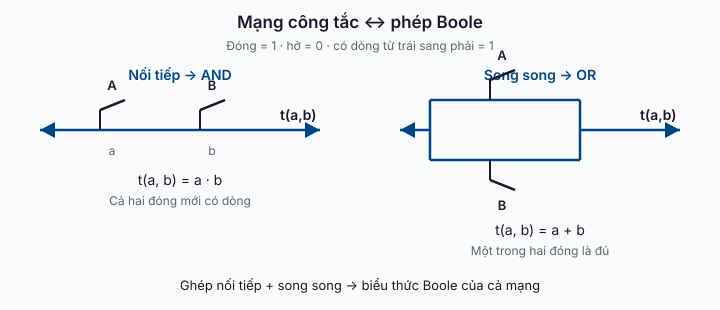
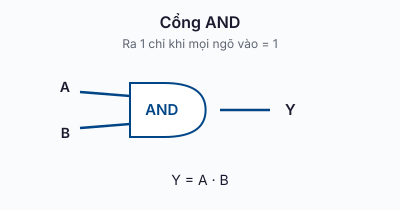
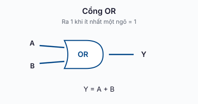
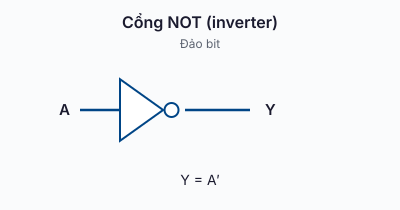
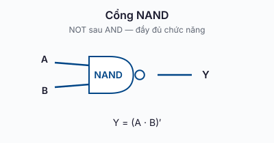
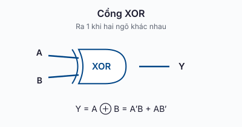
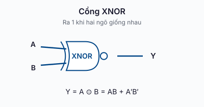
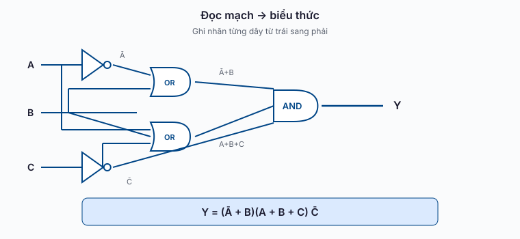
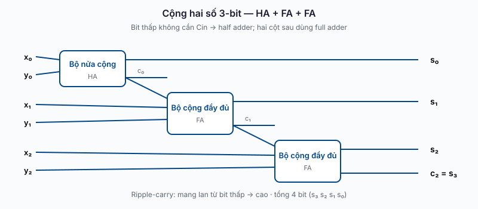

## Mạch logic tổ hợp

**Toán Rời Rạc**

Tiết 38 (45 phút) — Cổng → SOP → Mạch (ch13 `13_03`, `13_07`)

---

## Mục tiêu tiết học

- Nhắc **cổng** + **công tắc nối tiếp/song song**
- Vẽ mạch **hai tầng** từ SOP (tổng các tích)
- **Đọc** mạch → biểu thức; đếm **số cổng / tầng**
- Áp dụng **5 bước** từ yêu cầu lời → mạch
- **Half adder** + ghép **3-bit** (HA + FA + FA)

---

## Mạch tổ hợp là gì?

**Mạch tổ hợp**: đầu ra **chỉ** phụ thuộc đầu vào hiện tại  
(không có “nhớ” trạng thái).

Ví dụ: cổng AND, mạng AND–OR, half adder, MUX.

(Đối lập: mạch tuần tự — có flip-flop / trạng thái.)

---

## Công tắc → AND / OR

| Cấu trúc | Hàm |
|:---|:---|
| Nối tiếp | $$ab$$ (AND) |
| Song song | $$a+b$$ (OR) |

---

## Bảy cổng — nhớ bằng câu

| Cổng | Ra **1** khi… |
|:---|:---|
| NOT | vào = **0** |
| AND | **mọi** vào = **1** |
| OR | **≥ 1** vào = **1** |
| NAND | **không** phải cả hai = **1** |
| NOR | **mọi** vào = **0** |
| XOR | hai vào **khác nhau** |
| XNOR | hai vào **giống nhau** |

---

## Cổng AND / OR / NOT

---

## Cổng NAND / XOR / XNOR

**NAND đầy đủ**: một mình dựng được NOT, AND, OR → mọi hàm.

---

## Đọc mạch → biểu thức

$$Y = (\bar A+B)(A+B+C)\bar C$$

---

## Từ SOP đến mạch hai tầng

SOP (tổng các tích):

$$
F = t_1 + t_2 + \cdots + t_r
$$

**Tầng 1**: mỗi $$t_i$$ → một cổng **AND** (+ NOT ở ngõ vào nếu cần)  
**Tầng 2**: một cổng **OR** gom các tích

→ Mạch **AND–OR** hai tầng.

---

## Ví dụ — XOR hai tầng

$$
F = A'B + AB'
$$

1. NOT: $$A'$$, $$B'$$
2. AND: $$(A',B)$$ và $$(A,B')$$
3. OR: hai kết quả

Cùng hàm = **một** cổng XOR (nếu được dùng).

---

## Ví dụ — Majority

$$
F = AB + AC + BC
$$

- 3 AND hai ngõ
- 1 OR ba ngõ

= bit **nhớ ra** $$C_{out}$$ của full adder (3 ngõ).

---

## Đếm số cổng và số tầng

| Đại lượng | Cách đếm trên bài |
|:---|:---|
| **Số cổng** | Đếm AND + OR + NOT (thô) |
| **Số tầng** | Số lớp cổng trên đường dài nhất vào→ra |

SOP hai tầng: **nông** (2 tầng) nhưng có thể **rộng** (nhiều AND).

---

## Năm bước thiết kế mạch

1. **Đặt biến** vào/ra (quy ước 0/1)
2. **Bảng chân trị**
3. **Biểu thức** — SOP từ hàng $$Y=1$$
4. **Rút gọn** (đại số / K-map)
5. **Vẽ mạch** từ biểu thức đã rút

---

## Ví dụ — Ba công tắc & đèn

Đèn $$Y$$ sáng khi:
- cả ba hở, **hoặc**
- công tắc 1 và 2 đóng, 3 hở

Quy ước: đóng = **1**, hở = **0**, sáng = **1**.

---

## Ví dụ — Bảng và SOP

$$Y=1$$ chỉ tại $$(0,0,0)$$ và $$(1,1,0)$$:

$$
Y = \bar A\bar B\bar C + AB\bar C = \bar C\,(\bar A\bar B + AB).
$$

$$\bar A\bar B + AB = A \odot B$$ (**XNOR**, không phải XOR).

Mạch: XNOR($$A,B$$) AND NOT($$C$$).

---

## Half adder — bộ nửa cộng

| $$A$$ | $$B$$ | $$S$$ (tổng) | $$C$$ (nhớ) |
|:---:|:---:|:---:|:---:|
| 0 | 0 | 0 | 0 |
| 0 | 1 | 1 | 0 |
| 1 | 0 | 1 | 0 |
| 1 | 1 | 0 | 1 |

$$
S = A \oplus B,\qquad C = AB.
$$

Không xét nhớ **vào** từ cột trước.

---

## Half adder — sơ đồ

**Sum** = XOR; **Carry** = AND.  
Không có nhớ **vào** (Cin) → “nửa” bộ cộng.

---

## Full adder — bộ cộng đầy đủ

Ba ngõ: $$A$$, $$B$$, $$C_{in}$$.

$$
S = A \oplus B \oplus C_{in}
$$

$$
C_{out} = AB + A C_{in} + B C_{in}
$$

---

## Cộng 3-bit: HA + FA + FA

Bit thấp: **HA** (Cin = 0).  
Hai cột sau: **FA**. Mang $$c_0 \to c_1 \to c_2 = s_3$$.

Chi tiết $$n$$-bit / nhân: tiết 35b, bài 13.7.

---

## MUX 2-to-1 (chọn nguồn)

$$
Y = I_0 \bar S + I_1 S
$$

| $$S$$ | $$Y$$ |
|:---:|:---|
| 0 | $$I_0$$ |
| 1 | $$I_1$$ |

= `if S then I1 else I0` phần cứng.

---

## Decoder 2-to-4 (one-hot)

$$
Y_i = 1 \iff (A_1 A_0)_2 = i
$$

Mỗi $$Y_i$$ là **một minterm** — liên hệ trực tiếp bài hàm Boole.

---

## Bài tập lớp 1 — Vẽ mạch

Mô tả tầng cho:

$$
F = x'y'z + xy
$$

Đếm AND, OR, NOT (AND tối đa 3 ngõ).

---

## Bài tập lớp 1 — Gợi ý

- 2 AND (3-ngõ và 2-ngõ)
- 1 OR 2-ngõ
- 2 NOT ($$x'$$, $$y'$$)

---

## Bài tập lớp 2 — Năm bước

Yêu cầu: “Còi kêu khi **đúng hai** trong ba cảm biến $$A,B,C$$ bật.”

Làm đủ 5 bước đến biểu thức (chưa cần vẽ đẹp).

---

## Bài tập lớp 2 — Gợi ý

Hàng $$F=1$$: $$011, 101, 110$$ →. Hàm bằng **1** tại các hàng **3, 5, 6**.

$$
F = A'BC + AB'C + ABC'.
$$

(Có thể rút thêm bằng K-map.)

---

## Bài tập lớp 3 — Half adder

1. Hiện thực $$S$$ **không** dùng XOR (chỉ AND/OR/NOT)
2. Đếm cổng
3. So với 1 XOR + 1 AND

---

## Bài tập ôn tập (mang về)

1. Vẽ AND–OR cho $$F = ab' + a'b$$ (XOR).
2. Đếm cổng: $$F = x'y'z + x'yz' + xy'z' + xyz$$ trước/sau rút (nếu rút được).
3. Lặp ví dụ 3 công tắc: bảng 8 dòng + mạch XNOR–AND.
4. MUX: chứng minh $$Y = I_0\bar S + I_1 S$$ bằng bảng.
5. (Thách thức) Full adder: kiểm $$(A,B,C_{in})=(1,1,1)$$.

---

## Liên hệ toàn block Boolean

| Tiết | Nội dung |
|:---:|:---|
| 30–31 | Đại số & hàm Boole |
| 32–34 | Cổng, K-map, QM |
| 35–35b | Ứng dụng & mạch cộng/nhân |
| 36 | Bài tập hàm Boole |
| 37 | Đơn giản hóa |
| **38** | **Mạch tổ hợp** |
| 39 | Tổng kết khóa học |

---

## Câu hỏi?
