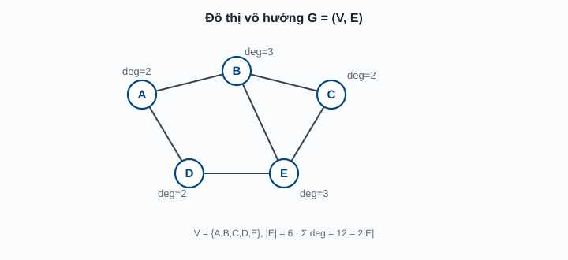
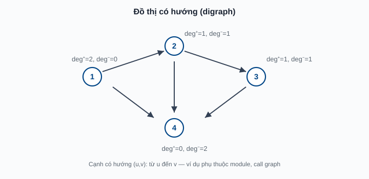
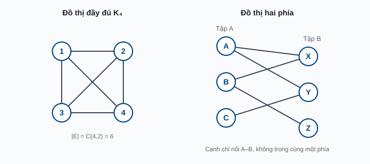

## Giới thiệu Đồ thị

**Toán Rời Rạc** · Chương 12 · Bài 12.1

Định nghĩa · Bậc · Handshaking

---

## Mục tiêu tiết học

- Định nghĩa $$G = (V, E)$$
- Phân loại: vô hướng / có hướng / trọng số
- Tính bậc và áp dụng **định lý bắt tay**
- Nhận biết $$K_n$$, đồ thị hai phía
- Mô hình hóa bài toán CNTT

**Bài học**: `contents/chapter12/…12_01_…`

---

## Bối cảnh

Quan hệ (Ch.5) = tập cặp

**Đồ thị** = hình thức hóa cùng ý tưởng:

- **Đỉnh** = đối tượng
- **Cạnh** = liên kết

Mạng xã hội, dependency, call graph, CFG, routing  
→ đều là đồ thị

---

## Định nghĩa

**Đồ thị** $$G = (V, E)$$:

- $$V$$: tập **đỉnh** hữu hạn, không rỗng
- $$E$$: tập **cạnh**

| Loại | Cạnh |
|:---|:---|
| **Vô hướng** | $$\{u,v\}$$ |
| **Có hướng** | $$(u,v)$$ |

Có **trọng số**: mỗi cạnh gắn cost / delay

---

## Hình — vô hướng

$$\sum \deg(v) = 2|E|$$

---

## Hình — có hướng

Bậc ra $$\deg^+$$, bậc vào $$\deg^-$$

---

## Mô hình hóa CNTT

| Bài toán | Đỉnh | Cạnh |
|:---|:---|:---|
| Mạng xã hội | Người dùng | Bạn bè |
| Dependency | Module | Phụ thuộc |
| Call graph | Hàm | Gọi |
| Web | URL | Hyperlink |
| CFG | Basic block | Nhánh |

---

## Các loại cấu trúc

| Loại | Đặc điểm |
|:---|:---|
| **Đơn** | ≤ 1 cạnh; không khuyên |
| **Đa đồ thị** | Cạnh song song |
| **$$K_n$$** | Đầy đủ; $$|E|=\binom{n}{2}$$ |
| **Hai phía** | $$V=A\cup B$$; cạnh chỉ $$A$$–$$B$$ |

---

## $$K_n$$ và bipartite

$$|E(K_5)| = \binom{5}{2} = 10$$

---

## Bậc đỉnh

**Vô hướng**: $$\deg(v)$$ = số cạnh kề $$v$$

**Có hướng**:

- $$\deg^+(v)$$ — bậc ra
- $$\deg^-(v)$$ — bậc vào

$$\sum \deg^+ = \sum \deg^- = |E|$$

---

## Định lý bắt tay

**Handshaking Lemma** (vô hướng):

$$\sum_{v \in V} \deg(v) = 2|E|$$

**Hệ quả**: số đỉnh bậc **lẻ** là **chẵn**

Mỗi cạnh đóng góp 2 vào tổng bậc

---

## Ví dụ nhanh

Bậc $$2,3,2,2,3$$:

$$2+3+2+2+3 = 12 = 2|E| \implies |E|=6$$

Dãy $$3,3,3$$: tổng $$9$$ lẻ  
→ **không** tồn tại đồ thị

---

## Thực hành

1. 8 đỉnh, mỗi đỉnh bậc 3 → $$|E|=?$$
2. $$K_5$$: số cạnh và bậc mỗi đỉnh?
3. Dãy $$3,3,2,2,2,2$$ có khả thi không?

---

## Tóm tắt

- $$G=(V,E)$$: vô hướng / có hướng / trọng số
- Đơn, đa, $$K_n$$, hai phía
- Bậc đo kết nối cục bộ
- Handshaking: $$\sum\deg=2|E|$$

**Tiết sau**: ma trận kề & danh sách kề

---

## Bài tập ôn tập (1/2)

1. Định nghĩa đồ thị vô hướng và có hướng
2. 6 đỉnh, tổng bậc 14 → bao nhiêu cạnh?
3. Vì sao số đỉnh bậc lẻ luôn chẵn?

---

## Bài tập ôn tập (2/2)

4. Mô hình 4 gói: `app→libA, app→libB, libA→core, libB→core`  
   — viết $$V$$, $$E$$, $$\deg^\pm$$
5. $$K_6$$ có bao nhiêu cạnh?

---

## Câu hỏi?
