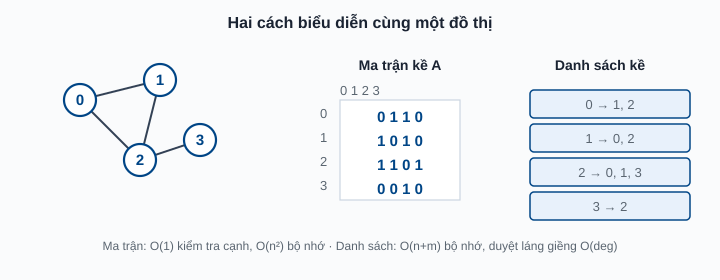

## Biểu diễn Đồ thị

**Toán Rời Rạc** · Chương 12 · Bài 12.2

Ma trận kề · Danh sách kề · Thưa / dày

---

## Mục tiêu tiết học

- Xây **ma trận kề** và **danh sách kề**
- So sánh $$O(1)$$ vs $$O(\deg)$$ khi kiểm tra cạnh
- Bộ nhớ $$O(n^2)$$ vs $$O(n+m)$$
- Chọn biểu diễn theo đồ thị **thưa** / **dày**

**Bài học**: `…12_02_Graph_Representations`

---

## Bối cảnh

$$G=(V,E)$$ là trừu tượng

Máy tính cần **cấu trúc dữ liệu**:

- Kiểm tra có cạnh $$(i,j)$$?
- Liệt kê láng giềng?
- Duyệt toàn bộ cạnh (BFS/DFS)?

Hai chuẩn: **ma trận kề**, **danh sách kề**

---

## Hình tổng quan



Cùng thông tin — khác chi phí

---

## Ma trận kề

Đỉnh $$0..n-1$$. Ma trận $$A_{n\times n}$$:

$$
A[i][j] =
\begin{cases}
1 & \text{có cạnh }(i,j)\\
0 & \text{không}
\end{cases}
$$

- Vô hướng → $$A$$ **đối xứng**
- Có trọng số → lưu $$w$$ thay vì 1

---

## Ví dụ ma trận

Cạnh $$\{0,1\},\{0,2\},\{1,2\},\{2,3\}$$:

|  | 0 | 1 | 2 | 3 |
|:---:|:---:|:---:|:---:|:---:|
| 0 | 0 | 1 | 1 | 0 |
| 1 | 1 | 0 | 1 | 0 |
| 2 | 1 | 1 | 0 | 1 |
| 3 | 0 | 0 | 1 | 0 |

$$\deg(2)=3$$ = tổng hàng 2

---

## Chi phí — ma trận

| Thao tác | Độ phức tạp |
|:---|:---|
| Kiểm tra cạnh | $$O(1)$$ |
| Láng giềng của $$i$$ | $$O(n)$$ |
| Bộ nhớ | $$O(n^2)$$ |

---

## Danh sách kề

Mảng / map $$n$$ mục:

mục $$i$$ = list các $$j$$ kề với $$i$$

```python
graph = {
    0: [1, 2],
    1: [0, 2],
    2: [0, 1, 3],
    3: [2],
}
```

Vô hướng: mỗi cạnh lưu **hai chiều**

---

## Chi phí — danh sách

| Thao tác | Độ phức tạp |
|:---|:---|
| Kiểm tra cạnh | $$O(\deg(i))$$ |
| Duyệt láng giềng | $$O(\deg(i))$$ |
| Bộ nhớ | $$O(n+m)$$ |

BFS/DFS trên list: $$O(n+m)$$

---

## Thưa vs dày

**Dày**: $$m \approx n^2$$ (gần $$K_n$$)

**Thưa**: $$m \ll n^2$$ (mạng thực: $$m=O(n)$$)

|  | Ma trận | List |
|:---|:---|:---|
| $$n=10^6$$, $$m=3\cdot10^6$$ | ~TB | ~chục MB |
| BFS/DFS | quét $$O(n^2)$$ | $$O(n+m)$$ |

---

## Nguyên tắc chọn

1. **Thưa** (social, web, dependency) → **danh sách kề**
2. **Dày** hoặc check cạnh $$(i,j)$$ rất nhiều, $$n$$ nhỏ → ma trận
3. Thuật toán lớn gần như luôn giả định list

---

## Code kiểm tra cạnh

```python
def has_edge_matrix(A, u, v):
    return A[u][v] != 0  # O(1)

def has_edge_list(g, u, v):
    return v in g.get(u, [])  # O(deg)
```

---

## Thực hành

1. Digraph: $$(0,1),(1,2),(2,0),(2,3)$$ — viết $$A$$
2. Khi nào list tiết kiệm hơn ma trận?
3. Từ list cho trước → ma trận + $$\deg(1)$$

---

## Tóm tắt

- Ma trận: $$O(1)$$ cạnh, $$O(n^2)$$ bộ nhớ
- List: $$O(n+m)$$, duyệt láng giềng $$O(\deg)$$
- Chọn theo **mật độ cạnh** và thao tác chính

**Tiết sau**: path, cycle, liên thông

---

## Bài tập ôn tập (1/2)

1. Viết ma trận kề digraph 4 cạnh ở trên
2. So sánh bộ nhớ $$n=1000$$, $$m=3000$$
3. Vì sao BFS trên ma trận kém khi thưa?

---

## Bài tập ôn tập (2/2)

4. Cài `neighbors(g, u)` cho list — độ phức tạp?
5. Digraph có cần list cạnh vào không? Khi nào?

---

## Câu hỏi?
