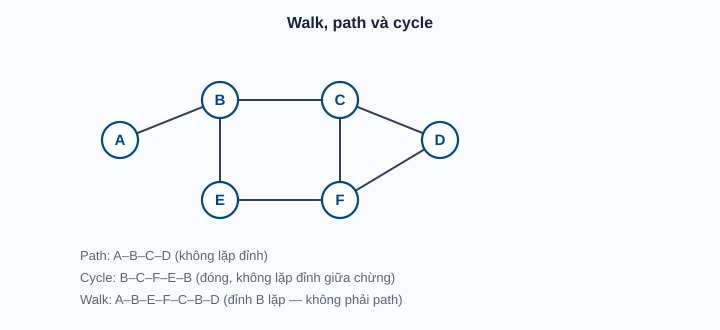
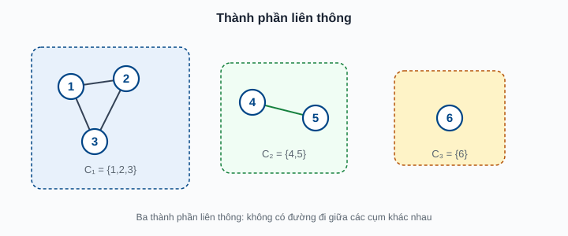

## Đường đi, Chu trình & Liên thông

**Toán Rời Rạc** · Chương 12 · Bài 12.3

Walk · Path · Cycle · Connected · DAG

---

## Mục tiêu tiết học

- Phân biệt walk / trail / path / cycle
- Liên thông (vô hướng)
- Liên thông yếu / mạnh (có hướng)
- Thành phần liên thông
- DAG và phụ thuộc vòng

**Bài học**: `…12_03_Paths_Cycles…`

---

## Câu hỏi thực tế

Biết **ai kề ai** chưa đủ:

- Hai máy **thông** được không?
- Module có **phụ thuộc vòng**?
- Mạng tách thành **mấy cụm**?

→ path, cycle, connectivity

---

## Walk, trail, path, cycle

| Khái niệm | Ràng buộc |
|:---|:---|
| **Walk** | Dãy đỉnh–cạnh; cho phép lặp |
| **Trail** | Walk **không lặp cạnh** |
| **Path** | Walk **không lặp đỉnh** |
| **Cycle** | Path đóng, $$k\ge 3$$ (đơn) |

**Độ dài** = số cạnh

---

## Hình minh họa

Path ⊂ Trail ⊂ Walk (về độ chặt)

---

## Ví dụ nhanh

- $$A\text{–}B\text{–}C\text{–}D$$: **path**
- $$B\text{–}C\text{–}F\text{–}E\text{–}B$$: **cycle**
- $$A\text{–}B\text{–}E\text{–}F\text{–}C\text{–}B\text{–}D$$: **walk** (lặp $$B$$)

Có hướng: chỉ đi theo chiều cạnh

---

## Liên thông (vô hướng)

$$G$$ **liên thông** nếu mọi cặp $$u,v$$ có **path** nối

**Thành phần liên thông**:  
tập đỉnh tối đại cảm sinh đồ thị con liên thông

Phân hoạch $$V$$; không có cạnh giữa hai thành phần

---

## Hình — thành phần

3 cụm = 3 thành phần

---

## Liên thông có hướng

**Yếu**: bỏ hướng → vô hướng liên thông

**Mạnh**: mọi $$u,v$$ có path **có hướng**  
$$u\to\cdots\to v$$ **và** $$v\to\cdots\to u$$

Mạnh $$\implies$$ yếu; ngược lại **sai**

---

## Ví dụ digraph

Cạnh: $$1\to 2$$, $$2\to 3$$, $$1\to 3$$

- **Yếu**: có
- **Mạnh**: **không** (không về từ 3)

---

## DAG

**DAG** = digraph **không chu trình** có hướng

Ứng dụng:

- Build / compile order
- Task scheduling
- Pipeline không vòng

Có **thứ tự tôpô** ⟺ là DAG

---

## Circular dependency

Nếu

$$A \to B \to C \to A$$

→ chu trình có hướng  
→ **không** có thứ tự build hợp lệ

Lỗi kiến trúc, không chỉ cú pháp

---

## Đồ thị con & clique

**Đồ thị con**: $$V'\subseteq V$$, $$E'\subseteq E$$ hợp lệ

**Clique**: mọi cặp có cạnh  
(= cảm sinh $$K_r$$)

---

## Liên hệ thuật toán

| Câu hỏi | Công cụ |
|:---|:---|
| Liên thông / thành phần | BFS, DFS, Union–Find |
| Chu trình vô hướng | DFS |
| Chu trình có hướng / topo | DFS trên digraph |
| Reachability | BFS / DFS từ nguồn |

→ Mục 12.4

---

## Thực hành

1. Cạnh $$AB,BC,CD$$ — mấy thành phần?
2. Walk $$A\to B\to C\to B\to D$$ có phải path?
3. Digraph $$1\to2\to3$$, $$1\to3$$: mạnh? yếu?
4. `app→ui→core→app` có phải DAG?

---

## Tóm tắt

- Walk → trail → path; cycle = path đóng
- Liên thông / thành phần (vô hướng)
- Yếu vs mạnh (có hướng)
- DAG = không chu trình có hướng

**Tiết sau**: Euler, Hamilton, BFS, DFS

---

## Bài tập ôn tập (1/2)

1. Định nghĩa path và cycle
2. Chứng minh ngắn: “có path nối” là quan hệ tương đương
3. Liệt kê thành phần trên hình 3 cụm

---

## Bài tập ôn tập (2/2)

4. Vì sao mạnh ⇒ yếu?
5. Cho dependency có chu trình — hậu quả với topo sort?

---

## Câu hỏi?
