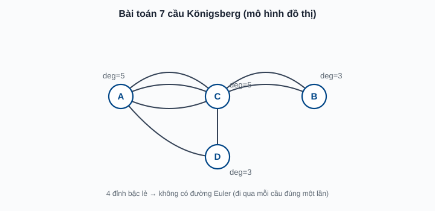
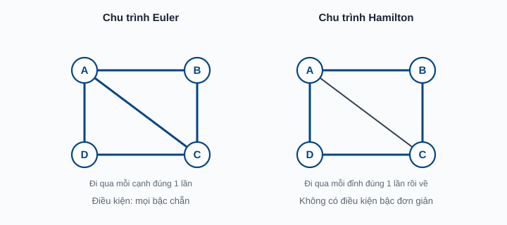
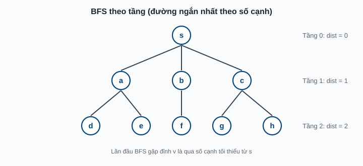
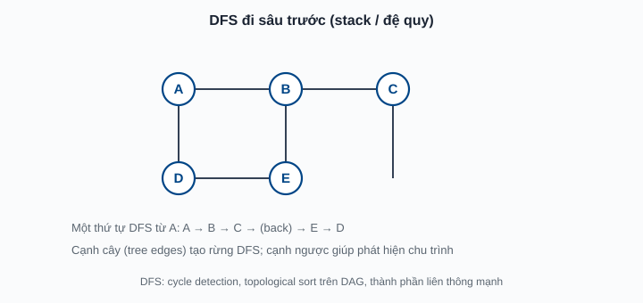

## Euler, Hamilton & Duyệt Đồ thị

**Toán Rời Rạc** · Chương 12 · Bài 12.4

Euler · Hamilton · BFS · DFS

---

## Mục tiêu tiết học

- Phân biệt Euler (cạnh) và Hamilton (đỉnh)
- Điều kiện bậc cho đường / chu trình Euler
- Mô tả BFS, DFS và $$O(V+E)$$
- Euler ∈ P vs TSP / Hamilton tối ưu NP-hard

**Bài học**: `…12_04_Euler_Hamilton…`

---

## Königsberg (1736)

Có đi qua **mỗi cầu đúng một lần**?



4 đỉnh bậc lẻ → **không** có đường Euler

---

## Euler — định nghĩa

**Đường Euler**: trail qua **mỗi cạnh đúng 1 lần**

**Chu trình Euler**: đường Euler **đóng**

Phủ **cạnh** — đỉnh có thể thăm nhiều lần

---

## Định lý Euler (vô hướng)

$$G$$ liên thông (trên các đỉnh có cạnh):

| | Điều kiện |
|:---|:---|
| **Chu trình Euler** | mọi bậc **chẵn** |
| **Đường Euler mở** | đúng **2** đỉnh bậc lẻ |
| **Không có đường Euler** | số đỉnh bậc lẻ $$\notin\{0,2\}$$ |

Thuật toán Hierholzer: $$O(E)$$

---

## Ví dụ Euler

- Bậc $$2,2,4,4$$ → **chu trình** Euler
- Bậc $$3,3,2,2$$ → **đường** mở, không chu trình
- Königsberg: 4 bậc lẻ → **không** đường Euler

---

## Hamilton — định nghĩa

**Đường Hamilton**: path qua **mỗi đỉnh đúng 1 lần**

**Chu trình Hamilton**: cycle qua mọi đỉnh rồi về

Phủ **đỉnh** — không cần dùng hết cạnh

---

## Euler vs Hamilton



| | Euler | Hamilton |
|:---|:---|:---|
| Đối tượng | Cạnh | Đỉnh |
| Điều kiện | Bậc chẵn | Không đơn giản |
| Độ khó | $$O(E)$$ | Quyết định/tối ưu khó |

---

## TSP

**Traveling Salesman**:  
chu trình Hamilton **trọng số nhỏ nhất**

→ **NP-hard** (Ch.20)

Thực tế: heuristic / xấp xỉ  
**không** mâu thuẫn Euler giải nhanh

---

## BFS

**Breadth-First Search** — hàng đợi (queue)

Duyệt theo **tầng** khoảng cách từ $$s$$



Không trọng số: lần đầu gặp $$v$$ = **ít cạnh nhất**

---

## DFS

**Depth-First Search** — stack / đệ quy

Đi **sâu** trước, rồi quay lui



Ứng dụng: chu trình, topo sort, SCC

---

## Độ phức tạp

Danh sách kề:

$$O(|V|+|E|)$$ thời gian, $$O(|V|)$$ phụ

| | BFS | DFS |
|:---|:---|:---|
| Cấu trúc | Queue | Stack |
| Đường ngắn nhất (#cạnh) | **Có** | Không đảm bảo |
| Topo / cycle digraph | — | **Mạnh** |

---

## Code BFS (ý tưởng)

```python
from collections import deque

def bfs(graph, start):
    seen = {start}
    q = deque([start])
    while q:
        u = q.popleft()
        for v in graph[u]:
            if v not in seen:
                seen.add(v)
                q.append(v)
```

---

## Ứng dụng CS

- BFS: hop-count, kiểm tra liên thông
- DFS: circular dependency trước build
- Euler: vẽ một nét, Chinese Postman (biến thể)
- Hamilton/TSP: lịch trình, tối ưu tour

---

## Thực hành

1. Bậc $$2,2,4,4$$ — chu trình Euler?
2. Bậc $$3,3,2,2$$ — đường / chu trình Euler?
3. Vì sao BFS cho shortest path không trọng số?
4. Euler vs TSP: P hay NP-hard?

---

## Tóm tắt Chương 12

1. $$G=(V,E)$$, bậc, handshaking
2. Ma trận kề / danh sách kề
3. Path, cycle, liên thông, DAG
4. Euler (P) · Hamilton/TSP (khó) · BFS/DFS

**Mở rộng**: Ch.16 Cây · Ch.17 Đồ thị nâng cao

---

## Bài tập ôn tập (1/2)

1. Nêu điều kiện đường Euler và chu trình Euler
2. Phân biệt Euler và Hamilton bằng 1 câu
3. Chạy BFS từ 0 trên chu trình 4 đỉnh — `dist`

---

## Bài tập ôn tập (2/2)

4. DFS phát hiện circular dependency như thế nào?
5. Vì sao Hierholzer đa thức còn TSP thì không?

---

## Câu hỏi?
