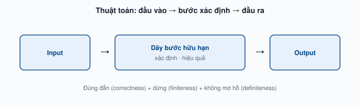

## Giới thiệu Thuật toán

**Toán Rời Rạc** · Chương 14 · Bài 14.1

---

## Định nghĩa

Dãy hữu hạn bước **xác định**  
Input → Output **đúng**

---

## Tính chất

Input · Output · Definiteness  
Finiteness · Correctness · Effectiveness

---

## Hình

---

## Linear vs Binary search

Linear: $$Θ(n)$$  
Binary: $$Θ(\log n)$$ (mảng tăng)

---

## Tóm tắt

Mã giả · trace · correctness

**Sau**: Big-O

