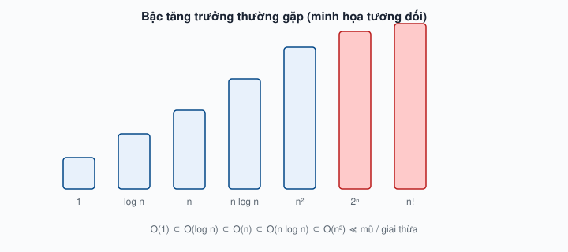

## Big-O · Θ · Ω

**Toán Rời Rạc** · Chương 14 · Bài 14.2

---

## Định nghĩa O

$$f=O(g)$$: $$f(n)\le c\,g(n)$$  
với $$n\ge n_0$$

---

## Hình

---

## Bậc

$$1 \prec \log n \prec n \prec n\log n \prec n^2 \prec 2^n \prec n!$$

---

## Quy tắc

Tổng → max  
Đa thức → bậc cao  
Log đổi cơ số = Θ

---

## Tóm tắt

Tiệm cận · bỏ hằng số

**Sau**: phân tích T(n)

