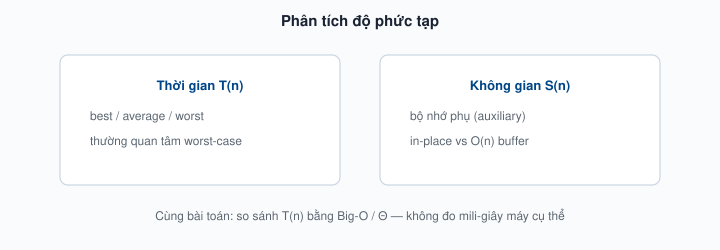

## Độ phức tạp Thuật toán

**Toán Rời Rạc** · Chương 14 · Bài 14.3

---

## T(n) và S(n)

Thời gian · không gian phụ  
Best / avg / **worst**

---

## Hình

---

## Vòng lặp

1 vòng: $$Θ(n)$$  
Lồng $$n\times n$$: $$Θ(n^2)$$  
$$\sum i = Θ(n^2)$$

---

## Merge sort

$$T(n)=2T(n/2)+Θ(n)$$  
→ $$Θ(n\log n)$$

---

## Tóm tắt Ch.14

Thuật toán · Big-O · phân tích

**Sau**: số / đồ thị / automata

