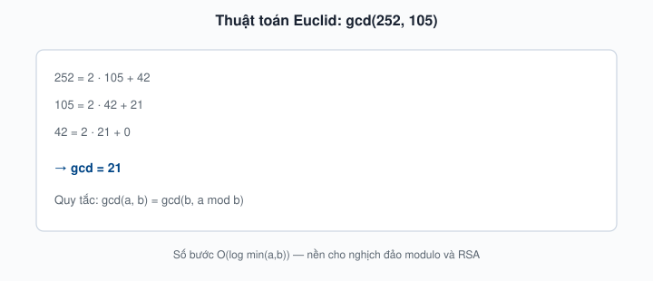

## Chia hết & Số nguyên tố

**Toán Rời Rạc** · Chương 15 · Bài 15.1

Định lý chia · Prime · Euclid

---

## Mục tiêu tiết học

- Định lý chia: $$a = dq + r$$
- Số nguyên tố / hợp số
- Định lý cơ bản số học
- GCD và thuật toán Euclid
- Bézout → nghịch đảo (mục sau)

**Bài học**: `…15_01_Divisibility_and_Primes`

---

## Bối cảnh

Lý thuyết số = tính chất $$\mathbb{Z}$$

Trong CS: khóa, modulo, factoring, HTTPS

Bắt đầu từ **chia hết** và **nguyên tố**

---

## Chia hết

$$b \mid a$$ ⇔ $$\exists c\in\mathbb{Z}:\; a = bc$$

- $$3\mid 12$$, $$7\nmid 20$$
- $$1\mid n$$; $$n\mid 0$$ ($$n\neq 0$$)

---

## Định lý chia

Với $$d > 0$$, tồn tại duy nhất $$q,r$$:

$$a = dq + r,\quad 0 \le r < d$$

- $$17 = 5\cdot 3 + 2$$
- $$-17 = 5\cdot(-4) + 3$$ (dư ≥ 0)

Python: `(-17)%5 == 3`

---

## Số nguyên tố

$$p>1$$ nguyên tố ⇔ ước dương chỉ $$1$$ và $$p$$

- Hợp số: $$n>1$$ không nguyên tố
- $$1$$: không nguyên tố, không hợp số
- $$2$$: nguyên tố chẵn duy nhất

---

## Định lý cơ bản

Mọi $$n>1$$:

$$n = p_1^{e_1}\cdots p_k^{e_k}$$

**duy nhất** (không kể thứ tự)

$$60 = 2^2\cdot 3\cdot 5$$

---

## Sàng Eratosthenes

Liệt kê nguyên tố $$\le n$$:

- gạch bội từ $$i^2$$
- $$O(n\log\log n)$$

Ứng viên còn lại = nguyên tố

---

## GCD

$$\gcd(a,b)$$ = ước dương lớn nhất chung

$$\gcd(a,b)=1$$ → nguyên tố cùng nhau

$$\gcd(0,5)=5$$; $$(0,0)$$ không định nghĩa

---

## Euclid

$$\gcd(a,b)=\gcd(b,\, a\bmod b)$$

$$O(\log\min(a,b))$$ bước

---

## Bézout

$$\gcd(a,b)=sa+tb$$ với $$s,t\in\mathbb{Z}$$

Euclid **mở rộng** → nghịch đảo modulo  
khi $$\gcd(a,n)=1$$

---

## Thực hành

1. $$-45$$ div $$7$$ → $$q,r$$?
2. Nguyên tố $$\le 30$$
3. $$\gcd(252,105)$$
4. Phân tích $$360$$

---

## Tóm tắt

- Định lý chia, dư không âm
- Prime + định lý cơ bản
- Euclid + Bézout

**Tiết sau**: đồng dư & CRT

---

## Bài tập ôn tập (1/2)

1. Định nghĩa $$b\mid a$$
2. Vì sao dư luôn $$0\le r<d$$?
3. Euclid cho $$\gcd(48,18)$$

---

## Bài tập ôn tập (2/2)

4. Chứng minh phác: vô hạn nguyên tố
5. Liên hệ GCD với RSA (một câu)

---

## Câu hỏi?
