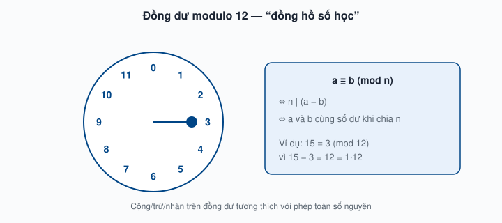

## Đồng dư & Số học Modulo

**Toán Rời Rạc** · Chương 15 · Bài 15.2

Congruence · Inverse · CRT · ModExp

---

## Mục tiêu tiết học

- $$a\equiv b\pmod n$$
- Cộng/trừ/nhân modulo
- $$ax\equiv b\pmod n$$
- Nghịch đảo + Euclid mở rộng
- CRT, ModExp, Fermat/Euler

**Bài học**: `…15_02_Modular_Arithmetic`

---

## Định nghĩa đồng dư

$$a \equiv b \pmod n \iff n\mid(a-b)$$

⇔ cùng số dư khi chia $$n$$

---

## Phép toán

Nếu $$a\equiv b$$, $$c\equiv d \pmod n$$:

$$a\pm c \equiv b\pm d,\quad ac\equiv bd \pmod n$$

Rút gọn trước khi nhân lớn

---

## Ví dụ rút gọn

$$(47\cdot 93)\bmod 13$$

$$47\equiv 8$$, $$93\equiv 2$$

$$8\cdot 2=16\equiv 3\pmod{13}$$

---

## Phương trình tuyến tính

$$ax \equiv b \pmod n$$

$$d=\gcd(a,n)$$

Có nghiệm ⇔ $$d\mid b$$  
→ đúng $$d$$ nghiệm mod $$n$$

---

## Ví dụ

$$6x\equiv 3\pmod 9$$

$$d=3\mid 3$$ → 3 nghiệm

$$2x\equiv 1\pmod 3$$ → $$x\equiv 2\pmod 3$$

Nghiệm mod 9: $$2,5,8$$

---

## Nghịch đảo modulo

$$a\cdot \bar a \equiv 1 \pmod n$$

Tồn tại ⇔ $$\gcd(a,n)=1$$

Tính bằng Euclid mở rộng (Bézout)

---

## Ví dụ nghịch đảo

$$7^{-1}\bmod 26 = 15$$

vì $$7\cdot 15=105=4\cdot 26+1$$

---

## CRT

$$n_i$$ đôi một coprime:

$$x\equiv a_i\pmod{n_i}$$

→ nghiệm duy nhất mod $$N=\prod n_i$$

Tôn Tử: dư 2,3,2 mod 3,5,7 → $$x\equiv 23\pmod{105}$$

---

## Lũy thừa nhanh

$$b^e\bmod n$$ bằng bình phương lặp

$$O(\log e)$$ nhân modulo

RSA: $$e$$ / $$d$$ hàng nghìn bit

---

## Fermat & Euler

**Fermat**: $$p$$ nguyên tố, $$p\nmid a$$:

$$a^{p-1}\equiv 1\pmod p$$

**Euler**: $$\gcd(a,n)=1$$:

$$a^{\varphi(n)}\equiv 1\pmod n$$

→ nền tính đúng RSA

---

## Thực hành

1. $$4x\equiv 5\pmod 9$$
2. $$11^{-1}\bmod 26$$
3. CRT: $$x\equiv 1,2,3 \pmod{3,5,7}$$
4. Ước #nhân khi mũ 2048-bit

---

## Tóm tắt

- Đồng dư + phép toán
- Inverse khi coprime
- CRT · ModExp · Euler

**Tiết sau**: RSA & Diffie–Hellman

---

## Bài tập ôn tập (1/2)

1. Định nghĩa $$a\equiv b\pmod n$$
2. Giải $$6x\equiv 3\pmod 9$$
3. Khi nào có $$a^{-1}\bmod n$$?

---

## Bài tập ôn tập (2/2)

4. Nêu công thức CRT (ý tưởng)
5. Fermat suy từ Euler thế nào?

---

## Câu hỏi?
