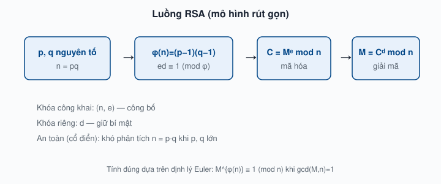
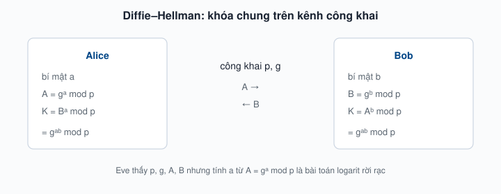

## Mật mã học Cơ bản

**Toán Rời Rạc** · Chương 15 · Bài 15.3

Caesar · RSA · Diffie–Hellman

---

## Mục tiêu tiết học

- Đối xứng vs bất đối xứng
- Caesar / Affine
- Tạo khóa & mã RSA (số nhỏ)
- Diffie–Hellman
- Chữ ký số (khái niệm)

**Bài học**: `…15_03_Introduction_to_Cryptography`

---

## Hệ mật

- **Plaintext** → $$E$$ → ciphertext → $$D$$
- **Đối xứng**: cùng $$K$$ (AES)
- **Bất đối xứng**: $$(K_{pub},K_{priv})$$ (RSA)

CIA: bí mật · toàn vẹn · xác thực

---

## Caesar & Affine

**Caesar**: $$E(x)=(x+k)\bmod 26$$

**Affine**: $$E(x)=(ax+b)\bmod 26$$

$$\gcd(a,26)=1$$; $$D$$ dùng $$a^{-1}$$

HELLO, $$k=3$$ → KHOOR (26 khóa!)

---

## Vấn đề trao đổi khóa

Đối xứng cần $$K$$ chung trước

Kênh nghe lén → khó chia sẻ $$K$$

**Public key**: công bố $$K_{pub}$$, giữ $$K_{priv}$$

---

## RSA — tạo khóa

1. $$p,q$$ nguyên tố; $$n=pq$$
2. $$\varphi(n)=(p-1)(q-1)$$
3. $$e$$: $$\gcd(e,\varphi)=1$$
4. $$d=e^{-1}\bmod\varphi(n)$$
5. Công khai $$(n,e)$$; riêng $$d$$

---

## RSA — mã / giải

$$C \equiv M^e \pmod n$$

$$M \equiv C^d \pmod n$$

---

## Tính đúng

$$ed\equiv 1\pmod{\varphi(n)}$$

+ Euler: $$M^{\varphi(n)}\equiv 1\pmod n$$  
(khi $$\gcd(M,n)=1$$)

→ $$M^{ed}\equiv M\pmod n$$

---

## An toàn RSA

Biết $$(n,e)$$, tìm $$d$$ ≈ phân tích $$n=pq$$

Thực tế: $$n$$ ≥ 2048 bit (cổ điển)

$$n$$ nhỏ (vd 33) → phá ngay

---

## Diffie–Hellman

Công khai $$p,g$$

Alice: $$A=g^a\bmod p$$  
Bob: $$B=g^b\bmod p$$

$$K=g^{ab}\bmod p$$ chung

An toàn: **DLP** khó

---

## Hình DH

---

## Chữ ký số

Ký bằng **khóa riêng**  
Xác minh bằng **khóa công khai**

RSA đơn giản: $$S\equiv M^d$$, kiểm $$S^e\equiv M$$

Thực tế: ký **hash**(tài liệu)

---

## Thực hành

1. Caesar MATH, $$k=5$$
2. RSA: $$p=3,q=11,e=7$$, $$M=5$$
3. DH: $$p=23,g=5,a=6,b=15$$
4. Phá $$(n,e)=(33,7)$$, $$C=15$$

---

## Tóm tắt

- Cổ điển: modulo 26, khóa nhỏ
- RSA: factoring; Euler
- DH: $$g^{ab}$$; DLP
- Chữ ký ≠ mã hóa che nội dung

**Tiết sau**: hash, LCG, ECC, PQC

---

## Bài tập ôn tập (1/2)

1. Đối xứng vs bất đối xứng
2. Nêu 4 bước tạo khóa RSA
3. Vì sao Caesar không an toàn?

---

## Bài tập ôn tập (2/2)

4. Eve biết $$p,g,A,B$$ — thiếu gì để ra $$K$$?
5. Chữ ký dùng khóa nào để ký?

---

## Câu hỏi?
