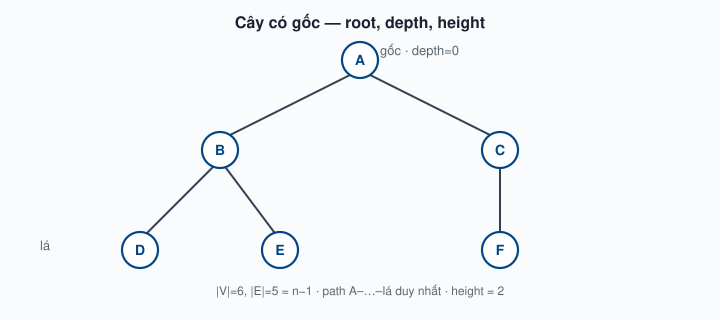

## Giới thiệu Cây

**Toán Rời Rạc** · Chương 16 · Bài 16.1

Tree · Root · $$n-1$$ cạnh

---

## Mục tiêu tiết học

- Định nghĩa cây / cây có gốc
- Tính chất tương đương
- Lá, depth, height, rừng
- Cây khung (khái niệm)
- FS, DOM, AST

**Bài học**: `…16_01_Introduction_to_Trees`

---

## Bối cảnh

Đồ thị (Ch.12) → lớp đặc biệt:

**Cây** = liên thông + **không chu trình**

Filesystem · DOM · parse tree · index

---

## Định nghĩa

**Cây**: đồ thị vô hướng liên thông, không cycle

**Cây có gốc**: chọn root  
→ quan hệ cha–con theo path duy nhất từ gốc

---

## Hình



$$|E| = |V| - 1$$

---

## Thuật ngữ

| | |
|:---|:---|
| **Lá** | Không có con (cây có gốc) |
| **depth(v)** | #cạnh gốc → $$v$$ |
| **height** | max depth |
| **Rừng** | không chu trình (nhiều cây) |

---

## Tính chất tương đương

Với $$n$$ đỉnh, tương đương:

1. Là cây  
2. Liên thông + $$n-1$$ cạnh  
3. Không cycle + $$n-1$$ cạnh  
4. Đúng **một** path đơn mọi cặp  
5. Thêm cạnh → đúng một cycle

---

## Ví dụ

10 đỉnh, 9 cạnh, liên thông → **cây**

10 đỉnh, 10 cạnh, liên thông → **có cycle**

Rừng: $$|E| = |V| - c$$ ($$c$$ thành phần)

---

## Cây khung

**Spanning tree** của $$G$$ liên thông:

- chứa **mọi** đỉnh
- là cây ($$|E'|=|V|-1$$)

MST (tối ưu trọng số) → tiết 16.3

---

## Biểu diễn

```python
tree = {
  "A": ["B", "C"],
  "B": ["D", "E"],
  "C": ["F"],
  ...
}
```

JSON / XML / DOM = cây lồng nhau

---

## Ứng dụng CS

- **FS**: một đường dẫn từ root
- **DOM**: render / query
- **AST**: compiler
- Symlink vòng → không còn cây thuần

---

## Thực hành

1. 15 đỉnh, 14 cạnh, liên thông — cây?
2. Cây $$n\ge 2$$ có ≥ 2 lá — vì sao?
3. Rừng 12 đỉnh, 9 cạnh — mấy thành phần?

---

## Tóm tắt

- Cây: liên thông, acyclic, $$n-1$$ cạnh
- Rooted: depth / height / leaf
- Spanning tree: phủ $$V$$

**Tiết sau**: duyệt cây

---

## Bài tập ôn tập (1/2)

1. Định nghĩa cây
2. $$|E|$$ của cây 100 đỉnh?
3. Path giữa 2 đỉnh trên cây: bao nhiêu?

---

## Bài tập ôn tập (2/2)

4. Rừng vs cây
5. Vì sao FS “lý tưởng” là cây?

---

## Câu hỏi?
