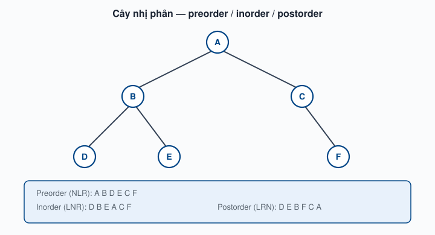

## Duyệt Cây

**Toán Rời Rạc** · Chương 16 · Bài 16.2

Preorder · Inorder · Postorder · Level-order

---

## Mục tiêu tiết học

- Ba thứ tự DFS (nhị phân)
- Level-order = BFS
- Ứng dụng: serialize, BST, delete
- Độ phức tạp $$O(n)$$

**Bài học**: `…16_02_Tree_Traversal`

---

## Ý tưởng

Thăm **mọi** nút đúng **một** lần

Thứ tự = semantics thuật toán

---

## Ba thứ tự DFS

| | Quy tắc |
|:---|:---|
| **Preorder** | N → L → R |
| **Inorder** | L → N → R |
| **Postorder** | L → R → N |

N = gốc (node), L/R = con

---

## Hình & kết quả



---

## Ứng dụng nhanh

- **Preorder**: copy / serialize prefix
- **Inorder**: BST → tăng dần
- **Postorder**: xóa cây, tính bottom-up

---

## Code (ý tưởng)

```python
def preorder(n):
    if not n: return
    visit(n)
    preorder(n.left)
    preorder(n.right)
```

Inorder / postorder: đổi chỗ `visit`

---

## Level-order

**BFS** — hàng đợi

Tầng 0, 1, 2, …

Ví dụ: A, B, C, D, E, F

---

## Độ phức tạp

Thời gian: $$O(n)$$ mọi thứ tự

Bộ nhớ:

- DFS đệ quy: $$O(h)$$
- BFS queue: $$O(w)$$ (độ rộng)

---

## Cây vs đồ thị

Trên **cây** (chỉ đi xuống con):  
không cần `visited` chống cycle

Trên **đồ thị**: DFS/BFS + `visited`

---

## Thực hành

1. Preorder & postorder cây A–F
2. Inorder BST cho thứ tự nào?
3. Vì sao postorder khi `free` cây?

---

## Tóm tắt

- NLR / LNR / LRN
- Level-order = BFS
- $$O(n)$$; inorder BST = sorted

**Tiết sau**: MST · Kruskal · Prim

---

## Bài tập ôn tập (1/2)

1. Định nghĩa preorder
2. Level-order cây ví dụ
3. Liên hệ DFS Ch.12

---

## Bài tập ôn tập (2/2)

4. $$h$$ vs $$w$$ ảnh hưởng bộ nhớ thế nào?
5. Cây không nhị phân: inorder?

---

## Câu hỏi?
