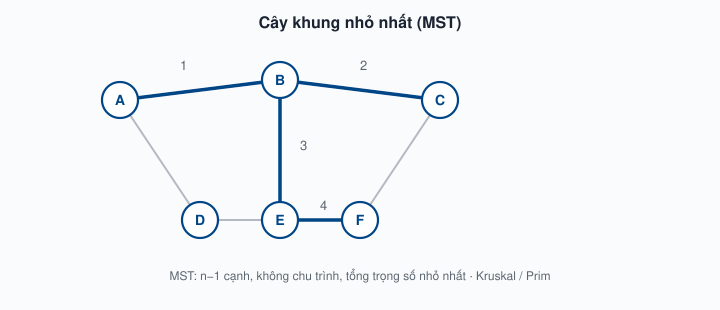

## Cây khung & MST

**Toán Rời Rạc** · Chương 16 · Bài 16.3

Spanning tree · Kruskal · Prim

---

## Mục tiêu tiết học

- Cây khung / MST
- Cut property (greedy)
- Kruskal + Union–Find
- Prim + heap
- So sánh & ứng dụng

**Bài học**: `…16_03_Spanning_Trees_and_MST`

---

## Bài toán

Nối mọi đỉnh, **không cycle**  
→ tổng trọng số **nhỏ nhất**

= **Minimum Spanning Tree**

---

## Định nghĩa

$$G$$ liên thông, trọng số $$w(e)$$

MST = cây khung $$T$$:

$$\sum_{e\in T} w(e)$$ cực tiểu

Đúng $$|V|-1$$ cạnh

---

## Hình

---

## Cut property

Phân hoạch $$S$$ / $$V\setminus S$$

Cạnh **nhẹ nhất** cắt qua cut  
→ thuộc **một** MST

→ greedy “an toàn”

---

## Kruskal

1. Sort cạnh tăng dần  
2. Thêm nếu **không** tạo cycle  
   (Union–Find)  
3. Dừng khi $$|V|-1$$ cạnh

$$O(E\log E)$$

---

## Prim

1. $$S=\{s\}$$  
2. Thêm cạnh nhẹ nhất từ $$S$$ ra ngoài  
3. Lặp đến $$|S|=|V|$$

Heap: $$O(E\log V)$$

---

## So sánh

| | Kruskal | Prim |
|:---|:---|:---|
| Greedy | Cạnh toàn cục | Từ tập $$S$$ |
| CTDL | Union–Find | PQ |
| Hợp | Thưa | Dày / từ gốc |

---

## Ví dụ tay

Cạnh: AB1, BD2, AD4, BC5, CD6

MST: AB+BD+BC = **8**

Bỏ AD (cùng thành phần)

---

## Lưu ý

MST ≠ shortest path tree

Dijkstra tối ưu path từ nguồn  
MST tối ưu **tập** cạnh liên thông

---

## Ứng dụng

- Cáp / LAN tối thiểu
- Clustering (cắt cạnh MST nặng)
- Nền nhiều thuật toán mạng

---

## Thực hành

1. Tổng MST ví dụ?
2. Vì sao bỏ cạnh cycle?
3. $$G$$ không liên thông — có MST?

---

## Tóm tắt

- MST: $$n-1$$ cạnh, min weight
- Kruskal / Prim — greedy
- Cut property

**Tiết sau**: Huffman & BST

---

## Bài tập ôn tập (1/2)

1. Định nghĩa spanning tree
2. Kruskal: cấu trúc phụ?
3. Prim bắt đầu từ đâu?

---

## Bài tập ôn tập (2/2)

4. Độ phức tạp Kruskal
5. MST vs Dijkstra — khác gì?

---

## Câu hỏi?
