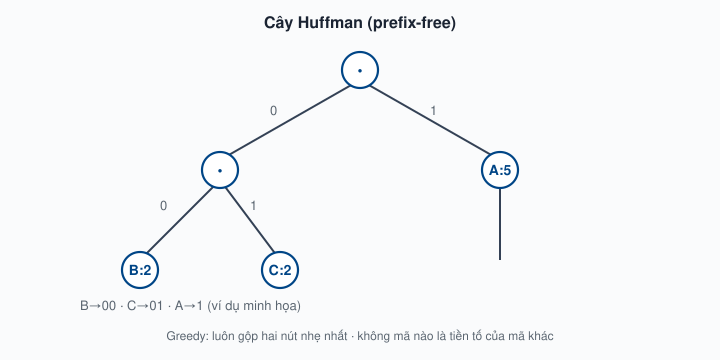
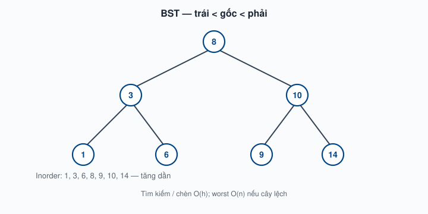

## Huffman & BST

**Toán Rời Rạc** · Chương 16 · Bài 16.4

Nén · Tìm kiếm · Prefix-free

---

## Mục tiêu tiết học

- Xây cây Huffman (greedy)
- Prefix-free
- Định nghĩa BST, tìm/chèn
- Inorder = sorted
- BST vs AVL vs hash

**Bài học**: `…16_04_Huffman_and_BST`

---

## Hai hướng dùng cây

| Huffman | BST |
|:---|:---|
| Nén theo tần suất | Tìm kiếm có thứ tự |
| Lá = ký tự | Nút = key |
| Bit 0/1 trên cạnh | Trái / phải theo so sánh |

---

## Huffman — greedy

1. Mỗi ký tự = lá (tần suất)  
2. Gộp **hai** nút nhẹ nhất  
3. Lặp → một gốc  
4. Đường gốc→lá = mã

---

## Hình Huffman

---

## Prefix-free

Không mã nào là **tiền tố** mã khác

→ giải mã **không** cần dấu phân cách

Đọc bit đến khi chạm lá

---

## Ứng dụng nén

ZIP (DEFLATE), JPEG, MP3, …

Entropy coding: Huffman / biến thể

Ký tự hay gặp → mã **ngắn**

---

## BST

Mọi key **trái** < gốc  
Mọi key **phải** > gốc  
Hai con cũng là BST

---

## Tìm / chèn

So với gốc → đi trái hoặc phải

Trung bình: $$O(\log n)$$  
Worst (lệch): $$O(n)$$

Chèn 1..n tăng → danh sách!

---

## Inorder

Trái → Gốc → Phải

Trên BST → **tăng dần**

( chứng minh quy nạp theo cây )

---

## So sánh CTDL

| | BST | AVL/RB | Hash |
|:---|:---|:---|:---|
| Worst | $$O(n)$$ | $$O(\log n)$$ | $$O(n)$$ |
| Thứ tự | Có | Có | Không |
| TB search | $$\log n$$ | $$\log n$$ | $$O(1)$$ |

---

## Chọn khi nào?

- Cần **range / inorder** → cây (cân bằng)
- Chỉ lookup điểm → hash
- Học / prototype → BST thường

---

## Thực hành

1. Preorder cây M–F–T–…
2. Vì sao A (freq cao) mã ngắn?
3. Chèn 5,3,7,1,4 — tìm 4
4. Chèn 1..5 — worst case?

---

## Tóm tắt Chương 16

| Mục | Nội dung |
|:---|:---|
| 16.1 | Cây, $$n-1$$ cạnh |
| 16.2 | Duyệt NLR/LNR/LRN/BFS |
| 16.3 | MST Kruskal/Prim |
| 16.4 | Huffman + BST |

**Tiếp**: Ch.17 đồ thị nâng cao

---

## Bài tập ôn tập (1/2)

1. Bước gộp Huffman
2. Prefix-free nghĩa là gì?
3. Định nghĩa BST

---

## Bài tập ôn tập (2/2)

4. Inorder BST cho gì?
5. AVL giải quyết worst case thế nào?

---

## Câu hỏi?
