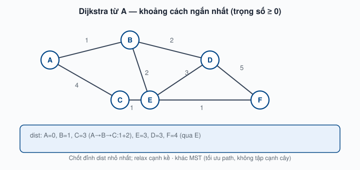

## Đường đi Ngắn nhất · Dijkstra

**Toán Rời Rạc** · Chương 17 · Bài 17.1

BFS · Dijkstra · Bellman–Ford

---

## Mục tiêu tiết học

- Shortest path từ nguồn $$s$$
- BFS vs Dijkstra vs BF
- Relax + priority queue
- Trọng số âm
- Khác MST

**Bài học**: `…17_01_Shortest_Path…`

---

## Bài toán

$$\mathrm{dist}(s,v)$$ = tổng trọng số  
**nhỏ nhất** path $$s\to v$$

Không path → $$\infty$$

---

## Bảng thuật toán

| Trọng số | Thuật toán |
|:---|:---|
| = 1 / không | **BFS** $$O(V+E)$$ |
| $$\ge 0$$ | **Dijkstra** |
| Có âm | **Bellman–Ford** |

---

## Hình Dijkstra

---

## Dijkstra — ý tưởng

1. `dist[s]=0`, còn lại $$\infty$$  
2. Chốt $$u$$ chưa chốt, `dist` min  
3. **Relax** cạnh $$(u,v)$$  
4. Lặp đến hết

---

## Relax

Nếu

$$\mathrm{dist}[u]+w(u,v) < \mathrm{dist}[v]$$

thì cập nhật `dist[v]`, `parent[v]=u`

---

## Vì sao $$w\ge 0$$?

Khi chốt $$u$$, path tối ưu  
không thể “đi vòng rẻ hơn”  
nếu không có cạnh âm

Cạnh âm → chốt sớm **sai**

---

## Ví dụ tay

AB1, AC4, BC2, BD6, CD1 từ A

$$\mathrm{dist}(D)=4$$  
path $$A\to B\to C\to D$$

---

## Bellman–Ford

Relax **mọi** cạnh $$V-1$$ lần

Lần $$V$$ còn cải thiện  
→ **chu trình âm**

---

## Dijkstra ≠ MST

| | Shortest path | MST |
|:---|:---|:---|
| Tối ưu | Path từ $$s$$ | Tập cạnh cây |
| Thuật toán | Dijkstra | Kruskal/Prim |

---

## Ứng dụng

- Routing / OSPF (mô hình)
- Game pathfinding (+ A\*)
- Mạng có chi phí cạnh

---

## Thực hành

1. dist D ví dụ?
2. BFS sai khi nào?
3. Cạnh −1 → thuật toán nào?

---

## Tóm tắt

- BFS: ít hop  
- Dijkstra: $$w\ge 0$$ + heap  
- BF: âm + phát hiện cycle âm

**Tiết sau**: topo sort · DAG

---

## Bài tập ôn tập (1/2)

1. Định nghĩa dist(s,v)
2. Bước relax
3. Độ phức tạp binary heap

---

## Bài tập ôn tập (2/2)

4. Dijkstra vs Kruskal
5. dist = ∞ nghĩa là gì?

---

## Câu hỏi?
