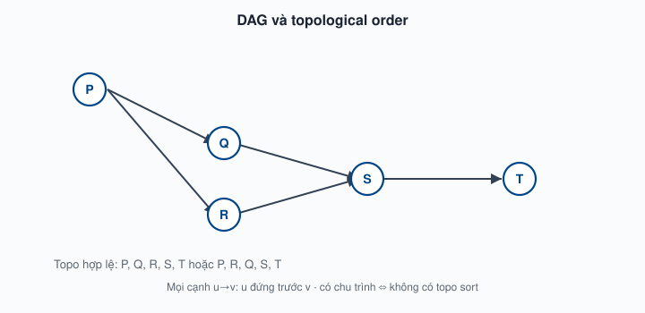

## Sắp xếp Topo trên DAG

**Toán Rời Rạc** · Chương 17 · Bài 17.2

DAG · DFS · Kahn

---

## Mục tiêu tiết học

- Định nghĩa DAG & topo order
- DFS postorder đảo
- Kahn (indegree + queue)
- $$O(V+E)$$
- Build / lịch / cycle

**Bài học**: `…17_02_Topological_Sort`

---

## Động lực

`make`: B sau A nếu A → B

Chu trình phụ thuộc  
→ **không** build được

---

## Định nghĩa

**DAG**: digraph **không** chu trình

**Topo sort**: hoán vị đỉnh  
mọi cạnh $$u\to v$$: $$u$$ **trước** $$v$$

---

## Định lý

Có topo sort  
**⇔** đồ thị là **DAG**

---

## Hình



---

## DFS-topo

1. DFS toàn đồ thị  
2. Khi **xong** $$u$$ → ghi $$u$$  
3. **Đảo** danh sách

= postorder reverse

---

## Kahn

1. Tính indeg  
2. Queue indeg = 0  
3. Pop $$u$$; giảm indeg kề  
4. Enqueue khi indeg → 0  

Thiếu đỉnh → **có cycle**

---

## Ví dụ

```text
    A
   / \
  B   C
   \ /
    D
```

**A,B,C,D** hoặc **A,C,B,D**

---

## Độ phức tạp

DFS và Kahn: $$O(V+E)$$

Danh sách kề

---

## Ứng dụng

| | |
|:---|:---|
| Make / Cargo / npm | Phụ thuộc package |
| Lịch học | Môn tiên quyết |
| CI pipeline | Giai đoạn |
| Deadlock | Chu trình chờ |

---

## Phát hiện cycle

Topo **thất bại** ⇔ có chu trình

Circular import / dependency

---

## Thực hành

1. Mọi topo: P→Q, P→R, Q→S, R→S
2. Thêm S→P?
3. Vì sao indeg 0 đứng đầu?

---

## Tóm tắt

- DAG ⇔ topo  
- DFS postorder / Kahn  
- $$O(V+E)$$ · build & scheduling

**Tiết sau**: tô màu · matching

---

## Bài tập ôn tập (1/2)

1. Định nghĩa DAG
2. Kahn: cấu trúc phụ?
3. Nhiều topo order?

---

## Bài tập ôn tập (2/2)

4. DFS phát hiện cycle thế nào?
5. Liên hệ thứ tự bộ phận (Ch.5)

---

## Câu hỏi?
