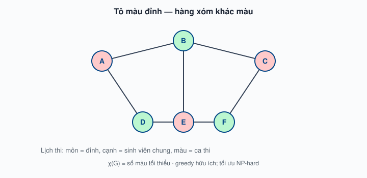
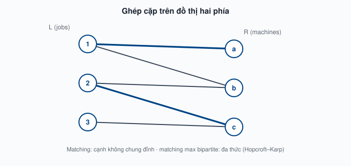

## Tô màu & Ghép cặp

**Toán Rời Rạc** · Chương 17 · Bài 17.3

χ(G) · Greedy · Matching

---

## Mục tiêu tiết học

- Tô màu đỉnh, $$\chi(G)$$
- Greedy coloring
- Matching bipartite
- P vs NP-hard (preview)

**Bài học**: `…17_03_Graph_Coloring…`

---

## Tô màu đỉnh

Gán màu: **hàng xóm khác màu**

$$\chi(G)$$ = số màu **tối thiểu**

---

## Ứng dụng lịch thi

Môn = đỉnh  
Cạnh = sinh viên chung  
Màu = **ca thi**

$$\chi$$ ≈ số ca tối thiểu

---

## Hình

---

## Greedy

Duyệt đỉnh; màu nhỏ nhất  
chưa dùng bởi hàng xóm

$$\le \Delta+1$$ màu  
**không** luôn = $$\chi$$

---

## Một số $$\chi$$

| Đồ thị | $$\chi$$ |
|:---|:---|
| Cây (có cạnh) | 2 |
| $$C_n$$ chẵn / lẻ | 2 / 3 |
| $$K_n$$ | $$n$$ |
| Bipartite | 2 |

---

## Độ khó

Tính $$\chi$$ tối ưu: **NP-hard**

Brooks: thường $$\chi \le \Delta$$  
(trừ clique, cycle lẻ)

---

## Matching

Tập cạnh **không chung đỉnh**

Max matching: lực lượng max

---

## Bipartite matching

Đa thức (Hopcroft–Karp, …)

Job–máy, assignment

---

## Bản đồ P / hard

| Bài | |
|:---|:---|
| BFS, Dijkstra, topo, MST | **P** |
| Matching bipartite | **P** |
| $$\chi$$ tối ưu, Hamilton, TSP | **NP-hard** |

---

## Tổng kết Ch.17

1. Shortest path  
2. Topo / DAG  
3. Color + matching  

→ Ch.20: phức tạp tính toán

---

## Thực hành

1. $$\chi(C_5)$$?
2. A–B–C path: số ca?
3. Matching max size 2?

---

## Tóm tắt Chương 17

| Mục | |
|:---|:---|
| 17.1 | Dijkstra / BF |
| 17.2 | Topo sort |
| 17.3 | Color · match |

**Tiếp**: Ch.18 automata / ngôn ngữ

---

## Bài tập ôn tập (1/2)

1. Định nghĩa tô màu hợp lệ
2. Greedy luôn tối ưu?  
3. Matching là gì?

---

## Bài tập ôn tập (2/2)

4. Vì sao bipartite matching ∈ P?
5. Register allocation ↔ tô màu?

---

## Câu hỏi?
