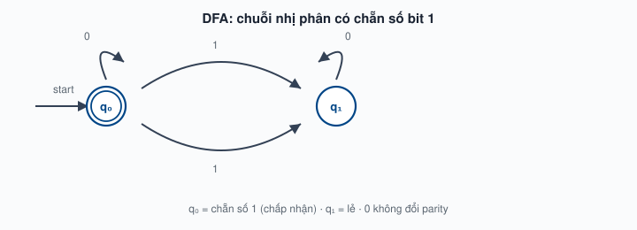

## DFA & Máy hữu hạn trạng thái

**Toán Rời Rạc** · Chương 18 · Bài 18.1

---

## Mục tiêu

- Bộ năm DFA
- Chạy chuỗi · chấp nhận
- Sơ đồ / bảng
- Giới hạn bộ nhớ

**Bài**: `…18_01_…`

---

## DFA

$$M=(Q,\Sigma,\delta,q_0,F)$$

$$\delta:Q\times\Sigma\to Q$$ **tất định**

---

## Hình

---

## Chấp nhận

$$\hat\delta(q_0,w)\in F$$

$$L(M)=\{w:\hat\delta(q_0,w)\in F\}$$

---

## Acceptor vs transducer

| Acceptor | Transducer |
|:---|:---|
| yes/no | chuỗi ra |
| DFA/NFA | Mealy/Moore |

---

## Giới hạn

Không đếm tùy ý

$$\{0^n1^n\}$$ ∉ regular

---

## Tóm tắt

DFA · $$L(M)$$ · state diagram

**Sau**: Mealy / Moore
