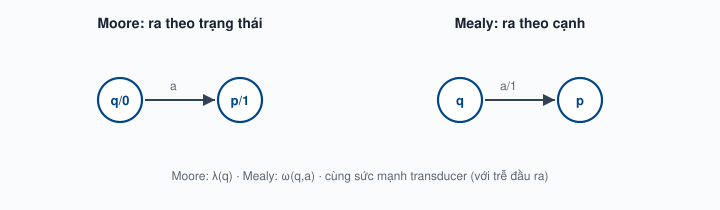

## Mealy & Moore

**Toán Rời Rạc** · Chương 18 · Bài 18.2

---

## Moore

$$\lambda:Q\to\Delta$$

Ra theo **trạng thái**

Độ dài ra = $$n+1$$

---

## Mealy

$$\omega:Q\times\Sigma\to\Delta$$

Ra theo **cạnh**

Độ dài ra = $$n$$

---

## Hình

---

## So sánh

Moore: ổn định theo state  
Mealy: phản ứng sớm hơn 1 bước

Cùng sức mạnh transducer

---

## Tóm tắt

λ(q) vs ω(q,a)

**Sau**: NFA ≡ DFA
