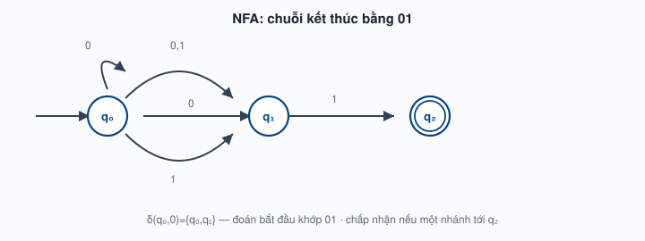
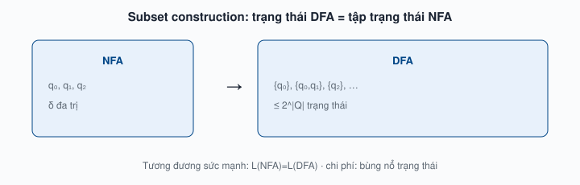

## NFA & Tương đương DFA

**Toán Rời Rạc** · Chương 18 · Bài 18.3

---

## NFA

$$\delta:Q\times\Sigma\to\mathcal{P}(Q)$$

Chấp nhận: **tồn tại** đường tới $$F$$

---

## Hình

---

## Subset construction

Trạng thái DFA = tập con NFA

$$\delta_D(S,a)=\bigcup_{q\in S}\delta_N(q,a)$$

$$\le 2^{|Q|}$$ trạng thái

---

## Hình

---

## Kết luận

NFA gọn khi thiết kế  
DFA chắc khi chạy  
**Cùng** lớp regular

**Sau**: regex · Kleene
