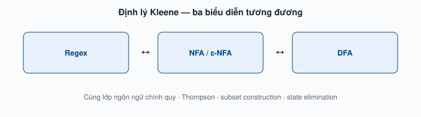
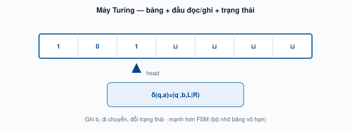

## Regex · Kleene · Turing

**Toán Rời Rạc** · Chương 18 · Bài 18.4–18.5

---

## Regex

$$r+s,\ rs,\ r^*$$

Ví dụ: $$(0+1)^*01$$

---

## Kleene

regex ≡ NFA ≡ DFA

---

## Pumping lemma

Chứng minh **không** chính quy

$$\{0^n1^n\}$$ — bơm lệch số 0/1

---

## Máy Turing

Băng R/W · δ ghi + L/R

---

## Decidable vs RE

| Decidable | Recognizable |
|:---|:---|
| luôn dừng | có thể loop |

Church–Turing: TM ≈ thuật toán

---

## Tóm tắt Ch.18

FSM → NFA/DFA → regex → TM

**Sau**: Ch.19 văn phạm
