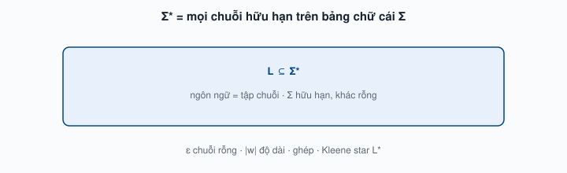

## Ngôn ngữ Hình thức

**Toán Rời Rạc** · Chương 19 · Bài 19.1

---

## Σ và chuỗi

Σ hữu hạn ≠ ∅  
$$w\in\Sigma^*$$ · $$|w|$$ · ε

---

## Hình

---

## Ngôn ngữ

$$L\subseteq\Sigma^*$$

Hợp · giao · ghép · $$L^*$$

---

## Tóm tắt

Alphabet · string · language ops

**Sau**: Chomsky

