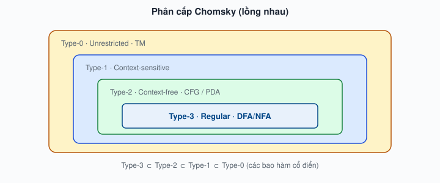
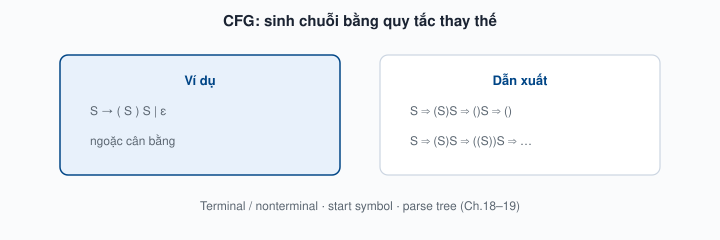

## Phân cấp Chomsky

**Toán Rời Rạc** · Chương 19 · Bài 19.2

---

## Bốn type

| Type | Máy |
|:---:|:---|
| 3 Regular | DFA |
| 2 CF | PDA |
| 1 CS | LBA |
| 0 RE | TM |

---

## Hình

---

## CFG

Ngoặc cân bằng ∈ CF \ Regular

---

## Tóm tắt

Regular ⊂ CF ⊂ CS ⊂ RE

**Sau**: lexer/parser

