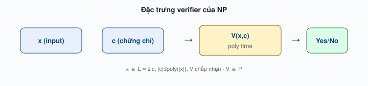
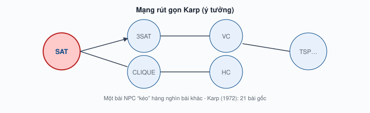

## P · NP · P ≟ NP

**Toán Rời Rạc** · Chương 20 · Bài 20.1  
*Mức cao học / NCS*

---

## Câu chuyện mở

TSP: **tìm** tour tối ưu — khó khi $$n$$ lớn  

**Kiểm** một tour cho trước — dễ (cộng $$n$$ cạnh)

→ trực giác **NP**

---

## Quyết định

Ngôn ngữ $$L \subseteq \{0,1\}^*$$

Yes / No  

TSP-DEC: tồn tại tour $$\le K$$?

---

## Lớp P

Giải **tất định** trong $$O(n^k)$$

BFS · Dijkstra · sort · AKS primality

---

## Lớp NP (verifier)

$$x\in L \Leftrightarrow \exists c$$ ngắn, $$V(x,c)=\mathrm{Yes}$$

---

## $$P \subseteq NP$$

Verifier bỏ $$c$$, chạy thuật toán $$P$$

Chiều $$NP\subseteq P$$ — **câu hỏi mở**

---

## Rút gọn $$\le_p$$

$$x\in A \Leftrightarrow f(x)\in B$$ · $$f$$ poly-time

---

## NP-complete

NP-hard + thuộc NP  

Nếu **một** NPC ∈ P ⇒ $$P=NP$$

---

## Cook–Levin

**SAT** là NP-complete  

Tableau máy Turing → công thức mệnh đề

---

## Karp 1972

21 bài · sau đó hàng nghìn

---

## Myth cần tránh

NP ≠ “không giải được”  
NP ≠ EXPTIME  
Factoring **chưa** biết NPC

---

## Đọc cốt lõi

Sipser · Arora–Barak  
Garey–Johnson  
Cook 1971 · Karp 1972  
Fortnow CACM · Aaronson survey

---

## Tóm tắt

P · NP · verifier · ≤ₚ · NPC · P≟NP

**Sau**: xấp xỉ · FPT · nghiên cứu
