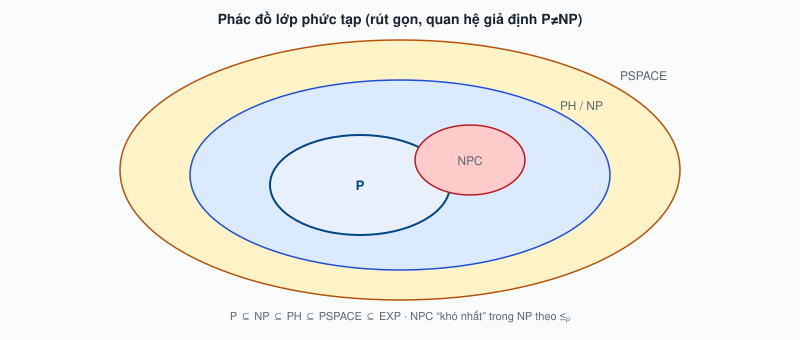

## Sau NPC: Nghiên cứu & Thực hành

**Toán Rời Rạc** · Chương 20 · Bài 20.2  
*NCS / luận văn*

---

## NPC không phải hết chuyện

Exact poly?  
Xấp xỉ?  
FPT (tham số $$k$$)?  
Instance thực / solver?  
Average-case / crypto?

---

## Landscape

P ⊆ NP ⊆ PH ⊆ PSPACE ⊆ EXP

---

## Xấp xỉ

Ratio $$\rho$$ · PTAS · FPTAS  

Metric TSP ~3/2 · VC ratio 2  

PCP → inapproximability

---

## FPT

$$f(k)\,n^{O(1)}$$

Vertex Cover theo $$k$$: FPT  

Clique theo $$k$$: W[1]-hard

---

## Solvers

CDCL SAT · SMT · MILP  

Không phủ nhận NPC  

Khai thác cấu trúc instance

---

## Average-case

Impagliazzo **five worlds**  

Crypto ≠ worst-case NPC  

LWE · factoring · DLOG

---

## Chọn đề tài

Status rõ (P/NPC/APX/FPT)  
Gap upper/lower?  
Công cụ lab phù hợp?  

Tránh: “chứng minh P≠NP” làm luận văn ThS

---

## Đọc nâng cao

Vazirani / Williamson–Shmoys  
Cygan et al. Parameterized  
Arora–Barak (PCP)  
Fortnow · Aaronson · Wigderson

---

## Tóm tắt Chương 20

20.1 Nền P/NP  
20.2 Bản đồ sau NPC + phương pháp NCS
